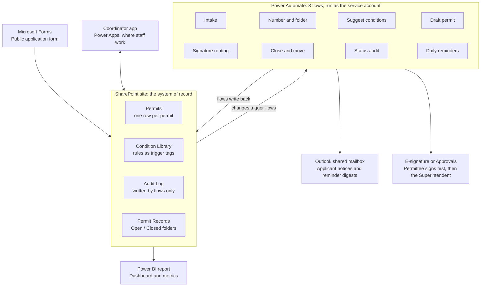
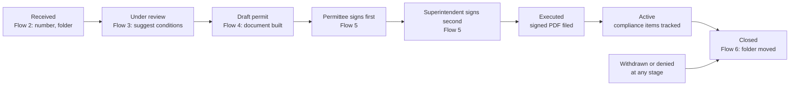

# Special Use Permit System — Microsoft 365 Build Guide

Markdown copy of the shared build guide. Edit the shared document, then re-run `scripts/sync-guide.py`.

## Overview

The recommended build is a SharePoint site as the system of record, with Power Automate doing the work staff do by hand today and a Power Apps app plus Power BI as the front end. Every document stays in SharePoint, in one folder per permit, linked to one row in a **Permits** list that replaces the Excel tracker.

The five building blocks:

1. **SharePoint site** — lists for permits, the condition library, selected conditions, compliance items and the audit log, plus a document library with *Open Projects* and *Closed Projects* folders.
2. **Intake** — an online application form that writes straight to the Permits list (Microsoft Forms for the public, or a Power Apps form for staff entering emailed applications).
3. **Power Automate flows** — assign the permit number, create and name the folder, suggest conditions, generate the draft permit from a Word template, route signatures, move closed permits, and send reminders.
4. **Coordinator app (Power Apps)** — one screen per job: review queue, permit record, condition picker, documents, and timeline.
5. **Dashboard and reports (Power BI or SharePoint views)** — status, upcoming deadlines, workload metrics.



People work in the form, the app and the report; every record and document lives in the SharePoint site; flows react to changes there and handle email and signatures.

The guide's default path uses only what a standard Microsoft 365 license includes. Steps that need a premium license (Power Automate or Power Apps Premium, or a paid e-signature service) are marked **Premium** and each has a standard-license fallback. Nothing here has been run against your tenant yet, so treat expressions and scripts as a tested-in-principle starting point.

### Where each requested feature is delivered

| Requested feature | Delivered by | Phase |
| --- | --- | --- |
| Form that populates a dashboard or SharePoint list | Intake form → Permits list | 3 |
| Permit template selected by application type | Permit Types list maps type → Word template | 1, 4 |
| Automatic condition suggestions by type and impact | Condition rules + "Suggest conditions" flow | 2, 4 |
| Condition library | Condition Library list (migrated from Excel) | 2 |
| Folder creation and permit shell generation | "New application" flow + "Generate draft permit" flow | 4 |
| Standard folder and file naming | Naming rules applied by flows | 0, 4 |
| Reminder: permit expiration | Daily reminder flow | 5 |
| Reminder: start date near, permit not executed | Daily reminder flow | 5 |
| Reminder: COI expiration | Daily reminder flow | 5 |
| Signature routing, permittee then Superintendent | "Signature routing" flow | 4 |
| Move closed permits to Closed Projects | "Close permit" flow | 4 |
| Interactive dashboard | Power BI report or app home screen | 6, 7 |
| Searchable, filterable permit database | Permits list views + app search | 6, 7 |
| Reporting and workload metrics | Power BI report | 7 |
| Documents tied to the permit record | Folder link stored on each permit row | 1, 4 |
| Audit trail | Audit Log list written only by flows, plus SharePoint version history | 4, 8 |
| Role-based access | Three SharePoint groups with separate permissions | 8 |

## Phase 0: Prerequisites and decisions

Settle eight decisions and the naming convention before anyone builds, because list column names and folder names are hard to change later.

### Decisions to make first

| Decision | Options | Recommended default |
| --- | --- | --- |
| Tenant type | Commercial, GCC, GCC High | Confirm with IT. It decides the e-signature choice: DocuSign's connector works in GCC, GCC High and DoD; Adobe Acrobat Sign's in GCC only; SharePoint eSignature documents only the commercial cloud. |
| Licensing budget | Standard M365 only, or add Power Automate Premium / Power Apps Premium for 1–3 builder and service accounts | Start standard. The only Premium piece is the Word Online (Business) connector (fill a Word template, convert to PDF), so Premium is needed only for the account that owns those flows. |
| E-signature tool | SharePoint eSignature, Adobe Acrobat Sign, DocuSign, or "upload signed PDF + internal approval" | If the agency already licenses DocuSign or Adobe Acrobat Sign, use it: both have standard Power Automate connectors with signing order. SharePoint eSignature ($2 per request) supports signing order but has no Power Automate actions. Otherwise use the upload-and-approve fallback in Phase 4. |
| How applicants submit | Keep email, Microsoft Forms, or Power Pages portal | Microsoft Forms for the data plus an email or upload link for attachments (Phase 3). |

Four more questions change the design, so ask them in the same meeting:

- **Mandated forms.** Are the application and the permit fixed agency forms? If so, the Word templates must reproduce them and the public form must collect the same fields.
- **Literal folder move, or status-driven views.** Moving a folder to Closed Projects breaks every link already emailed or stored. A *Closed* view filtered on status gives the same experience with no move. This guide builds the move because it was requested.
- **Who "compliance staff" are.** Reviewers who clear a permit before it is issued, monitors who check conditions afterwards, or both. Pre-issuance reviewers need a Reviews list (see the hardening list in the appendix).
- **Visibility and sensitive content.** May every coordinator see every permit? Archaeological site locations and applicant personal data may need a separate restricted library.

### Accounts and access

1. Ask IT for a **service account** (for example `svc-sup-flows@agency`) with a mailbox and an M365 license. All flows run under this account, so they keep working when a staff member leaves.
2. You need **SharePoint site owner** rights on the new site. Running the optional setup script also needs a one-time Entra ID app registration by a tenant admin.
3. Create a shared mailbox, for example `sup-permits@agency`, for applicant correspondence and reminder emails.
4. If your tenant has Power Platform environments set up, ask for a dedicated environment, or at least use a **Solution** so the app and flows can be moved and backed up as one unit.

### Naming convention

Flows apply these rules, so nobody types a folder or file name again.

| Item | Pattern | Example |
| --- | --- | --- |
| Permit number | `SUP-{year}-{4-digit sequence}` | `SUP-2026-0042` |
| Folder | `{PermitNumber}_{Applicant}_{Location}` | `SUP-2026-0042_RiverBendOutfitters_MillCreekTrail` |
| Application | `{PermitNumber}_Application.pdf` | `SUP-2026-0042_Application.pdf` |
| Draft permit | `{PermitNumber}_DraftPermit_v{n}.docx` | `SUP-2026-0042_DraftPermit_v2.docx` |
| Certificate of Insurance | `{PermitNumber}_COI_exp{yyyy-MM-dd}.pdf` | `SUP-2026-0042_COI_exp2027-05-01.pdf` |
| Site plan | `{PermitNumber}_SitePlan_{n}.pdf` | `SUP-2026-0042_SitePlan_1.pdf` |
| Correspondence | `{PermitNumber}_Correspondence_{yyyy-MM-dd}` | `SUP-2026-0042_Correspondence_2026-11-20.msg` |
| Executed permit | `{PermitNumber}_Executed.pdf` | `SUP-2026-0042_Executed.pdf` |

Applicant and location parts drop spaces and the characters SharePoint rejects (`~ " # % & * : < > ? / \ { | }`) and are cut to 30 characters.

## Phase 1: Build the SharePoint site

One site holds seven lists and one document library; the **Permits** list replaces the Excel tracker row for row. You can click through the steps below or run the setup script in the appendix, which builds the same thing.

### Step 1.1 — Create the site

1. Go to SharePoint start → **+ Create site** → **Team site** (or Communication site if you don't want a Microsoft 365 group and Teams channel).
2. Name it **Special Use Permits**; the address becomes `/sites/SpecialUsePermits`.
3. Add the service account and one backup person as site owners.

### Step 1.2 — Create the lists in this order

Create a column with a short name without spaces first (for example `PermitNumber`), then rename its display name. SharePoint keeps the first name forever as the internal name, and flows use it.

1. **Settings** — `Title` (key) and `Value`. Add rows: `ReminderDaysPermitExpiry = 60,30,7`, `ReminderDaysCOI = 30,7`, `ReminderDaysStartUnexecuted = 30,14,7`, `ProgramMailbox = sup-permits@agency`, `NextSeq_2026 = 1`.
2. **PermitTypes** — `Title`, `TemplateFile` (text: path to the Word template), `DefaultTermDays` (number). Rows: Special Event; Commercial Filming / Photography; Right-of-Way / Utility; Research / Collection; Construction / Access; Agricultural Use (replace with your real types).
3. **ConditionLibrary** — see Phase 2.
4. **Permits** — columns below.
5. **PermitConditions** — `Permit` (lookup to Permits), `Condition` (lookup to ConditionLibrary), `ConditionText` (multiple lines), `Source` (choice: Suggested, Added by staff), `Included` (yes/no), `SortOrder` (number).
6. **ComplianceItems** — `Permit` (lookup), `DueDate`, `Completed` (yes/no), `CompletedDate`, `EvidenceUrl` (hyperlink), `AssignedTo` (person).
7. **AuditLog** — `Title` (permit number), `PermitId` (number), `EventType` (choice: Created, Status Changed, Field Changed, Document Added, Signature Sent, Signed, Reminder Sent, Moved to Closed), `Detail` (multiple lines), `Actor` (text), `EventTime` (date and time).

### Permits list columns

| Column (internal name) | Type | Filled by |
| --- | --- | --- |
| `PermitNumber` (also copied to Title) | Single line, indexed, enforce unique | Flow |
| `PermitType` | Lookup → PermitTypes | Form |
| `Status` | Choice (values below), indexed | Flows and staff |
| `ApplicantName`, `ApplicantOrg`, `ApplicantEmail`, `ApplicantPhone` | Single line | Form |
| `ProjectTitle`, `ProjectDescription` | Single line / multiple lines | Form |
| `LocationName`, `Latitude`, `Longitude` | Single line / numbers | Form |
| `Impacts` | Choice, allow multiple | Form, reviewed by staff |
| `ProposedStart`, `ProposedEnd` | Date | Form |
| `PermitExpiration` | Date, indexed | Staff |
| `ReceivedDate` | Date | Flow |
| `Coordinator`, `Superintendent` | Person | Staff (default from Settings) |
| `COIReceived` / `COIExpiration` | Yes/No / Date, indexed | Staff or flow |
| `PermitteeSigned`, `SuperintendentSigned` | Date | Signature flow |
| `ComplianceComplete` | Yes/No | Compliance staff |
| `ClosedDate` | Date | Close flow |
| `FolderUrl`, `FolderPath` | Hyperlink / single line | Flows |
| `SignatureRequestId`, `LastReminderKey`, `SourceSubmissionId` | Single line, hidden from forms | Flows |

**Status values, in order:** Received → Under Review → Draft Permit → Out for Permittee Signature → Out for Superintendent Signature → Executed → Active → Closed. Withdrawn and Denied also close the permit. Keep status names free of dashes and punctuation, because flows and reports match them as exact text.

**Impact values:** Ground disturbance; Near stream, river or wetland; Tree clearing; Structures or temporary facilities; Motorized equipment or vehicles off road; Large group or public event; Night activity or lighting; Commercial filming or photography; Utility or right-of-way work; Use of drones (UAS).

### Step 1.3 — Create the document library

1. **+ New → Document library**, named `PermitRecords` (display name *Permit Records*).
2. Add columns `PermitNumber` (single line) and `DocType` (choice: Application, Draft Permit, COI, Site Plan, Correspondence, Compliance Record, Executed Permit, Other).
3. Create two folders: **Open Projects** and **Closed Projects**.
4. Make a **Templates** library (or folder) for the Word permit templates, one per permit type, and put its path in each PermitTypes row.
5. Turn on versioning for the library (Library settings → Versioning) with major versions kept.

### Step 1.4 — Views and formatting

Create these views on Permits so the list already works as a tracker before any automation exists: *My open permits*, *Awaiting signature*, *COI expiring in 30 days*, *Permits expiring in 60 days*, *Start within 30 days and not executed*, *Closed this year*. The exact filters and the JSON that colors the Status column are in `list-views.md` in the companion kit.

## Phase 2: Condition library and suggestion rules

Each condition in the library carries its own trigger tags, so suggestions come from data staff can edit, not from logic buried in a flow. Adding a new rule means adding or tagging a row.

### Step 2.1 — Add the library columns

In **ConditionLibrary** create: `ConditionCode` (text, e.g. `CUL-01`), `Category` (choice: General, Insurance & Liability, Cultural Resources, Soils & Erosion, Water Resources, Wildlife, Vegetation, Public Safety, Operations), `ConditionText` (multiple lines, plain text: the exact permit wording), `AppliesToTypes` (lookup to PermitTypes, allow multiple; blank means all types), `TriggerImpacts` (choice, allow multiple, the same ten impact values as Permits), `AlwaysInclude` (yes/no), `Active` (yes/no), `SortOrder` (number).

### Step 2.2 — Move the Excel library in

1. In the current Excel condition library, add columns matching the ones above and fill `TriggerImpacts` and `AlwaysInclude` for each row. This tagging is the real work: a program lead should do it once.
2. Save as CSV and import with the setup script, or paste into the list's **Edit in grid view**.
3. Keep the Excel file read-only as an archive. From now on, edit conditions only in the list, so version history records who changed wording and when.

### Step 2.3 — The suggestion rule

A condition is suggested for a permit when all three are true:

1. It is **Active**.
2. **AppliesToTypes** is blank or contains the permit's type.
3. It is **AlwaysInclude**, or at least one of its **TriggerImpacts** matches the permit's **Impacts**.

How your three examples are tagged:

| Impact on the application | Conditions tagged with it |
| --- | --- |
| Ground disturbance | Archaeological resources / stop work on discovery; soil protection and erosion control |
| Near stream, river or wetland | Riparian buffer protection; no refueling or equipment storage in the buffer |
| Tree clearing | Tricolored bat seasonal clearing restriction (dates set by your biologist) |

Suggestions are a starting point. The coordinator confirms or removes each one and can add others from the library, and the permit records which were suggested and which were added by staff.

### Step 2.4 — Keep the library healthy

- Retire a condition by setting **Active** to No, never by deleting, so old permits still link to it.
- Give the program lead **Edit** on the library and everyone else **Read**.
- Review the library once a year; the *Changed this year* view shows what moved.

## Phase 3: Intake form

Applicants fill one online form, and a flow turns each response into a Permits row, so staff stop retyping emails into Excel. Attachments need their own path, because Microsoft Forms does not accept file uploads from people outside your organization.

### Step 3.1 — Build the public form (Microsoft Forms)

1. In Forms, create **Special Use Permit Application**, owned by the shared mailbox or a group so it doesn't belong to one person.
2. Set **Settings → Who can fill out this form → Anyone can respond**.
3. Add questions in this order, matching the Permits columns: applicant name, organization, email, phone; permit type (choice, using your PermitTypes names exactly); project title; description; location; proposed start and end dates; impacts (multiple choice, the ten impact values, each with a one-line hint such as *"Ground disturbance: any digging, trenching, grading, or stakes deeper than 6 inches"*); a final yes/no confirming they will email or upload site plans and insurance.
4. In the thank-you message, tell applicants that a permit number and upload instructions will arrive by email within one business day.

### Step 3.2 — Handle attachments

Pick one:

- **Reply-with-files (simplest).** The New Application flow (Phase 4) emails the applicant their permit number and asks them to reply with site plans and the COI. A second flow on the shared mailbox saves attachments from emails whose subject contains `SUP-` into that permit's folder, named by the convention.
- **Upload link.** The flow sends a SharePoint \*\*Request files\*\* link for the permit folder, which lets the applicant upload without seeing what's in the folder. It needs external sharing allowed on the site.
- **Power Pages portal (Premium).** A real applicant portal with logins and uploads. It is the most polished option but adds licensing cost and setup.

### Step 3.3 — Staff entry form for emailed applications

Some applications will still arrive as PDFs by email. Staff enter them in the coordinator app (Phase 6) or the Permits list's **+ New** form. Both create the same Permits row, so the same flows run either way.

### Step 3.4 — Test

Submit three test applications: one with ground disturbance, one near water, one with tree clearing. Each should create a Permits row within a minute once the Phase 4 flow is on.

## Phase 4: Power Automate flows

Seven flows do the work staff do by hand today. Build them in this order, all owned by the service account and kept inside one Solution. Each flow below lists its trigger, its actions in order, and the expressions to paste.

Two rules apply to every flow that is triggered by a change to a Permits item and then updates that same item. First, add a **trigger condition** so the flow ignores its own updates, or it will loop. Second, write an AuditLog row for every change it makes.



At every stage, Flow 7 logs each status change and Flow 8 sends daily deadline reminders.

The Superintendent is only asked to sign after the permittee has signed, and every route out, including withdrawal or denial, ends with the folder moved to Closed Projects.

### Flow 1 — Intake to list (Forms → Permits)

**Trigger:** Microsoft Forms → *When a new response is submitted* (the application form).

1. Forms → *Get response details*.
2. SharePoint → *Create item* in **Permits**: map each answer to its column, set Status = `Received`, `ReceivedDate` = `utcNow()`, `SourceSubmissionId` = the response ID. For **Impacts**, map the multiple-choice answer (Forms returns it as a JSON text list; use `json(<answer>)` in an *Apply to each* to build the choice array).

That is all it does. Numbering and folders happen in Flow 2, so emailed applications entered by staff get exactly the same treatment.

### Flow 2 — New permit setup (number, folder, notice)

**Trigger:** SharePoint → *When an item is created* on **Permits**. **Settings → Concurrency control: On, degree of parallelism 1.** Two applications arriving at the same second would otherwise get the same number.

1. *Compose* **Year**: `formatDateTime(utcNow(),'yyyy')`
2. *Get items* on **Settings**, filter `Title eq 'NextSeq_@{outputs('Year')}'`. If none comes back (first permit of a new year), *Create item* with Value `1` and use 1.
3. *Compose* **Seq**: `int(first(body('Get_items_Settings')?['value'])?['Value'])`
4. *Compose* **PermitNumber**: `concat('SUP-', outputs('Year'), '-', formatNumber(outputs('Seq'), '0000'))`
5. *Update item* on Settings: Value = `add(outputs('Seq'), 1)`
6. *Compose* **ApplicantShort** (strips spaces and the characters SharePoint rejects, then cuts to 30):

```
take(replace(replace(replace(replace(replace(replace(replace(replace(replace(replace(replace(replace(replace(replace(replace(replace(coalesce(triggerBody()?['ApplicantOrg'], triggerBody()?['ApplicantName']),' ',''),'~',''),'"',''),'#',''),'%',''),'&',''),'*',''),':',''),'<',''),'>',''),'?',''),'/',''),'\',''),'{',''),'|',''),'}',''),30)
```

7. *Compose* **LocationShort**: the same expression on `triggerBody()?['LocationName']`.
8. *Compose* **FolderName**: `concat(outputs('PermitNumber'),'_',outputs('ApplicantShort'),'_',outputs('LocationShort'))`
9. SharePoint → *Create new folder*: library **PermitRecords**, folder path `/Open Projects/@{outputs('FolderName')}`.
10. *Update item* on the permit: Title and PermitNumber = PermitNumber; FolderPath = `/PermitRecords/Open Projects/@{outputs('FolderName')}`; FolderUrl = the folder's link from step 9; Coordinator and Superintendent defaults if blank.
11. *Create item* in **AuditLog**: EventType `Created`, Detail `Folder created: @{outputs('FolderName')}`.
12. Outlook → *Send an email from a shared mailbox (V2)* to the applicant: permit number, what to send next (site plans, COI), and the subject line to use (`SUP-2026-0042 documents`). Copy the coordinator.

### Flow 3 — Suggest conditions

**Trigger:** Power Apps (V2) with input `PermitId` (the app's *Suggest conditions* button). Optionally also run it when Status changes to `Under Review`.

1. *Get item* on Permits (`PermitId`).
2. *Select* **PermitImpacts**: from `body('Get_item')?['Impacts']`, map (text mode) `item()?['Value']`.
3. *Get items* on **ConditionLibrary**, filter `Active eq 1`, pagination on, threshold 5000. Don't filter on the multi-choice column in OData; SharePoint handles that unreliably. Filter in the flow instead.
4. *Get items* on **PermitConditions**, filter `Permit/Id eq @{triggerBody()?['PermitId']}`, then *Select* **ExistingIds** = `item()?['Condition']?['Id']` so a second run adds no duplicates.
5. *Apply to each* library row (concurrency 10), containing:
   1. *Select* **Triggers**: from `items('Apply_to_each')?['TriggerImpacts']`, map `item()?['Value']`.
   2. *Select* **Types**: from `items('Apply_to_each')?['AppliesToTypes']`, map `item()?['Id']`.
   3. *Condition* (advanced mode):

```
@and(
  or(empty(body('Types')), contains(body('Types'), body('Get_item')?['PermitType']?['Id'])),
  or(equals(items('Apply_to_each')?['AlwaysInclude'], true),
     greater(length(intersection(body('Triggers'), body('PermitImpacts'))), 0)),
  not(contains(body('ExistingIds'), items('Apply_to_each')?['ID']))
)
```

If the condition is true: *Create item* in **PermitConditions** with Permit, Condition, ConditionText copied from the library (a snapshot, so later library edits don't change issued permits), Source `Suggested`, Included Yes, SortOrder from the library.

6. *Create item* in AuditLog: `Conditions suggested: n`. Return the count to the app.

### Flow 4 — Generate the draft permit

**Trigger:** Power Apps (V2) with `PermitId` (the app's *Generate draft* button).

1. *Get item* on Permits, then *Get item* on PermitTypes to read **TemplateFile**.
2. *Get items* on PermitConditions: filter `Permit/Id eq @{triggerBody()?['PermitId']} and Included eq 1`, order by `SortOrder`.
3. *Select* **ConditionRows**: map `Code` = `item()?['Title']` and `Text` = `item()?['ConditionText']`. Numbering comes from a numbered paragraph in the template, not from the flow.
4. **Premium:** Word Online (Business) → *Populate a Microsoft Word template* inside a Switch on permit type, with one branch per type and the template file picked from the folder browser in each branch (a template chosen by a dynamic path makes the action lose its named fields); fill the plain-text fields (permit number, applicant, location, dates, description) and pass **ConditionRows** to the repeating section named `Conditions`.
5. SharePoint → *Create file* in the permit's FolderPath, named `@{body('Get_item')?['PermitNumber']}_DraftPermit_v@{n}.docx`, where `n` is one more than the number of existing draft files in the folder (*List folder*, then *Filter array* on names containing `_DraftPermit_`).
6. Set the file's DocType = `Draft Permit` and PermitNumber; set the permit's Status = `Draft Permit`; write AuditLog `Document Added`.

**How to prepare the template:** open each template in Word desktop, turn on the **Developer** tab, and insert a **plain text content control** where each field goes, titled exactly as the flow field. Put the conditions in a **repeating section content control** titled `Conditions` containing one numbered paragraph with a `Text` plain-text control inside.

The action fills only plain text, drop-down, combo box, image and repeating section controls; rich text, date picker and check box controls are not supported. Send dates as text with `formatDateTime(<date>, 'MMMM d, yyyy')`, give every control a unique title, and keep templates under 10 MB.

**Standard-license fallback:** the flow copies the type's template into the folder with the right name and sets the library columns. Fields come from **Insert → Quick Parts → Document Property** bound to those columns, and the coordinator pastes the conditions block that the app shows with a *Copy conditions* button. It's one paste instead of a fully generated document.

### Flow 5 — Signature routing (permittee, then Superintendent)

**Trigger:** Permits *When an item is modified*, trigger condition `@equals(triggerBody()?['Status']?['Value'], 'Out for Permittee Signature')` and `@empty(triggerBody()?['SignatureRequestId'])`.

**With DocuSign or Adobe Acrobat Sign (standard connectors; the service is licensed separately):**

1. Word Online (Business) → *Convert Word Document to PDF* (Premium) on the latest draft, or on standard licenses OneDrive for Business → \*Convert file\* to PDF (verify in your tenant); save it as `{PermitNumber}_ForSignature.pdf`.
2. E-signature connector → create and send a request with **signing order on**: signer 1 = ApplicantEmail, signer 2 = Superintendent's email.
3. Save the request ID in `SignatureRequestId`; AuditLog `Signature Sent`.
4. A second flow triggered by the service's *signer completed* / *envelope status changed* event: when signer 1 finishes, set PermitteeSigned = today and Status = `Out for Superintendent Signature`; when the request completes, set SuperintendentSigned = today, Status = `Executed`, save the signed PDF as `{PermitNumber}_Executed.pdf` with DocType `Executed Permit`, and log `Signed` each time.

**Standard-license fallback (no e-signature service):**

1. Convert to PDF as above and email it from the shared mailbox asking the permittee to sign and reply.
2. The mailbox attachment flow (Phase 3) files the signed copy. The coordinator checks it and enters **PermitteeSigned** in the app.
3. A flow triggered by PermitteeSigned being filled runs Approvals → *Start and wait for an approval* (type *Approve/Reject – First to respond*) assigned to the Superintendent, with the PDF link.
4. On Approve: SuperintendentSigned = today, Status = `Executed`, AuditLog `Signed`. On Reject: Status back to `Draft Permit` with the comments logged.

An Approvals response records who approved and when, but agency counsel should confirm whether it counts as a signature for permits. If not, the Superintendent signs the PDF itself and the approval just routes the task.

**If you choose SharePoint eSignature:** the coordinator starts the request from the PDF in the permit folder (*… → eSignature*, with *Recipients must sign in order* on, permittee first). External permittees must be enabled as guests. There is no Power Automate action for it, so the coordinator records the two signature dates in the app; the signed copy is saved back to the same folder.

### Flow 6 — Close permit and move folder

**Trigger:** Permits *When an item is modified*, trigger condition:

```
@and(or(equals(triggerBody()?['Status']?['Value'],'Closed'), equals(triggerBody()?['Status']?['Value'],'Withdrawn'), equals(triggerBody()?['Status']?['Value'],'Denied')), empty(triggerBody()?['ClosedDate']))
```

1. SharePoint → *Move folder*: source = the permit's FolderPath, destination = `/PermitRecords/Closed Projects`, if exists = fail (a name clash needs a person).
2. *Update item*: ClosedDate = today, FolderPath and FolderUrl = the new location (the old link no longer works after a move).
3. AuditLog `Moved to Closed`.

### Flow 7 — Status audit

**Trigger:** Permits *When an item is modified* (no trigger condition).

1. SharePoint → *Get changes for an item or a file (properties only)*, Since = `triggerOutputs()?['body/{TriggerWindowStartToken}']`.
2. *Condition*: `body('Get_changes')?['ColumnHasChanged']?['Status']` is true.
3. If yes, *Create item* in AuditLog: EventType `Status Changed`, Detail `Status set to @{triggerBody()?['Status']?['Value']}`, Actor = `triggerBody()?['Editor']?['Email']`.

Add the same pattern for COIReceived, PermitteeSigned and SuperintendentSigned if you want each milestone logged separately. SharePoint version history keeps every field value too; the AuditLog is the readable summary.

## Phase 5: Scheduled reminders

One flow runs every morning, finds permits that hit a reminder threshold today, and sends each coordinator a single digest email. Because it matches the exact day (60, 30 and 7 days out), each reminder goes out once per threshold instead of every day.

### Flow 8 — Daily reminders

**Trigger:** *Recurrence*, every 1 day at 7:00, with your time zone set.

1. *Get items* on **Settings** and *Compose* each offset list, e.g. **ExpiryDays** = `split(<Value of ReminderDaysPermitExpiry>, ',')` → `["60","30","7"]`.
2. *Initialize variable* **Hits** (array, empty).
3. **Permit expiration.** *Apply to each* offset `d` in ExpiryDays: *Get items* on Permits with filter

```
PermitExpiration eq '@{formatDateTime(addDays(utcNow(), int(items('Each_expiry'))), 'yyyy-MM-dd')}' and Status ne 'Closed' and Status ne 'Withdrawn' and Status ne 'Denied'
```

Append each result to Hits with a reason such as `Permit expires in 30 days`.

4. **COI expiration.** Same loop over ReminderDaysCOI on `COIExpiration`, only for permits not yet closed. Also run one query for `COIExpiration lt '@{formatDateTime(utcNow(),'yyyy-MM-dd')}'` on active permits and send that list every Monday, so an already-expired COI keeps showing up until it's fixed.
5. **Start date near, not executed.** Same loop over ReminderDaysStartUnexecuted on `ProposedStart`, with the extra filter `SuperintendentSigned eq null`.
6. *Select* and group Hits by Coordinator email (*Apply to each* over `union()` of the coordinator emails, then *Filter array*).
7. *Create HTML table* per coordinator (columns: Permit, Applicant, Reason, Date, link to the record) and *Send an email from a shared mailbox* with subject `SUP reminders – @{formatDateTime(utcNow(),'MMM d')}`.
8. Write one AuditLog row per permit, EventType `Reminder Sent`, and stamp `LastReminderKey` on the permit with the reason and date, so a re-run on the same day sends nothing twice. That update fires the item-modified triggers, which is why Flows 5 and 6 carry trigger conditions and Flow 7 only logs when Status changed.

Time-zone note: `utcNow()` is in UTC, so a 7:00 run in US time zones is already the same calendar day in UTC. If you schedule the flow in the evening, use `convertFromUtc(utcNow(), 'Eastern Standard Time')` (or your zone) instead.

### Optional: reminders to applicants

Add a fourth query that emails the **permittee** 30 days before their COI expires, asking for a renewed certificate, with the coordinator copied.

### Test it

Set a test permit's PermitExpiration to exactly 30 days from today, a second COIExpiration to 7 days from today, and a third ProposedStart 14 days out with no signatures. Run the flow manually and confirm one email lists all three.

## Phase 6: Coordinator app (Power Apps)

A canvas app gives staff one place to work a permit from intake to closeout, with buttons that call the Phase 4 flows. A canvas app that uses only SharePoint and standard flows runs on standard M365 licenses. The clickable prototype linked in the appendix shows each screen below.

### Step 6.1 — Create the app

1. make.powerapps.com → **Solutions** → open the SUP solution → **New → App → Canvas app**, tablet layout.
2. **Data → Add data → SharePoint**: add Permits, PermitConditions, ConditionLibrary, PermitTypes, ComplianceItems, AuditLog and the PermitRecords library.
3. Add the Power Apps-triggered flows (Suggest conditions, Generate draft) under **Power Automate → Add flow**.

### Step 6.2 — Build the screens

| Screen | What it shows | Key controls |
| --- | --- | --- |
| Home | Counts (open, awaiting signature, COI expiring, start date near and unexecuted) and a *Needs attention* list | Galleries filtered by date; tap opens the record |
| Permits | Searchable list of all permits | Search box, dropdown filters for type, status, coordinator; date filter for expiration |
| Permit record | Header with number, status and lifecycle steps; tabs for Details, Conditions, Documents, Signatures, Compliance, History | Edit form; action buttons by status |
| Conditions (tab) | Suggested and added conditions with on/off toggles and editable text | *Suggest conditions*, *Add from library*, *Generate draft* buttons |
| Documents (tab) | Files in the permit folder | Gallery on PermitRecords filtered by PermitNumber; *Open folder* link |
| History (tab) | AuditLog rows for this permit, newest first | Read-only gallery |
| New application | Staff entry for emailed applications | Same fields as the public form |

### Step 6.3 — Key formulas

Search on the Permits screen (delegable for text columns starting with the search term):

```
Filter(Permits,
  (IsBlank(drpStatus.Selected.Value) || Status.Value = drpStatus.Selected.Value) &&
  (IsBlank(drpType.Selected) || PermitType.Id = drpType.Selected.ID) &&
  (IsBlank(txtSearch.Text) || StartsWith(ApplicantName, txtSearch.Text) || StartsWith(PermitNumber, txtSearch.Text))
)
```

Suggest conditions button:

```
SuggestConditions.Run(galPermits.Selected.ID);
Refresh(PermitConditions);
Notify("Conditions suggested. Review them before generating the draft.", NotificationType.Success)
```

Show buttons only to the right role (see Phase 8), for example on *Superintendent approves*:

```
Visible: varIsApprover && ThisItem.Status.Value = "Out for Superintendent Signature"
```

where `varIsApprover` is set in `App.OnStart` from membership in the approving-officials group (Office 365 Groups connector or a *Settings* row listing approvers).

### Step 6.4 — Share and pin

Share the app with the three SharePoint groups' members, then add it as a tab in the program's Teams channel so staff open it where they already work.

## Phase 7: Dashboard, search and reporting

Start with SharePoint views and the app's Home screen, which cost nothing extra. Add a Power BI report when managers want trends and workload metrics.

### Step 7.1 — SharePoint views (no extra license)

The Phase 1 views already give a working tracker. Add the Status color formatting from `list-views.md`, and pin the views to the site's home page with the **List** web part, one per section: *Needs attention*, *Awaiting signature*, *Expiring in 60 days*.

The Permits list's search box and column filters cover the requested search by type, status, location, applicant and expiration date.

### Step 7.2 — Power BI report

1. Power BI Desktop → **Get data → SharePoint Online list** (use the 2.0 implementation), site URL, then pick Permits, PermitTypes, PermitConditions, AuditLog and ComplianceItems.
2. In Power Query, expand Status and PermitType to their values, and keep only the columns you report on.
3. Add measures:

```
Open Permits = CALCULATE(COUNTROWS(Permits), NOT Permits[Status] IN {"Closed","Withdrawn","Denied"})
Days to Execute = AVERAGEX(FILTER(Permits, NOT ISBLANK(Permits[SuperintendentSigned])), DATEDIFF(Permits[ReceivedDate], Permits[SuperintendentSigned], DAY))
COI Expiring 30d = CALCULATE(COUNTROWS(Permits), Permits[COIExpiration] >= TODAY(), Permits[COIExpiration] <= TODAY() + 30)
```

4. Build one page each for: **Status** (counts by status and type, the *Needs attention* table), **Workload** (applications received per month, open permits per coordinator, average days to execute by type), and **Compliance** (open compliance items by due date, COI expirations).
5. Publish to a workspace, set **scheduled refresh** (daily, or up to 8 times a day with Pro), and add the report to the SharePoint home page with the **Power BI** web part and to the Teams channel as a tab.

Power BI needs a Pro (or Premium Per User) license for each person who builds or views shared reports, unless your organization has Power BI capacity. If that's a blocker, the app's Home screen and the SharePoint views cover the essentials.

### Step 7.3 — Metrics to track from day one

| Metric | Source |
| --- | --- |
| Applications received per month, by type | Permits.ReceivedDate, PermitType |
| Average days from received to executed | ReceivedDate → SuperintendentSigned |
| Open permits per coordinator | Permits.Coordinator, Status |
| Permits executed after their proposed start date | SuperintendentSigned > ProposedStart |
| COIs that lapsed while a permit was active | COIExpiration < today, Status active |
| Most-used conditions | PermitConditions grouped by Condition |

## Phase 8: Roles, permissions, audit trail and retention

Access is set with five SharePoint groups at the site and list level, so nobody manages permissions per permit. The app hides buttons by role, but the SharePoint permissions are what actually enforce access.

### Step 8.1 — Groups and what each can do

| Group | Permits list | Condition library | Documents | AuditLog |
| --- | --- | --- | --- | --- |
| SUP Owners (program lead, service account) | Full control | Edit | Full control | Full control |
| SUP Coordinators | Contribute | Read (program lead edits) | Contribute | Read |
| SUP Compliance | Read; Edit on ComplianceItems | Read | Contribute | Read |
| SUP Approving Officials (Superintendent and deputies) | Read | Read | Read | Read |
| SUP Viewers (managers, other staff) | Read | Read | Read | Read |

1. Site settings → **Site permissions** → create the groups above and add people (or add Entra security groups to them, so IT manages membership).
2. On **AuditLog**, **ConditionLibrary** and **Settings**: List settings → **Permissions for this list** → *Stop inheriting* → set the levels in the table. Settings holds the permit number counter, so only owners and the service account should edit it.
3. On **ComplianceItems**: give SUP Compliance *Edit*.
4. Approving officials sign through the e-signature service or approve in Approvals, so they don't need edit rights on the list. The flows make those updates under the service account.

### Step 8.2 — Audit trail

The audit trail has three layers:

- **AuditLog list:** a readable history per permit, written only by flows (Phase 4, Flow 7) running as the service account. Users have Read only, so the history can't be edited.
- **Version history** on Permits and on every document: every field value and every file version, with who and when. Keep versioning on with at least 100 major versions.
- **Microsoft Purview audit log** (admin): records file access, sharing and deletes across the tenant, if your compliance team needs it.

### Step 8.3 — Records retention

1. Ask your records officer which schedule applies to special use permits and for how long.
2. In Microsoft Purview, have the admin publish a **retention label** (for example *SUP Permit Record – 7 years after closure*) to the site.
3. Flow 6 applies that label to the folder's files when it moves them to Closed Projects (*Set retention label* in the SharePoint connector), or set it as the default label on the Closed Projects folder.
4. Never delete permit folders by hand; let the retention policy dispose of them on schedule.

### Step 8.4 — Keep it running when people leave

- All flows and the app are owned by the service account and kept in one Solution, with a second co-owner.
- Connections in the flows use the service account, not personal accounts.
- Export the Solution after every change and store it in the site's *Admin* library as a backup.

* Wrap each flow's actions in a *Scope* and add a second scope set to run only if the first fails, which emails the program lead and the shared mailbox. By default, failure notices go only to the flow owner.
* Have someone sign in as the service account at least every 60 days and check the connections; unused connections and idle flows can be switched off after about 90 days.
* Write a one-page runbook: how to add a permit type, a condition or a template, change the approving official, and re-run a failed flow.

Site owners can technically edit the AuditLog list, so treat it as the readable activity log. Version history, the Purview audit log and the e-signature service's completion certificate are the authoritative record.

## Phase 9: Test, migrate and go live

Build in a test site first, move the current tracker and folders over in one cutover, and run the old and new side by side for two weeks before retiring the Excel tracker.

### Step 9.1 — Build and test in a copy

1. Create `/sites/SpecialUsePermits-Test` with the same setup (run the script with a different alias).
2. Load `Permits-sample.csv` from the kit: 12 fictitious permits covering every status.
3. Walk each scenario end to end and tick it off:

- [ ] Public form submission creates a numbered permit and a correctly named folder
- [ ] Two submissions in the same minute get different numbers
- [ ] Ground disturbance suggests the archaeological and soil conditions; near water suggests buffer conditions; tree clearing suggests the bat condition
- [ ] Draft permit generates with the right template, fields and numbered conditions
- [ ] Permittee signs, then the Superintendent is asked, and not before
- [ ] Daily reminder email lists the expiring permit, the COI and the unexecuted start date once each
- [ ] Closing a permit moves its folder to Closed Projects and the folder link still opens
- [ ] A Compliance user cannot edit a permit; a Viewer cannot edit anything; nobody can edit AuditLog
- [ ] The audit history shows every status change with who and when

### Step 9.2 — Migrate existing permits

1. Freeze the Excel tracker for the cutover day.
2. Map tracker columns to Permits columns in a copy of the workbook; add the existing permit numbers as-is (old numbers keep their format; the new sequence starts after the highest current number for this year, set in `NextSeq_{year}`).
3. Import with the script's CSV import or **Edit in grid view** paste. Turn off Flow 2 during import so it doesn't renumber or create duplicate folders.
4. Move existing project folders into **Open Projects** / **Closed Projects** of the new library (SharePoint *Move to*, or the SharePoint Migration Tool for large volumes), then run a one-time flow that matches folder names to permit numbers and fills `FolderUrl` and `FolderPath`.
5. Spot-check 10 permits against the old tracker.

### Step 9.3 — Go live

1. Turn on all flows in production; publish the form link on the program web page and in the email auto-reply of the old intake address.
2. Train coordinators (one hour, using the app), compliance staff and approving officials (15 minutes each on their part).
3. Run in parallel for two weeks, then set the Excel tracker read-only.
4. Review after 30 days: reminder accuracy, condition suggestions staff removed most often (adjust tags), and time from received to executed.

## Appendix

### Companion files

Everything below is in the project repository, [special-use-permit-m365](https://github.com/slapner/special-use-permit-m365) (private). None of it has been run against a live tenant; use a test site first.

| File | What it gives the builder |
| --- | --- |
| `kit/Provision-SUPSite.ps1` | PnP PowerShell script that builds Phase 1 and Step 8.1 in one run: site, lists, columns, indexes, library, folders, views, groups, permissions and seed data. Needs PowerShell 7.4+, PnP.PowerShell 3.x and your own Entra app registration (`Register-PnPEntraIDAppForInteractiveLogin`). |
| `kit/flows.md` | Action-by-action build sheets for every flow in Phases 4 and 5, with each expression and the points to verify in your tenant. More detailed than this guide. |
| `kit/list-views.md`, `kit/formatting/` | The six tracker views and the JSON that colors Status and overdue dates. |
| `kit/ConditionLibrary-seed.csv` | 22 sample conditions already tagged with triggers, including the archaeological, erosion, buffer and tricolored bat examples. Replace the wording with your own library. |
| `kit/Permits-sample.csv` | 12 fictitious permits covering every status, for Step 9.1. |
| `spec/` | The data model, the Microsoft facts checked for this guide, and the independent reviews. |

### Clickable preview

[SUP Coordinator](https://claude.ai/artifact/SN7CS7UKucuSFbMYWqkggf) is a mock-up of the Phase 6 app and the dashboard, using made-up permits. It simulates what the flows do (numbering, condition suggestions with the reason for each, the draft permit, signature order, reminders, the folder move, role-based buttons). Nothing in it is saved or sent, and it is not the Power App itself.

### Options considered

| Choice | Picked | Why not the alternative |
| --- | --- | --- |
| Where data lives | SharePoint lists | Dataverse adds a Premium license for every staff user and moves records out of SharePoint. Revisit only if you need per-coordinator record security. |
| Applicant intake | Microsoft Forms plus email or a file-request link | Forms can't take uploads from outside the organization; Power Pages can, but is Premium and a larger project. |
| Draft permit | Word template filled by a flow (Premium) with a copy-and-Quick-Parts fallback | The fallback needs one manual paste of conditions per permit. |
| Signatures | DocuSign or Adobe Acrobat Sign connector | SharePoint eSignature has signing order but no flow actions; Approvals is not an e-signature. |
| Closed permits | Move the folder, as requested | A status-filtered view is safer because links never break. |

### Hardening to add after the first version works

An independent architecture review recommended these. They are left out of version one to keep the build small; the full reasoning is in `spec/review-architecture.md`.

- [ ] A `SignatureStatus` column (Not sent, In progress, Completed, Declined, Voided, Expired) and the signing official's name and title captured at signing, so declined or expired requests are visible
- [ ] A `ReminderLog` list with a unique key per reminder, replacing `LastReminderKey`, so reminders missed during an outage are caught up exactly once
- [ ] A `Counters` list updated with an ETag check, as a second guard on permit numbers beyond the flow's concurrency setting
- [ ] A `CloseReason` column (Completed, Expired, Withdrawn, Denied, Revoked) and statuses for *Returned Incomplete* and *Expired*
- [ ] A `Reviews` list if specialists must clear a permit before it is issued
- [ ] Fill-in tokens in condition text, such as buffer width or clearing dates, completed per permit
- [ ] A restricted library for sensitive documents such as archaeological site locations
- [ ] A `FolderMoveState` column and a daily sweep that retries any closed permit whose folder is still under Open Projects
- [ ] Document IDs turned on, so links to files survive the move to Closed Projects

### Sources

Licensing and connector facts in this guide were checked on November 23, 2026 against these pages; the full table is in `spec/facts.md`.

- [Word Online (Business) connector](https://learn.microsoft.com/en-us/connectors/wordonlinebusiness/): Premium tier, supported content controls, 10 MB limit
- [File uploads in Microsoft Forms](https://support.microsoft.com/en-us/forms/add-questions-that-allow-for-file-uploads-in-microsoft-forms): uploads only for people inside the organization
- [SharePoint eSignature overview](https://learn.microsoft.com/en-us/microsoft-365/documentprocessing/esignature-overview) and [pay-as-you-go pricing](https://learn.microsoft.com/en-us/microsoft-365/documentprocessing/syntex-pay-as-you-go-services)
- [DocuSign connector](https://learn.microsoft.com/en-us/connectors/docusign/), [Adobe Acrobat Sign connector](https://learn.microsoft.com/en-us/connectors/adobesign/) and the [connector availability table](https://learn.microsoft.com/en-us/connectors/connector-reference/connector-reference-powerautomate-connectors) for government clouds
- [Approvals in Power Automate](https://learn.microsoft.com/en-us/power-automate/get-started-approvals)
- [SharePoint connector](https://learn.microsoft.com/en-us/connectors/sharepointonline/): Move folder action
- [PnP PowerShell app registration](https://pnp.github.io/powershell/articles/registerapplication.html)
- [Power Automate licensing FAQ](https://learn.microsoft.com/en-us/power-platform/admin/power-automate-licensing/faqs)
- [Power BI license types](https://learn.microsoft.com/en-us/power-bi/fundamentals/service-features-license-type) and [Power BI for US government](https://learn.microsoft.com/en-us/power-bi/enterprise/service-govus-overview)

Not confirmed, so test in your tenant: whether SharePoint eSignature is available in government clouds, whether *Move folder* keeps version history and item IDs, and which government license plans include Power BI Pro.
