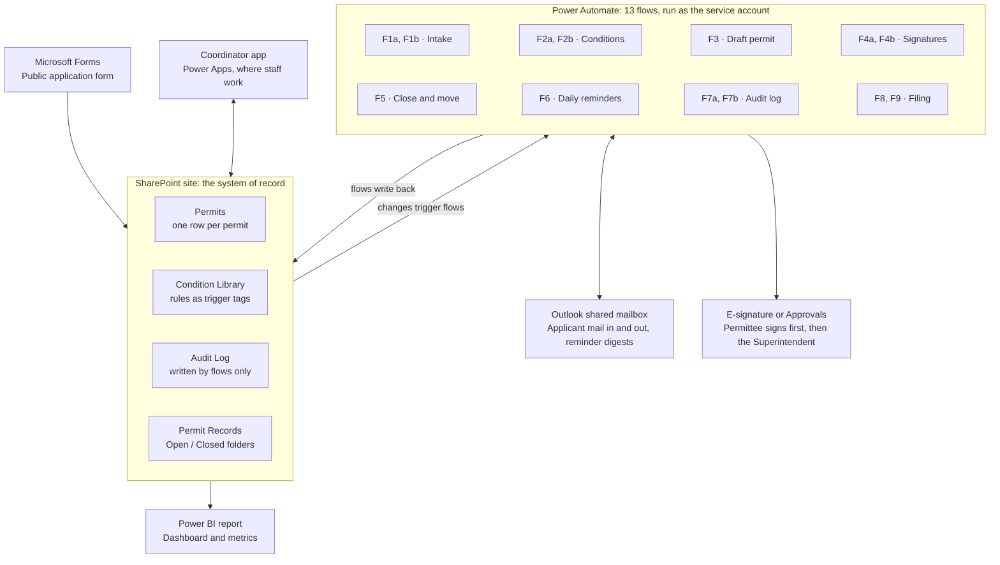
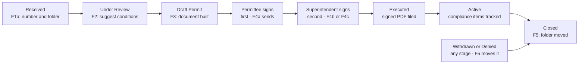

# Special Use Permit System — Microsoft 365 Build Guide

Markdown copy of the shared build guide. Edit the shared document, then re-run `scripts/sync-guide.py`.

## Overview

The recommended build is a SharePoint site as the system of record. Power Automate does the work staff do by hand today. A Power Apps app and Power BI are the front end. Every document stays in SharePoint, in one folder per permit, linked to one row in a **Permits** list that replaces the Excel tracker.

The five building blocks:

1. **SharePoint site** — lists for permits, the condition library, selected conditions, compliance items and the audit log. One document library holds *Open Projects* and *Closed Projects* folders.
2. **Intake** — an online application form that writes straight to the Permits list. Staff enter emailed applications in the same list.
3. **Power Automate flows** — 13 flows number each permit, create its folder, suggest conditions and generate the draft permit. They also route signatures, move closed permits and send reminders.
4. **Coordinator app (Power Apps)** — one screen per job: permit list, permit record, conditions, documents and history.
5. **Dashboard and reports** — SharePoint views first, then a Power BI report for trends and workload.



People work in the form, the app and the report; SharePoint holds every record; flows handle email and signatures.

The default path uses only what a standard Microsoft 365 licence includes. Steps that need a Premium licence or a paid e-signature service are marked **Premium**. Each has a standard-licence alternative.

Nothing here has been run against your tenant. Treat every expression and script as a tested-in-principle starting point, and build in a test site first.

### How to use this guide

- **Follow the phases in order.** Each step gives the exact names, values and expressions to type.
- **Names matter.** Lists, columns, flows and flow actions must be named exactly as written. Later steps find them by name.
- **Look for "Test in your tenant".** These notes mark behaviour that Microsoft does not document or that could not be confirmed. Each one says what to check and what to do if the result differs. Step 9.1 lists them all.
- **Use the kit.** The companion kit holds a setup script, seed data and longer build sheets. This guide and the kit use the same names.

### Recommended order of delivery

Deliver in six stages. Each stage leaves a system staff can use.

| Stage | What you build | Where | Licence |
| --- | --- | --- | --- |
| 1. Minimum working system | Site, lists, views and permissions. The form. Flows F7a, F1b, F1a, F7b, F5, F6 and F8 | Phases 0, 1, 3, 4, 5 | Standard |
| 2. Conditions | The tagged condition library and flow F2a | Phases 2, 4 | Standard |
| 3. Draft permit | Flow F3: the standard-licence version first, then the Premium version | Phase 4 | Standard, then Premium |
| 4. Signatures | Flow F4, for the one signature path you chose | Phase 4 | Standard, plus the e-signature service |
| 5. Coordinator app | The app, with flows F2b and F9 | Phase 6 | Standard |
| 6. Reporting | The Power BI report | Phase 7 | Power BI Pro per person |

After stage 1, staff can run the program on list views and list forms. Applications arrive, get a number and a folder, show up in the tracker views, trigger reminders, and close properly. The app in stage 5 makes the work faster; it is not required to start.

You can go live (Phase 9) after stage 1 and add the later stages while the system runs.

### Where each requested feature is delivered

| Requested feature | Delivered by | Phase |
| --- | --- | --- |
| Form that populates a dashboard or SharePoint list | Intake form and flow F1a → Permits list | 3, 4 |
| Permit template selected by application type | PermitTypes list holds each type's template; flow F3 uses it | 1, 4 |
| Automatic condition suggestions by type and impact | Tags on each condition, applied by flows F2a and F2b | 2, 4 |
| Condition library | ConditionLibrary list, moved from Excel | 2 |
| Folder creation and permit shell generation | Flow F1b (folder) and flow F3 (draft permit) | 4 |
| Standard folder and file naming | Naming rules applied by flows F1b, F3, F4 and F8 | 0, 4 |
| Reminder: permit expiration | Flow F6 | 5 |
| Reminder: start date near, permit not executed | Flow F6 | 5 |
| Reminder: COI expiration | Flow F6 | 5 |
| Signature routing, permittee then Superintendent | Flow F4, on the signature path chosen in Phase 0 | 0, 4 |
| Move closed permits to Closed Projects | Flow F5 | 4 |
| Interactive dashboard | Permits list views, the app's Home screen, then Power BI | 1, 6, 7 |
| Searchable, filterable permit database | Permits list views and the app's search | 1, 6 |
| Reporting and workload metrics | Power BI report | 7 |
| Documents tied to the permit record | Folder link on each permit; permit number stamped on each file by flows | 1, 4 |
| Audit trail | AuditLog list written by flows F7a and F7b, plus SharePoint version history | 4, 8 |
| Role-based access | Five SharePoint groups with separate permissions | 1, 8 |

## Phase 0: Prerequisites and decisions

Settle eight decisions, the accounts and the naming convention before anyone builds. List column names and folder names are hard to change later, and two requests to IT take days to arrive.

### Decisions to make first

| Decision | Options | Recommended default |
| --- | --- | --- |
| Tenant type | Commercial, GCC, GCC High, DoD | Confirm with IT. It decides the e-signature choice and the web addresses you use. See the government table below. |
| Licensing budget | Standard Microsoft 365 only, or add Premium for draft generation | Start standard. The only Premium piece is the Word Online (Business) connector. See "Who needs Premium" below. |
| E-signature path | A: DocuSign. B: Adobe Acrobat Sign. C: signed upload plus an approval. D: SharePoint eSignature | If the agency already licenses DocuSign or Adobe Acrobat Sign, use it. Both have standard connectors with a signing order. Otherwise use path C. Path D costs $2 per request and has no flow actions. |
| How applicants submit | Keep email, Microsoft Forms, or a Power Pages portal | Microsoft Forms for the data, plus reply-by-email for attachments (Phase 3). |

Four more questions change the design, so ask them in the same meeting:

- **Mandated forms.** Are the application and the permit fixed agency forms? If so, the Word templates must reproduce them and the public form must collect the same fields.
- **Literal folder move, or status-driven views.** Moving a folder to Closed Projects breaks every link already emailed or stored. A *Closed* view filtered on status gives the same experience with no move. This guide builds the move because it was requested.
- **Who "compliance staff" are.** Reviewers who clear a permit before it is issued, monitors who check conditions afterwards, or both. Pre-issuance reviewers need a Reviews list (see the hardening list in the appendix).
- **Visibility and sensitive content.** May every coordinator see every permit? Archaeological site locations and applicant personal data may need a separate restricted library.

### Who needs Premium

Word Online (Business) is the only Premium connector in this design. It fills the Word template in flow F3. It can also convert a draft to PDF in flow F4a, although this guide uses a Standard route there.

- A flow started from the app is licensed per person who runs it. Flow F3 is started from the app.
- So either every coordinator who presses **Generate draft** needs Power Apps Premium, or the flow carries one Power Automate Process licence.
- A Premium licence on the service account alone does not cover it. One licensed account shared by many users is not compliant.
- If neither is in budget, use F3's standard-licence version. It needs one manual paste of conditions per permit.

Every other flow, the app and the SharePoint site run on standard Microsoft 365 licences. The e-signature service and Power BI Pro are licensed separately.

Ask IT one more licensing question. If the environment is a **Managed Environment**, everyone who runs a flow needs Premium, even with standard connectors. Ask for an environment that is not managed.

### Government cloud differences

| Item | GCC | GCC High and DoD |
| --- | --- | --- |
| Power Apps address | `make.gov.powerapps.us` | GCC High: `make.high.powerapps.us`. DoD: `make.apps.appsplatform.us` |
| Power Automate address | `make.gov.powerautomate.us` | GCC High: `make.high.powerautomate.us`. DoD: `make.powerautomate.appsplatform.us` |
| Forms **Anyone can respond** | Available | Microsoft's page says available; older material says off. Confirm with the Forms administrator. |
| Forms email notifications | Not available | Not available |
| SharePoint **Request files** | Not stated. It needs *Anyone* links, so ask IT first | The same |
| DocuSign connector (path A) | Available | Available. The only connector listed for these clouds |
| Adobe Acrobat Sign connector (path B) | Available | Not available |
| SharePoint eSignature (path D) | Not documented. Treat as unavailable | Not documented. Treat as unavailable |
| Approvals (path C) | Available. Approvers must already be users in the tenant | The same |
| Power BI | `app.powerbigov.us`. Every viewer needs Pro. Commercial licences are not valid | The same |
| Setup script | Add `-AzureEnvironment USGovernment` | `USGovernmentHigh` or `USGovernmentDoD` |
| Other feature gaps | See Microsoft's *Business Applications US Government – Availability Summary*, which this guide did not check | The same |

The steps affected carry a short government note.

### Accounts and access

Ask IT for these before Phase 1. Send the whole list in one request.

1. **A service account**, for example `svc-sup-flows@agency`, with a mailbox, a Microsoft 365 licence and a OneDrive. It owns the solution, every connection, every flow, the form and the app. They keep working when a staff member leaves.
2. **A sign-in policy for that account.** A multi-factor prompt on this account breaks the SharePoint and Word connections. Ask IT to exempt it from interactive prompts or give it a compliant policy. Agree a password rotation plan, because each forced reset breaks every connection.
3. **A shared mailbox**, for example `sup-permits@agency`, for applicant correspondence. Ask the Exchange administrator to give the service account **Full Access** and **Send As** on it.
4. **A person with the SharePoint Administrator role** to run the setup script. The script creates the site through the admin endpoint. It also needs a one-time Entra ID app registration with admin consent. If you build by hand instead, check that you are allowed to create sites; many tenants turn self-service creation off.
5. **A Power Platform environment**, or permission to use the default one. Confirm it is not a Managed Environment.
6. **One Entra security group per role**: owners, coordinators, compliance, approving officials and viewers. The app can be shared with security groups, not with SharePoint groups.
7. **A retention label**, requested now from the records officer (Step 8.3). A published label can take up to seven days to appear.
8. **Connector approval.** If you chose path A or B, ask whether a data loss prevention policy blocks the DocuSign or Adobe Acrobat Sign connector.

### Create the solution

A solution keeps the app and flows together so they can be moved and backed up as one unit. Child flows, which the audit log uses, only work inside a solution.

1. Sign in to Power Automate as the service account. Use `make.powerautomate.com`, or the government address above.
2. Select **Solutions → New solution**.
3. Name it `SUP`. Pick a publisher, or create one named for your office.
4. Create every flow and the app from inside this solution, always signed in as the service account.

### Naming convention

Flows apply these rules, so nobody types a folder or file name again.

| Item | Pattern | Example |
| --- | --- | --- |
| Permit number | `SUP-{year}-{4-digit sequence}` | `SUP-2026-0042` |
| Folder | `{PermitNumber}_{Applicant}_{Location}` | `SUP-2026-0042_RiverBendOutfitters_MillCreekTrail` |
| Application | `{PermitNumber}_Application.pdf` | `SUP-2026-0042_Application.pdf` |
| Draft permit | `{PermitNumber}_DraftPermit_v{n}.docx` | `SUP-2026-0042_DraftPermit_v2.docx` |
| Permittee-signed copy (path C) | `{PermitNumber}_DraftPermit_v{n}_PermitteeSigned.pdf` | `SUP-2026-0042_DraftPermit_v2_PermitteeSigned.pdf` |
| Certificate of Insurance | `{PermitNumber}_COI_exp{yyyy-MM-dd}.pdf` | `SUP-2026-0042_COI_exp2027-05-01.pdf` |
| Site plan | `{PermitNumber}_SitePlan_{n}.pdf` | `SUP-2026-0042_SitePlan_1.pdf` |
| Correspondence | `{PermitNumber}_Correspondence_{yyyy-MM-dd}_{original name}` | `SUP-2026-0042_Correspondence_2026-11-20_plan.pdf` |
| Executed permit | `{PermitNumber}_Executed.pdf` | `SUP-2026-0042_Executed.pdf` |

The sequence restarts at 0001 each year. The year is the year the application was received, in local time.

Applicant and location parts drop spaces and the characters SharePoint rejects: `~ " # % & * : < > ? / \ { | }`. Repeated dots are reduced to one. Each part is cut to 30 characters, and a dot at the end is removed.

Flows name the files they create. Staff name the files they upload, using the same patterns.

A form response is a row in the Permits list, not a file. The Application pattern applies only when an applicant sends an application as a PDF.

## Phase 1: Build the SharePoint site

One site holds seven lists and one document library. The **Permits** list replaces the Excel tracker row for row. Build a test site first, then repeat for production.

There are two ways to build it. The setup script does Steps 1.1 to 1.6 in one run and is the recommended way. The manual steps build the same thing by hand, and they explain what the script creates.

Build the test site at `/sites/SUP-Test`. Build flows and the app against it. Create the production site, `/sites/SpecialUsePermits`, only when Step 9.1 passes.

### Option A — run the setup script

The script is `kit/Provision-SUPSite.ps1`. It is safe to run again: it skips anything that already exists.

It needs four things:

- PowerShell 7.4 or later, and the PnP.PowerShell module, version 3.
- A person with the **SharePoint Administrator** role to run it.
- Your own Entra ID app registration, created once with admin consent. The first command below creates it.
- Government clouds: add `-AzureEnvironment` to both commands, with the value from the Phase 0 table.

Commands, with your own tenant name, client ID and owner:

```
Install-Module PnP.PowerShell -Scope CurrentUser
Register-PnPEntraIDAppForInteractiveLogin -ApplicationName "SUP Provisioning" -Tenant contoso.onmicrosoft.com
./Provision-SUPSite.ps1 -TenantUrl https://contoso.sharepoint.com -ClientId <guid> -OwnerEmail you@contoso.com -SiteAlias SUP-Test -WhatIf
```

Run order:

1. Run the third command as shown. `-WhatIf` is a dry run. On a new site it previews only the site creation and stops.
2. Run it again without `-WhatIf`. Read the summary. Any line marked `FAIL` is listed at the end.
3. Set the site's time zone (Step 1.1, item 5). Do this before importing sample permits.
4. On the test site only, run it again with `-ImportSamplePermits` added. This loads 12 fictitious permits with folders.
5. Add the service account to **SUP Owners**. The script does not do this.
6. Add people to the other four groups, and empty the two default groups (Step 1.6).
7. Create the **SUP Admin** library and the *Changed this year* view by hand (Steps 1.3 and 2.4). The script does not create them.
8. Work through the checks in Step 1.7.

For production, run the script without `-SiteAlias` and without `-ImportSamplePermits`. Pass `-ProgramMailbox` with the real shared mailbox address.

### Step 1.1 — Create the site

1. Go to the SharePoint start page and select **+ Create site → Communication site**.
2. Pick the blank template.
3. Name it **Special Use Permits**. Set the address to `/sites/SpecialUsePermits`, or `/sites/SUP-Test` for the test site.
4. Add the service account and one backup person as owners. Select **Share site**, add each person, and choose **Full control**.
5. Select the gear, then **Site information → View all site settings → Regional settings**. Set **Time zone** to the office's zone.

Use a Communication site, not a Team site. A Team site adds a Microsoft 365 group whose members get **Edit** on everything, which defeats the permissions in Step 1.6.

Set the time zone before anyone enters a date. Date-only values shift by a day if it is wrong.

### Step 1.2 — Create the lists in this order

Create every list and column with its short name, without spaces. Rename the display name afterwards. SharePoint keeps the first name forever as the internal name, and flows use it. This applies to list names too: create `PermitTypes`, not `Permit Types`.

Create the lists in this order, because later lists look up earlier ones.

| # | List | Columns to add (internal name, type) |
| --- | --- | --- |
| 1 | `PermitTypes` | `TemplateFile` (single line), `DefaultTermDays` (number), `Prefix` (single line, optional) |
| 2 | `Settings` | `Value` (single line). `Title` holds the setting's name |
| 3 | `ConditionLibrary` | See Step 2.1 |
| 4 | `Permits` | See the table below |
| 5 | `PermitConditions` | `Permit` (lookup to Permits), `Condition` (lookup to ConditionLibrary), `ConditionText` (multiple lines, plain text), `Source` (choice: Suggested, Added by staff), `Included` (yes/no), `SortOrder` (number) |
| 6 | `ComplianceItems` | `Permit` (lookup to Permits), `DueDate` (date only), `Completed` (yes/no), `CompletedDate` (date only), `EvidenceUrl` (hyperlink), `AssignedTo` (person) |
| 7 | `AuditLog` | `PermitId` (number), `EventType` (choice, values below), `Detail` (multiple lines, plain text), `Actor` (single line), `EventTime` (date and time) |

Notes on these lists:

- **Lookups show Title.** In PermitConditions, `Title` holds the condition code. In AuditLog, `Title` holds the permit number. Flows fill both.
- **AuditLog EventType values:** Created, Status Changed, Field Changed, Document Added, Signature Sent, Signed, Reminder Sent, Moved to Closed.
- **Choice columns:** leave **Can add values manually** off on every choice column.

#### PermitTypes rows

Add your real permit types. The kit seeds these six.

| Title | DefaultTermDays | TemplateFile |
| --- | --- | --- |
| Special Event | 30 | `/sites/SpecialUsePermits/PermitRecords/_Templates/SUP_Template_SpecialEvent.docx` |
| Commercial Filming / Photography | 60 | `/sites/SpecialUsePermits/PermitRecords/_Templates/SUP_Template_Filming.docx` |
| Right-of-Way / Utility | 365 | `/sites/SpecialUsePermits/PermitRecords/_Templates/SUP_Template_ROW.docx` |
| Research / Collection | 365 | `/sites/SpecialUsePermits/PermitRecords/_Templates/SUP_Template_Research.docx` |
| Construction / Access | 180 | `/sites/SpecialUsePermits/PermitRecords/_Templates/SUP_Template_Construction.docx` |
| Agricultural Use | 365 | `/sites/SpecialUsePermits/PermitRecords/_Templates/SUP_Template_Agricultural.docx` |

`DefaultTermDays` sets a blank Permit Expiration when the draft is generated. `TemplateFile` is read only by F3's standard-licence version. On the test site the path starts with `/sites/SUP-Test`; the script adjusts it.

#### Settings rows

| Title | Value | Used by |
| --- | --- | --- |
| `ReminderDaysPermitExpiry` | `60,30,7` | F6 |
| `ReminderDaysCOI` | `30,7` | F6 |
| `ReminderDaysStartUnexecuted` | `30,14,7` | F6 |
| `ProgramMailbox` | The shared mailbox address | F1b, F5, F6 |
| `NextSeq_2026` | `1` | F1b: the next permit sequence number for that year |
| `NextSeq_2027` | `1` | F1b: ready for the January rollover |
| `Approvers` (optional) | Approving officials' emails, separated by `;` | The app (Phase 6). Add by hand |
| `DefaultCoordinator`, `DefaultSuperintendent` (optional) | One email address each | F1b add-on A. Add by hand |

The script seeds the first six rows. Settings holds the permit number counter, so only owners may edit it (Step 1.6).

#### Permits list columns

Flow expressions use the internal name. The flow designer and Power Apps show the display name.

| Column (internal name) | Display name | Type | Filled by |
| --- | --- | --- | --- |
| `Title` | Title | Single line | F1b copies the permit number here |
| `PermitNumber` | Permit Number | Single line, indexed, enforce unique values | F1b |
| `PermitType` | Permit Type | Lookup to PermitTypes | Form or staff |
| `Status` | Status | Choice, default `Received`, indexed | Flows and staff |
| `ApplicantName` | Applicant Name | Single line | Form or staff |
| `ApplicantOrg` | Applicant Organization | Single line | Form or staff |
| `ApplicantEmail` | Applicant Email | Single line | Form or staff |
| `ApplicantPhone` | Applicant Phone | Single line | Form or staff |
| `ProjectTitle` | Project Title | Single line | Form or staff |
| `ProjectDescription` | Project Description | Multiple lines, plain text | Form or staff |
| `LocationName` | Location | Single line | Form or staff |
| `Latitude`, `Longitude` | Latitude, Longitude | Number, 6 decimals, optional | Staff |
| `Impacts` | Impacts | Choice, allow multiple | Form, reviewed by staff |
| `ProposedStart` | Proposed Start | Date only, indexed | Form or staff |
| `ProposedEnd` | Proposed End | Date only | Form or staff |
| `PermitExpiration` | Permit Expiration | Date only, indexed | Staff, or F3's default |
| `ReceivedDate` | Received Date | Date only | F1a or F1b |
| `Coordinator` | Coordinator | Person | Staff, or F1b add-on A |
| `Superintendent` | Superintendent | Person | Staff, or F1b add-on A |
| `COIReceived` | COI Received | Yes/No | Coordinator |
| `COIExpiration` | COI Expiration | Date only, indexed | Coordinator |
| `PermitteeSigned` | Permittee Signed | Date only | F4, or the coordinator on path D |
| `SuperintendentSigned` | Superintendent Signed | Date only | F4, or the coordinator on path D |
| `ComplianceComplete` | Compliance Complete | Yes/No | Coordinator |
| `ClosedDate` | Closed Date | Date only | F5 |
| `FolderUrl` | Folder | Hyperlink | F1b, F5 |
| `FolderPath` | Folder Path | Single line | F1b, F5 |
| `SignatureRequestId` | Signature Request Id | Single line, hidden from forms | F4a |
| `LastReminderKey` | Last Reminder Key | Single line, hidden from forms | F6 |
| `SourceSubmissionId` | Source Submission Id | Single line, indexed, hidden from forms | F1a |

`FolderPath` holds the server-relative path, for example `/sites/SpecialUsePermits/PermitRecords/Open Projects/SUP-2026-0042_RiverBendOutfitters_MillCreekTrail`. Every flow expects that form.

`ComplianceComplete` is set by the coordinator. Compliance staff have Read on Permits, so they cannot set it.

**Status values, in order:** Received → Under Review → Draft Permit → Out for Permittee Signature → Out for Superintendent Signature → Executed → Active → Closed. Withdrawn and Denied also close the permit. That makes ten values. Keep status names free of dashes and punctuation, because flows and reports match them as exact text.

**Impact values:** Ground disturbance; Near stream, river or wetland; Tree clearing; Structures or temporary facilities; Motorized equipment or vehicles off road; Large group or public event; Night activity or lighting; Commercial filming or photography; Utility or right-of-way work; Use of drones (UAS).

*Test in your tenant:* before F1b exists, create two Permits items by hand. Both have a blank permit number. If SharePoint rejects the second, turn **Enforce unique values** off on `PermitNumber` and rely on F1b's concurrency setting.

### Step 1.3 — Create the document library

1. Select **+ New → Document library**. Name it `PermitRecords`, then rename its display name to **Permit Records**.
2. Add columns `PermitNumber` (single line, indexed; display name Permit Number) and `DocType` (choice; display name Doc Type).
3. Give `DocType` these values: Application, Draft Permit, COI, Site Plan, Correspondence, Compliance Record, Executed Permit, Other.
4. Create three folders at the top: `Open Projects`, `Closed Projects` and `_Templates`.
5. Upload the Word permit templates to `_Templates`. Their file names must match each PermitTypes row's **Template File**.
6. Open **Library settings → Versioning settings**. Keep major versions, with a limit of 100.
7. Create a second document library named `SUPAdmin`, display name **SUP Admin**. It holds solution backups (Step 8.4). The script does not create it.

Templates live in `Permit Records/_Templates`, not in a separate library. F3's standard-licence version depends on that.

### Step 1.4 — List settings that flows depend on

Do these four things by hand if you did not run the script.

1. **Make Title optional.** On Permits, PermitConditions, ComplianceItems and AuditLog, open **List settings → Title**. Set **Require that this column contains information** to **No**. Flows fill Title, and a required Title blocks every new item.
2. **Turn on versioning for Permits.** Open **List settings → Versioning settings**. Set **Create a version each time you edit an item** to **Yes**, and keep 100 versions. F7b and F2a fail without it.
3. **Add indexes.** Open **List settings → Indexed columns → Create a new index**. Index the columns marked "indexed" above, plus `Settings.Title`, `ConditionLibrary.ConditionCode`, `AuditLog.PermitId`, and `Permit` on PermitConditions and ComplianceItems.
4. **Hide three columns from forms.** On Permits, select **+ New**. In the form, select the **Edit form** icon, then **Edit columns**. Untick Signature Request Id, Last Reminder Key and Source Submission Id.

The script does items 1 to 3. Item 4 is always by hand.

### Step 1.5 — Views and formatting

Create six views on Permits. The list then works as a tracker before any automation exists.

| View | Filter | Sort |
| --- | --- | --- |
| *My open permits* | Coordinator is `[Me]`, and Status is not Closed, Withdrawn or Denied | Proposed Start, ascending. Group by Status |
| *Expiring in 60 days* | Status is Executed or Active, and Permit Expiration is between `[Today]` and `[Today]+60` | Permit Expiration, ascending |
| *COI expiring* | Status is not Closed, Withdrawn or Denied. COI Expiration is not blank and is on or before `[Today]+30` | COI Expiration, ascending |
| *Awaiting signature* | Status is Out for Permittee Signature or Out for Superintendent Signature | Proposed Start, ascending. Group by Status |
| *Unexecuted, start within 30 days* | Status is one of the five before Executed, and Proposed Start is on or before `[Today]+30` | Proposed Start, ascending |
| *Closed in last 365 days* | Status is Closed, Withdrawn or Denied, and Closed Date is on or after `[Today]-365` | Closed Date, descending |

*COI expiring* includes certificates that have already expired. *Unexecuted, start within 30 days* includes start dates already past. Those are the most urgent rows.

The script creates all six views and applies three column formats. To build them by hand, use `kit/list-views.md`. It gives the exact filter for each view and the JSON to paste.

- **Status** shows as a coloured pill (`kit/formatting/status-pill.json`).
- **Permit Expiration** and **COI Expiration** turn red when past and amber within 30 days (`date-overdue.json`).
- **Proposed Start** does the same, but only until the permit is executed (`date-start.json`).

To paste a format: select the column header, then **Column settings → Format this column → Advanced mode**.

The classic view editor reads filters strictly left to right, with at most ten conditions. If you edit a script-made view there, check its filter afterwards.

### Step 1.6 — Groups and permissions

Five SharePoint groups control access at the site and list level. Nobody manages permissions per permit. Build this now, so every flow and app test runs with real permissions.

| Group | Site | Permits and other lists | ComplianceItems and Permit Records | Settings, ConditionLibrary, AuditLog |
| --- | --- | --- | --- | --- |
| SUP Owners (program lead, service account) | Full Control | Full Control | Full Control | Full Control |
| SUP Coordinators | Contribute | Contribute | Contribute | Read |
| SUP Compliance | Read | Read | Contribute | Read |
| SUP Approving Officials | Read | Read | Read | Read |
| SUP Viewers | Read | Read | Read | Read |

Coordinators get **Contribute**, not Edit. Edit would let them delete lists and change columns.

1. Select the gear, then **Site permissions → Advanced permissions settings → Create Group**. Create the five groups with the site level in the table.
2. Add the Entra security group for each role to its SharePoint group, so IT manages membership. Add the service account to **SUP Owners**.
3. On **ComplianceItems** and **Permit Records**, open **List settings → Permissions for this list** and select **Stop Inheriting Permissions**. Give SUP Compliance **Contribute**.
4. On **AuditLog**, **Settings** and **ConditionLibrary**, stop inheriting in the same way. Change SUP Coordinators to **Read**. Only SUP Owners can now edit these three lists.
5. On **SUP Admin**, stop inheriting and remove every group except SUP Owners.
6. Empty or remove the site's two default groups, *Special Use Permits Members* and *Special Use Permits Visitors*.

The script does items 1, 3 and 4. It adds the `-OwnerEmail` person to SUP Owners, but not the service account.

The program lead who maintains condition wording goes in **SUP Owners**. If you would rather not make them an owner, give them **Contribute** on ConditionLibrary alone.

Approving officials sign through the e-signature service or answer an approval. They need no edit rights. Flows make those updates as the service account.

### Step 1.7 — Check the site

Tick these on the test site before building any flow.

- [ ] All seven lists and the library exist. Their internal column names match the tables above. To check one, open **List settings**, select the column, and read `Field=` in the address.
- [ ] `Status` shows 10 choices. `Impacts` and `TriggerImpacts` show 10 choices each.
- [ ] ConditionLibrary has 24 rows after the script runs. OPS-04 shows two Applies To Types; WAT-01 shows five.
- [ ] With the sample permits, *Expiring in 60 days* shows 0005, 0006 and 0007.
- [ ] *COI expiring* shows 0006 and 0007. *Unexecuted, start within 30 days* shows 0009 and 0010.
- [ ] *Closed in last 365 days* shows 0001 to 0004.
- [ ] A SUP Compliance member can edit ComplianceItems and upload to Permit Records, but cannot edit Permits.
- [ ] A coordinator cannot edit AuditLog, Settings or ConditionLibrary.
- [ ] The service account is in SUP Owners.

## Phase 2: Condition library and suggestion rules

Each condition in the library carries its own trigger tags. Suggestions therefore come from data staff can edit, not from logic buried in a flow. Adding a new rule means adding or tagging a row.

### Step 2.1 — Add the library columns

In **ConditionLibrary**, create these columns. The setup script creates them for you.

| Column (internal name) | Display name | Type | Holds |
| --- | --- | --- | --- |
| `Title` | Title | Single line | A short name, such as "Riparian buffer protection" |
| `ConditionCode` | Condition Code | Single line, indexed | A code such as `CUL-01` |
| `Category` | Category | Choice | General, Insurance & Liability, Cultural Resources, Soils & Erosion, Water Resources, Wildlife, Vegetation, Public Safety, Operations |
| `ConditionText` | Condition Text | Multiple lines, plain text | The exact permit wording |
| `AppliesToTypes` | Applies To Types | Lookup to PermitTypes, allow multiple | Blank means all permit types |
| `TriggerImpacts` | Trigger Impacts | Choice, allow multiple | The same ten impact values as Permits |
| `AlwaysInclude` | Always Include | Yes/No | Yes for standard conditions on every permit of the applicable types |
| `Active` | Active | Yes/No | No retires the condition |
| `SortOrder` | Sort Order | Number | Order on the permit |

Type the ten impact values exactly as in Phase 1. Flows match them as text.

### Step 2.2 — Move the Excel library in

1. In the current Excel condition library, add columns for the ones above. Fill `TriggerImpacts` and `AlwaysInclude` for each row. This tagging is the real work. A program lead should do it once.
2. Open `kit/ConditionLibrary-seed.csv`. Keep its header row. Replace its 24 sample rows with your own.
3. Where a cell holds several values, separate them with `;`. For example: `Ground disturbance;Utility or right-of-way work`.
4. Run the setup script again. It loads every row whose condition code is not already in the list, and marks each row Active.
5. Keep the Excel file read-only as an archive. From now on, edit conditions only in the list. Version history then records who changed wording and when.

The script checks each impact and permit type against the allowed values. It reports any row it could not load.

You can instead paste rows into the list with **Edit in grid view**. *Test in your tenant:* paste one row first. A multi-choice value that contains commas, such as "Near stream, river or wetland", often pastes wrongly.

The kit's 24 sample conditions are generic. Have program staff, the agency biologist and the archaeologist review every one before use. WLD-01 holds date placeholders on purpose.

### Step 2.3 — The suggestion rule

A condition is suggested for a permit when all three are true:

1. It is **Active**.
2. **Applies To Types** is blank or contains the permit's type.
3. It is **Always Include**, or at least one of its **Trigger Impacts** matches the permit's **Impacts**.

Flows F2a and F2b apply exactly this rule.

How the three example impacts are tagged in the sample library:

| Impact on the application | Conditions tagged with it |
| --- | --- |
| Ground disturbance | CUL-01 stop work on discovery; CUL-02 no collection of artifacts; SOI-01 erosion and sediment control; SOI-02 topsoil and revegetation; OPS-04 utility locate (two permit types only) |
| Near stream, river or wetland | WAT-01 riparian buffer protection (five permit types) |
| Tree clearing | WLD-01 tricolored bat seasonal clearing restriction (dates set by your biologist); VEG-01 tree protection and clearing limits |

Six sample conditions are marked Always Include with no type limit: GEN-01 to GEN-04, INS-01 and INS-02. Every permit gets those.

Suggestions are a starting point. The coordinator confirms or removes each one and can add others from the library. The permit records which were suggested and which were added by staff.

### Step 2.4 — Keep the library healthy

- Retire a condition by setting **Active** to No. Never delete one, so old permits still link to it.
- Only SUP Owners can edit the library (Step 1.6). The program lead is in that group, or has **Contribute** on this list alone. Everyone else has Read.
- Create a view named *Changed this year* by hand: filter **Modified** is on or after `[Today]-365`, sorted by Modified, descending. The script does not create it.
- Review the library once a year, using that view to see what moved.

## Phase 3: Intake form

Applicants fill one online form. Flow F1a turns each response into a Permits row, so staff stop retyping emails into Excel. Attachments need their own path, because Microsoft Forms does not accept file uploads from people outside your organization.

### Step 3.1 — Build the public form (Microsoft Forms)

1. Sign in to Forms as the service account. Create a form named **Special Use Permit Application**.
2. Add two co-owners, so the form does not depend on one sign-in. Select **… → Collaborate or Duplicate** and add them.
3. Select **Collect responses**, then **Anyone can respond**.
4. Add the questions in the table below, in that order.
5. In the thank-you message, say that a permit number and upload instructions will arrive by email within one business day.

A shared mailbox cannot own a form, because it cannot sign in. A group form works, but it does not appear in the flow's form list. For a group form, paste its ID into F1a by hand, as F1a explains.

If **Anyone can respond** is greyed out, a Forms administrator has turned off external responses for the tenant. Government: confirm this setting with the Forms administrator in GCC High and DoD.

| Question | Type | Required | Notes |
| --- | --- | --- | --- |
| Applicant name | Text | Yes |  |
| Organization | Text | No |  |
| Email | Text | Yes |  |
| Phone | Text | No |  |
| Permit type | Choice, one answer | Yes | Options must equal your PermitTypes titles exactly |
| Project title | Text | Yes |  |
| Project description | Long text | No |  |
| Location | Text | Yes |  |
| Proposed start date | Date | Yes |  |
| Proposed end date | Date | Yes |  |
| Impacts | Choice, multiple answers | No | Options must equal the ten impact values exactly |
| Will you send site plans and insurance by email? | Choice: Yes, No | No |  |

Three rules keep the form and the list in step:

- **Option text must match exactly.** A permit type or impact that differs by one character matches nothing. The flow reports no error; the permit simply gets no type or no suggested conditions.
- **Put hints in the question's subtitle.** Forms has no hint per option. For example: "Ground disturbance means any digging, trenching, grading, or stakes deeper than 6 inches."
- **Do not add an Other option** to the permit type or impacts question.

Do not add a file upload question. It switches off **Anyone can respond**.

### Step 3.2 — Handle attachments

Pick one.

- **Reply with files (simplest).** The applicant gets an email with their permit number and replies with site plans and the COI. Flow F8 saves attachments from replies whose subject contains the permit number into that permit's folder. The coordinator sends the first email from the shared mailbox, or F1b's add-on B sends it automatically.
- **Upload link.** The coordinator opens the permit folder, selects **Request files**, copies the link and emails it. The applicant can upload without seeing the folder's contents. This needs *Anyone* links enabled for the site, so ask IT first. No standard flow action creates the link, so it stays a manual step.
- **Power Pages portal (Premium).** A real applicant portal with sign-in and uploads. It is the most polished option, with added licensing cost and setup.

Flow F8 files every attachment as Correspondence, because it cannot tell a COI from a site plan. The coordinator renames each file to the naming convention and sets its **Doc Type**.

### Step 3.3 — Staff entry for emailed applications

Some applications will still arrive as PDFs by email. Staff enter them with the Permits list's **+ New** form today, and in the coordinator app once Phase 6 is built. Both create the same Permits row, so F1b runs either way.

Staff fill the applicant, project, location, type, dates and impacts. They leave Permit Number, Folder and Folder Path empty. F1b fills them within a few minutes.

### Step 3.4 — Test

The form cannot be tested until flows F1a and F1b exist. The test is at the end of F1b in Phase 4: submit three applications and check that each becomes a numbered permit with a folder.

Government: Forms cannot send its own email notifications in GCC, GCC High or DoD. F1b's email to the coordinator covers this.

## Phase 4: Power Automate flows

Thirteen flows do the work staff do by hand today. This phase gives every flow except F6 (Phase 5) as a trigger, a table of actions and the expressions to paste. Build them in the order below, signed in as the service account, inside the **SUP** solution.

The flow IDs match `kit/flows.md`. The kit's build sheets hold extra notes on each flow. Nothing you need for a working flow is left only in the kit.



At every stage, F7b logs each status change and F6 sends daily deadline reminders.

A permit moves left to right, and the Superintendent is asked to sign only after the permittee has signed.

### Step 4.1 — The flows and the order to build them

Count rule used everywhere in this guide: **13 flows** stay switched on when you use an e-signature connector (DocuSign or Adobe Acrobat Sign). Both F2 flows count. F10 runs once at migration and is not counted.

With no e-signature service, F4c replaces F4a and F4b, so 12 flows stay on. With SharePoint eSignature, the optional F4d replaces them.

| Build order | ID | Flow name to type | Trigger | Delivery stage | Licence |
| --- | --- | --- | --- | --- | --- |
| 1 | F7a | `SUP – Write Audit` | Called by the other flows | 1 | Standard |
| 2 | F1b | `SUP – Number, Folder, Notify` | Permits item created | 1 | Standard |
| 3 | F1a | `SUP – Form to Permits Item` | Forms response | 1 | Standard |
| 4 | F7b | `SUP – Status Changed Logger` | Permits item modified | 1 | Standard |
| 5 | F5 | `SUP – Close Permit` | Permits item modified | 1 | Standard |
| 6 | F6 | `SUP – Daily Reminders` | Daily at 7:00 (Phase 5) | 1 | Standard |
| 7 | F8 | `SUP – Mailbox Attachments` | Email arrives in the shared mailbox | 1 | Standard |
| 8 | F2a | `SUP – Suggest Conditions (status)` | Permits item modified | 2 | Standard |
| 9 | F3 | `SUPGenerateDraft` | App button | 3 | Standard fallback, or Premium |
| 10 | F4a | `SUPSendForSignature` | App button | 4, paths A and B | Standard, or Premium PDF step |
| 11 | F4b | `SUP – Signature Callback` | E-signature service event | 4, paths A and B | Standard |
| 10 | F4c | `SUP – Signed Upload and Approval` | Signed file uploaded | 4, path C only | Standard |
| 10 | F4d | `SUP – Signed Copy Arrived` | Signed file saved | 4, path D only, optional | Standard |
| 12 | F2b | `SUPSuggestConditions` | App button | 5 | Standard |
| 13 | F9 | `SUP – Stamp Permit Number` | File created in Permit Records | 5 | Standard |
| Once | F10 | `SUP – Migration Folder Match` | Run by hand (Phase 9) | Migration | Standard |

How the IDs map to `kit/flows.md`: F2a and F2b are the kit's "F2 option A" and "F2 option B". F4c is the kit's "F4 Standard fallback". F4d is the kit's file-arrival flow for SharePoint eSignature. F8, F9 and F10 are not in the kit.

The dash in a flow name is only a label, so a hyphen works too. The three names without spaces matter: the app calls those flows by name.

Flows started from the app (F2b, F3, F4a) can be tested before the app exists. Open the flow, select **Test → Manually**, and type a permit's ID.

### Step 4.2 — Set up once before the first flow

1. Sign in to Power Automate as the service account. Use `make.powerautomate.com`, or the government address from Phase 0.
2. Open **Solutions → SUP**. Create every flow with **New → Automation → Cloud flow** from inside the solution.
3. Create the connections when the first action asks for them. Each one must sign in as the service account.
4. Confirm the service account is in **SUP Owners** on the site. Without it, every audit write fails with error 403.
5. Decide how flows will move from the test site to production. See the next heading.

#### Moving from the test site to production

Every SharePoint action stores the site address and list. Pick one of two ways to re-point them later.

- **Environment variables (recommended).** In the solution, select **New → More → Environment variable**. Create `SUP_SiteUrl` with data type **Data source**, connector **SharePoint**, parameter type **Site**. Create one more per list with parameter type **List**: Permits, PermitTypes, ConditionLibrary, PermitConditions, ComplianceItems, AuditLog, Settings and Permit Records. In each SharePoint action, choose **Enter custom value** and pick the variable. For production, change only the variable values.
- **Re-point by hand.** Pick the test site and lists directly. At go-live, open every flow and change **Site Address** and the list on every SharePoint action. Do the same for each data source in the app.

Either way, the two actions **Compose SiteRel** and **Compose TenantRoot** hold the site path as text. Change them in every flow that has them, or create two text environment variables and pick those instead.

### Step 4.3 — How to read the action tables

Each flow has one table. Work down it one row at a time.

- **#** is the order. `7Y.1` is the first action inside the **True** branch of action 7. `7N.1` is inside the **False** branch. `10.1` is the first action inside loop 10.
- **Action (rename to)** gives the action's name in the designer, then the name to give it in bold. Rename it before you add the next action: select the action, then **… → Rename**. Expressions find actions by these names, so type them exactly.
- **Field** is the field's label in the designer. Labels follow the column display names the setup script creates.
- **Value** in `code` is an expression. Select the field, select **fx**, paste the expression, then select **Add**.
- **Text** before a value means type or paste it straight into the field. Text that contains `@{...}` turns into tokens when you save.
- **Token** means pick the named item from the dynamic content list. **Choose** means pick it from the dropdown.
- **Site Address** is not repeated in the tables. Every SharePoint action needs it: choose the site, or its environment variable.
- Leave every other field that is not listed empty.
- Where a table shows `/sites/SpecialUsePermits`, type the site you are building against, such as `/sites/SUP-Test`. Change it again for production.
- A second action of the same type gets `2` added to its name by the designer. Always rename it as the table says.

Three settings come up repeatedly:

- **Trigger conditions:** select the trigger, open the **Settings** tab, and under **Trigger conditions** select **Add**. Each condition goes in its own row. All rows must be true.
- **Concurrency control:** on the trigger's **Settings** tab, turn it **On** and set **Degree of parallelism** to `1`. For a SharePoint trigger this cannot be undone.
- **Run after:** select the action, open **Settings**, and under **Run after** tick only the listed result of the listed action.

Time zone: every local date uses `'Eastern Standard Time'`. Replace it with your Windows time-zone ID, and set the same zone under **Site settings → Regional settings**.

### Step 4.4 — Rules that apply to every flow

**Stop loops.** F1b, F3, F4, F5 and F6 update Permits items. F2a, F5 and F7b start when a Permits item is modified. Each of those three is guarded so it acts only on the change it cares about.

| Flow | Guard |
| --- | --- |
| F2a | Trigger condition on `Under Review`, then **Get changes** confirms that Status changed |
| F5 | Trigger condition: status is closed and the folder is not yet under `/Closed Projects/` |
| F7b | **Get changes** confirms that Status changed. It writes only to AuditLog, so it cannot loop |

**Write an audit row for every change a flow makes.** Flows do this by calling F7a. In the tables, a row named **Audit …** is always the action **Run a Child Flow** with these six fields:

| Field | Value |
| --- | --- |
| Child Flow | Choose **SUP – Write Audit** |
| PermitNumber | The permit number, as the row states |
| PermitId | The Permits item ID, as the row states |
| EventType | Text: one of the AuditLog choices, such as `Created` |
| Detail | As the row states |
| Actor | An email address, as the row states |

**Use the service account's connection for app-started flows.** After saving F2b, F3 or F4a, open the flow's details page. Under **Run only users** select **Edit**. For SharePoint, and for Word Online, OneDrive and Outlook where used, choose **Use this connection**. Otherwise the flow runs with the coordinator's own rights and cannot write AuditLog or Settings.

That setting lets every app user act as the service account through the flow. Keep each flow's only input as the permit ID.

**Catch failures.** By default, failure emails go only to the flow owner. Phase 8 adds an error-handling scope to each flow once it works.

### F7a — Write Audit (child flow)

Build this first, because every other flow calls it. It adds one row to AuditLog.

#### Trigger and settings

- **Trigger:** **Manually trigger a flow**. Flow name: `SUP – Write Audit`.
- Add five inputs in this order, because the order sets their internal keys: Text `PermitNumber`, Number `PermitId`, Text `EventType`, Text `Detail`, Text `Actor`.
- On the `Actor` input select **… → Make the field optional**.

#### Actions

| # | Action (rename to) | Field | Value |
| --- | --- | --- | --- |
| 1 | Create item → **Create item AuditLog** | Site Address | Choose the site |
|  |  | List Name | Choose **AuditLog** |
|  |  | Title | Token **PermitNumber** |
|  |  | Permit Id | Token **PermitId** |
|  |  | Event Type Value | Choose **Enter custom value**, then Token **EventType** |
|  |  | Detail | Token **Detail** |
|  |  | Actor | `if(empty(triggerBody()?['text_3']), 'system', triggerBody()?['text_3'])` |
|  |  | Event Time | `utcNow()` |
| 2 | Respond to a Power App or flow → **Respond ok** | Output, type Yes/No, named `ok` | `true` |

Without the response action, the calling flow waits until it times out. Older tenants name it **Respond to a PowerApp or flow**.

*Test in your tenant:* select the trigger, then **… → Peek code**. Confirm the Actor input's key is `text_3`. If it differs, use the key you see in the Actor expression.

#### After saving

On the flow's details page, under **Run only users**, select **Edit**. Set the SharePoint connection to **Use this connection**. A child flow cannot use the caller's connection.

If you do not use a solution, child flows are not available. Paste a **Create item** on AuditLog with the same fields wherever a table says **Audit …**.

### F1b — Number, folder, notify

F1b gives every new Permits item its number and folder. It runs for items from the form, the list's **+ New** form and the app, so all three get the same treatment.

#### Trigger and settings

- **Trigger:** SharePoint **When an item is created**. Site Address: the site. List Name: **Permits**. Flow name: `SUP – Number, Folder, Notify`.
- **Concurrency control:** On, degree of parallelism `1`. SharePoint has no safe "add one" operation. Two runs at once would read the same sequence number and issue it twice.
- **Trigger conditions:** `@empty(triggerBody()?['PermitNumber'])`. Items that arrive with a number, such as sample and migrated permits, are skipped. They are not renumbered and get no second folder.

The unique index on `PermitNumber` is a second safety net. A duplicate makes the update fail instead of saving silently.

#### Actions

| # | Action (rename to) | Field | Value |
| --- | --- | --- | --- |
| 1 | Compose → **Compose SiteRel** | Inputs | Text `/sites/SpecialUsePermits` (your test alias while testing) |
| 2 | Compose → **Compose TenantRoot** | Inputs | Text `https://<tenant>.sharepoint.com` |
| 3 | Initialize variable → **Initialize varSeq** | Name | Text `varSeq` |
|  |  | Type | Choose **Integer** |
|  |  | Value | Text `0` |
| 4 | Compose → **Compose Year** | Inputs | Expression F1b-A |
| 5 | Get items → **Get items Settings** | List Name | Choose **Settings** |
|  |  | Filter Query | Text `Title eq 'NextSeq_@{outputs('Compose_Year')}'` |
|  |  | Top Count | Text `1` |
| 6 | Condition → **Condition Seq row exists** | Left value | `length(body('Get_items_Settings')?['value'])` |
|  |  | Operator and right value | **is greater than** `0` |
| 6Y.1 | Set variable → **Set varSeq from row** | Name | Choose **varSeq** |
|  |  | Value | `int(first(body('Get_items_Settings')?['value'])?['Value'])` |
| 6Y.2 | Update item → **Update item Settings** | List Name | Choose **Settings** |
|  |  | Id | `first(body('Get_items_Settings')?['value'])?['ID']` |
|  |  | Title | `concat('NextSeq_', outputs('Compose_Year'))` |
|  |  | Value | `string(add(variables('varSeq'), 1))` |
| 6N.1 | Set variable → **Set varSeq to 1** | Name | Choose **varSeq** |
|  |  | Value | Text `1` |
| 6N.2 | Create item → **Create item Settings** | List Name | Choose **Settings** |
|  |  | Title | `concat('NextSeq_', outputs('Compose_Year'))` |
|  |  | Value | Text `2` |
| 7 | Compose → **Compose PermitNumber** | Inputs | `concat('SUP-', outputs('Compose_Year'), '-', formatNumber(variables('varSeq'), '0000'))` |
| 8 | Compose → **Compose ApplicantRaw** | Inputs | Expression F1b-B |
| 9 | Compose → **Compose ApplicantClean** | Inputs | Expression F1b-C |
| 10 | Compose → **Compose ApplicantShort** | Inputs | Expression F1b-D |
| 11 | Compose → **Compose LocationClean** | Inputs | Expression F1b-E |
| 12 | Compose → **Compose LocationShort** | Inputs | Expression F1b-F |
| 13 | Compose → **Compose FolderName** | Inputs | Expression F1b-G |
| 14 | Create new folder → **Create new folder** (default name) | List or Library | Choose **Permit Records** |
|  |  | Folder Path | Text `Open Projects/@{outputs('Compose_FolderName')}` |
| 15 | Compose → **Compose FolderPath** | Inputs | `concat(outputs('Compose_SiteRel'), '/PermitRecords/Open Projects/', outputs('Compose_FolderName'))` |
| 16 | Update item → **Update item Permit** | List Name | Choose **Permits** |
|  |  | Id | `triggerBody()?['ID']` |
|  |  | Title | `outputs('Compose_PermitNumber')` |
|  |  | Permit Number | `outputs('Compose_PermitNumber')` |
|  |  | Folder | `body('Create_new_folder')?['{Link}']` |
|  |  | Folder Path | `outputs('Compose_FolderPath')` |
|  |  | Received Date | Expression F1b-H |
|  |  | Status Value | `coalesce(triggerBody()?['Status']?['Value'], 'Received')` |
| 17 | Run a Child Flow → **Audit Created** | PermitNumber | `outputs('Compose_PermitNumber')` |
|  |  | PermitId | `triggerBody()?['ID']` |
|  |  | EventType | Text `Created` |
|  |  | Detail | Expression F1b-I |
|  |  | Actor | `triggerBody()?['Author']?['Email']` |
| 18 | Get items → **Get items Mailbox** | List Name | Choose **Settings** |
|  |  | Filter Query | Text `Title eq 'ProgramMailbox'` |
|  |  | Top Count | Text `1` |
| 19 | Send an email (V2) → **Send an email (V2)** (default name) | To | Expression F1b-J |
|  |  | Subject | Text `New SUP application @{outputs('Compose_PermitNumber')}: @{triggerBody()?['ProjectTitle']}` |
|  |  | Body | Text F1b-K |

#### Expressions

Expression F1b-A — Compose Year. It uses the received date in local time, so a permit received on the evening of 31 December keeps the right year:

```
formatDateTime(coalesce(triggerBody()?['ReceivedDate'], convertFromUtc(utcNow(), 'Eastern Standard Time')), 'yyyy')
```

Expression F1b-B — Compose ApplicantRaw:

```
if(empty(triggerBody()?['ApplicantOrg']), triggerBody()?['ApplicantName'], triggerBody()?['ApplicantOrg'])
```

Expression F1b-C — Compose ApplicantClean. It strips spaces and the characters SharePoint rejects, collapses repeated dots, then cuts to 30 characters:

```
take(replace(replace(replace(replace(replace(replace(replace(replace(replace(replace(replace(replace(replace(replace(replace(replace(replace(replace(replace(replace(coalesce(outputs('Compose_ApplicantRaw'), 'Applicant'), '~', ''), '"', ''), '#', ''), '%', ''), '&', ''), '*', ''), ':', ''), '<', ''), '>', ''), '?', ''), '/', ''), '\', ''), '{', ''), '|', ''), '}', ''), ' ', ''), '..', '.'), '..', '.'), '..', '.'), '..', '.'), 30)
```

Expression F1b-D — Compose ApplicantShort. It drops a trailing dot, which SharePoint rejects at the end of a folder name:

```
take(outputs('Compose_ApplicantClean'), sub(length(outputs('Compose_ApplicantClean')), if(endsWith(outputs('Compose_ApplicantClean'), '.'), 1, 0)))
```

Expression F1b-E — Compose LocationClean:

```
take(replace(replace(replace(replace(replace(replace(replace(replace(replace(replace(replace(replace(replace(replace(replace(replace(replace(replace(replace(replace(coalesce(triggerBody()?['LocationName'], 'Location'), '~', ''), '"', ''), '#', ''), '%', ''), '&', ''), '*', ''), ':', ''), '<', ''), '>', ''), '?', ''), '/', ''), '\', ''), '{', ''), '|', ''), '}', ''), ' ', ''), '..', '.'), '..', '.'), '..', '.'), '..', '.'), 30)
```

Expression F1b-F — Compose LocationShort:

```
take(outputs('Compose_LocationClean'), sub(length(outputs('Compose_LocationClean')), if(endsWith(outputs('Compose_LocationClean'), '.'), 1, 0)))
```

Expression F1b-G — Compose FolderName:

```
concat(outputs('Compose_PermitNumber'), '_', outputs('Compose_ApplicantShort'), '_', outputs('Compose_LocationShort'))
```

Expression F1b-H — Received Date. It keeps a date staff typed and fills today's local date otherwise:

```
coalesce(triggerBody()?['ReceivedDate'], formatDateTime(convertFromUtc(utcNow(), 'Eastern Standard Time'), 'yyyy-MM-dd'))
```

Expression F1b-I — audit Detail:

```
concat('Permit ', outputs('Compose_PermitNumber'), ' created. Folder: ', outputs('Compose_FolderPath'))
```

Expression F1b-J — email To. It is the coordinator, or the program mailbox when no coordinator is set:

```
if(empty(triggerBody()?['Coordinator']?['Email']), first(body('Get_items_Mailbox')?['value'])?['Value'], triggerBody()?['Coordinator']?['Email'])
```

Text F1b-K — email Body. Paste it into the body as plain text:

```
Applicant: @{triggerBody()?['ApplicantName']} (@{triggerBody()?['ApplicantOrg']})
Permit type: @{triggerBody()?['PermitType']?['Value']}
Dates: @{triggerBody()?['ProposedStart']} to @{triggerBody()?['ProposedEnd']}
Record: @{triggerBody()?['{Link}']}
Folder: @{outputs('Compose_TenantRoot')}@{replace(outputs('Compose_FolderPath'), ' ', '%20')}
```

#### Tenant tests and notes

- *Test in your tenant:* open run history and check that **Create new folder** returned `{Link}`. If the Folder column stays empty, set Folder to `concat(outputs('Compose_TenantRoot'), replace(outputs('Compose_FolderPath'), ' ', '%20'))`.
- The folder name always starts with the permit number, so it cannot start with a dot.
- The setup script seeds `NextSeq_` rows for this year and next year. Action 6N creates the row if one is ever missing.
- F1b emails the coordinator, not the applicant. The coordinator then sends the applicant their number and instructions. Add-on B below automates that email.

#### Check it works

1. Create two Permits items a few seconds apart with **+ New**. They must get consecutive numbers and one folder each.
2. Submit three test applications through the form once F1a is built: one with ground disturbance, one near water, one with tree clearing. Each should show a number within a few minutes.
3. Confirm a sample permit imported with a number is not renumbered.

#### Add-on A — default Coordinator and Superintendent

Use this when one coordinator and one Superintendent handle most permits. It is not in the kit, and the setup script does not create the two Settings rows.

1. In **Settings**, add rows `DefaultCoordinator` and `DefaultSuperintendent`. Each **Value** is one email address.
2. Before action 16, add **Get items** renamed **Get items DefCoord**: list **Settings**, Filter Query `Title eq 'DefaultCoordinator'`, Top Count `1`.
3. Add **Get items** renamed **Get items DefSup**: the same, with `Title eq 'DefaultSuperintendent'`.
4. In action 16, set **Coordinator Claims** to expression F1b-L and **Superintendent Claims** to expression F1b-M.

Expression F1b-L — Coordinator Claims:

```
if(empty(triggerBody()?['Coordinator']?['Claims']), if(empty(first(body('Get_items_DefCoord')?['value'])?['Value']), null, concat('i:0#.f|membership|', first(body('Get_items_DefCoord')?['value'])?['Value'])), triggerBody()?['Coordinator']?['Claims'])
```

Expression F1b-M — Superintendent Claims:

```
if(empty(triggerBody()?['Superintendent']?['Claims']), if(empty(first(body('Get_items_DefSup')?['value'])?['Value']), null, concat('i:0#.f|membership|', first(body('Get_items_DefSup')?['value'])?['Value'])), triggerBody()?['Superintendent']?['Claims'])
```

*Test in your tenant:* create one item with no coordinator and confirm the default person appears. A wrong email address makes action 16 fail.

#### Add-on B — acknowledgement email to the applicant

Use this with the reply-with-files option in Phase 3. It is not in the kit. Replies must reach the shared mailbox, so the email is sent from that mailbox.

Add these two actions after action 19.

| # | Action (rename to) | Field | Value |
| --- | --- | --- | --- |
| 20 | Condition → **Condition Has applicant email** | Left value | `empty(triggerBody()?['ApplicantEmail'])` |
|  |  | Operator and right value | **is equal to** `false` |
| 20Y.1 | Send an email from a shared mailbox (V2) → **Send an email from a shared mailbox (V2)** (default name) | Original Mailbox Address | `first(body('Get_items_Mailbox')?['value'])?['Value']` |
|  |  | To | `triggerBody()?['ApplicantEmail']` |
|  |  | Subject | Text `@{outputs('Compose_PermitNumber')} documents` |
|  |  | Body | Text F1b-N |

Text F1b-N — applicant email Body:

```
We received your special use permit application. Your permit number is @{outputs('Compose_PermitNumber')}.
Reply to this email with your site plan and certificate of insurance attached.
Keep @{outputs('Compose_PermitNumber')} in the subject line so your files reach the right record.
```

Use made-up applicant email addresses in the test site, because this action emails people outside the office.

### F1a — Form to Permits item

F1a turns one Microsoft Forms response into one Permits item. That is all it does. F1b then numbers the item. Skip F1a if you do not take applications through Forms.

#### Trigger and settings

- **Trigger:** Microsoft Forms **When a new response is submitted**. Form Id: the application form. Flow name: `SUP – Form to Permits Item`.
- For a group form, the form is not in the dropdown. Choose **Enter custom value** and paste the text after `FormId=` from the form's edit address.

#### Actions

| # | Action (rename to) | Field | Value |
| --- | --- | --- | --- |
| 1 | Get response details → **Get response details** (default name) | Form Id | The same form |
|  |  | Response Id | `triggerOutputs()?['body/resourceData/responseId']` |
| 2 | Get items → **Get items Existing** | List Name | Choose **Permits** |
|  |  | Filter Query | Text `SourceSubmissionId eq '@{triggerOutputs()?['body/resourceData/responseId']}'` |
|  |  | Top Count | Text `1` |
| 3 | Condition → **Condition New response** | Left value | `length(body('Get_items_Existing')?['value'])` |
|  |  | Operator and right value | **is equal to** `0` |
| 3Y.1 | Compose → **Compose ImpactsAnswer** | Inputs | Token: the impacts question |
| 3Y.2 | Select → **Select Impacts** | From | `if(empty(outputs('Compose_ImpactsAnswer')), json('[]'), json(outputs('Compose_ImpactsAnswer')))` |
|  |  | Map | Stay in key and value mode. Key: Text `Value`. Value: `item()` |
| 3Y.3 | Compose → **Compose TypeAnswer** | Inputs | Token: the permit type question |
| 3Y.4 | Get items → **Get items Type** | List Name | Choose **PermitTypes** |
|  |  | Filter Query | Text `Title eq '@{replace(outputs('Compose_TypeAnswer'), '''', '''''')}'` |
|  |  | Top Count | Text `1` |
| 3Y.5 | Create item → **Create item Permit** | List Name | Choose **Permits** |
|  |  | Applicant Name, Applicant Organization, Applicant Email, Applicant Phone | Token: the matching answers |
|  |  | Project Title, Project Description, Location | Token: the matching answers |
|  |  | Proposed Start, Proposed End | Token: the two date answers |
|  |  | Permit Type Id | `first(body('Get_items_Type')?['value'])?['ID']` |
|  |  | Impacts | Select **Switch to input entire array**, then `body('Select_Impacts')` |
|  |  | Status Value | Text `Received` |
|  |  | Received Date | `formatDateTime(convertFromUtc(utcNow(), 'Eastern Standard Time'), 'yyyy-MM-dd')` |
|  |  | Source Submission Id | `triggerOutputs()?['body/resourceData/responseId']` |

#### Notes

- Action 2 and the condition skip a response that is replayed, so no duplicate permit is created.
- `PermitType` is a lookup column. It needs the type's item ID, which action 3Y.4 finds from the answer text.
- Forms returns a multiple-choice answer as text that looks like a list. Action 3Y.2 turns it into the shape a multi-choice column needs. An unanswered question becomes an empty list.
- The received date is the local date. Plain `utcNow()` would store tomorrow's date for anything received in the evening.
- The Response Id expression is the same value as the trigger's **Response Id** token.
- *Test in your tenant:* submit one response with two impacts ticked. Check in run history that **Select Impacts** returned two rows.

### F7b — Status changed logger

F7b writes one AuditLog row each time a permit's Status changes, showing the old and new status. It writes only to AuditLog, so it cannot loop.

#### Trigger and settings

- **Trigger:** SharePoint **When an item or a file is modified**. List: **Permits**. Flow name: `SUP – Status Changed Logger`. No trigger condition.
- Versioning must be on for the Permits list. The setup script turns it on; Step 1.4 covers the manual path.

#### Actions

| # | Action (rename to) | Field | Value |
| --- | --- | --- | --- |
| 1 | Get changes for an item or a file (properties only) → **Get changes** | List Name | Choose **Permits** |
|  |  | Id | `triggerBody()?['ID']` |
|  |  | Since | `triggerOutputs()?['body/{TriggerWindowStartToken}']` |
|  |  | Include Minor Versions | Choose **Yes** |
| 2 | Condition → **Condition Status changed** | Left value | `body('Get_changes')?['ColumnHasChanged']?['Status']` |
|  |  | Operator and right value | **is equal to** `true` |
| 2N.1 | Terminate → **Terminate Not status** | Status | Choose **Succeeded** |
| 3 | Send an HTTP request to SharePoint → **Send an HTTP request to SharePoint** (default name) | Method | Choose **GET** |
|  |  | Uri | Text F7b-A |
|  |  | Headers | Key: Text `Accept`. Value: Text `application/json;odata=nometadata` |
| 4 | Filter array → **Filter array OlderStatus** | From | `body('Send_an_HTTP_request_to_SharePoint')?['value']` |
|  |  | Condition | Select **Edit in advanced mode**, then paste Text F7b-B |
| 5 | Compose → **Compose PreviousStatus** | Inputs | `coalesce(first(body('Filter_array_OlderStatus'))?['Status'], '(none)')` |
| 6 | Run a Child Flow → **Audit Status Changed** | PermitNumber | `triggerBody()?['PermitNumber']` |
|  |  | PermitId | `triggerBody()?['ID']` |
|  |  | EventType | Text `Status Changed` |
|  |  | Detail | `concat(outputs('Compose_PreviousStatus'), ' → ', triggerBody()?['Status']?['Value'])` |
|  |  | Actor | `triggerBody()?['Editor']?['Email']` |

Text F7b-A — Uri:

```
_api/web/lists/getbytitle('Permits')/items(@{triggerBody()?['ID']})/versions?$select=VersionLabel,Status&$top=20
```

Text F7b-B — Filter array condition:

```
@not(equals(item()?['Status'], triggerBody()?['Status']?['Value']))
```

#### Notes

- **Get changes** returns only "changed" or "not changed" for each column. The old status comes from version history in action 3.
- Action 4 finds the newest version whose status differs from the current one. The version just before is not enough, because other edits can add versions that already carry the new status.
- Two edits saved inside one trigger polling window arrive as one run. Only the net change is logged.
- When a flow made the change, Actor is the service account. The flow's own audit row carries the human context.
- *Test in your tenant:* the versions list should be newest first. If `$top` is rejected, remove `&$top=20` from the Uri.
- To log other milestones, copy actions 2 to 6 for `COIReceived`, `PermitteeSigned` or `SuperintendentSigned`, with EventType `Field Changed`.

### F5 — Close permit and move the folder

F5 moves a permit's folder to **Closed Projects** when its status becomes Closed, Withdrawn or Denied. It then updates the folder link, because the old link stops working after a move.

#### Trigger and settings

- **Trigger:** SharePoint **When an item or a file is modified**. List: **Permits**. Flow name: `SUP – Close Permit`.
- **Concurrency control:** On, degree of parallelism `1`, so two quick edits cannot both try the move.
- **Trigger conditions:** paste Text F5-A on one line.

Text F5-A — trigger condition:

```
@and(contains(createArray('Closed','Withdrawn','Denied'), triggerBody()?['Status']?['Value']), not(empty(triggerBody()?['FolderPath'])), not(contains(coalesce(triggerBody()?['FolderPath'], ''), '/Closed Projects/')))
```

The flow's own update puts `/Closed Projects/` in the folder path, so the flow cannot start itself again. A permit with no folder path, such as a migrated permit without a folder, is skipped.

#### Actions

| # | Action (rename to) | Field | Value |
| --- | --- | --- | --- |
| 1 | Compose → **Compose SiteRel** | Inputs | Text `/sites/SpecialUsePermits` |
| 2 | Compose → **Compose TenantRoot** | Inputs | Text `https://<tenant>.sharepoint.com` |
| 3 | Compose → **Compose FolderSiteRel** | Inputs | `replace(triggerBody()?['FolderPath'], outputs('Compose_SiteRel'), '')` |
| 4 | Get items → **Get items Mailbox** | List Name | Choose **Settings** |
|  |  | Filter Query | Text `Title eq 'ProgramMailbox'` |
|  |  | Top Count | Text `1` |
| 5 | Get item → **Get item Fresh** | List Name | Choose **Permits** |
|  |  | Id | `triggerBody()?['ID']` |
| 6 | Condition → **Condition Already moved** | Left value | `contains(coalesce(body('Get_item_Fresh')?['FolderPath'], ''), '/Closed Projects/')` |
|  |  | Operator and right value | **is equal to** `true` |
| 6Y.1 | Terminate → **Terminate Already moved** | Status | Choose **Succeeded** |
| 7 | Move folder → **Move folder** (default name) | Current Site Address | Choose the site |
|  |  | Folder to Move | `outputs('Compose_FolderSiteRel')` |
|  |  | Destination Site Address | Choose the site |
|  |  | Destination Folder | Text `/PermitRecords/Closed Projects` |
|  |  | If another folder is already there | Choose **Fail this action** |
| 8 | Get folder metadata using path → **Get folder metadata using path Source** | Folder Path | `outputs('Compose_FolderSiteRel')` |
|  |  | Run after | **Move folder**: tick only **has failed** |
| 9 | Send an email (V2) → **Send an email (V2) Move failed** | To | Expression F5-B |
|  |  | Subject | Text `SUP folder move failed: @{triggerBody()?['PermitNumber']}` |
|  |  | Body | Text F5-C |
|  |  | Run after | **Get folder metadata using path Source**: tick only **is successful** |
| 10 | Terminate → **Terminate Move failed** | Status | Choose **Failed** |
|  |  | Message | Text `Folder move failed` |
| 11 | Compose → **Compose NewFolderPath** | Inputs | `replace(triggerBody()?['FolderPath'], '/PermitRecords/Open Projects/', '/PermitRecords/Closed Projects/')` |
|  |  | Run after | **Terminate Move failed**: tick only **is skipped** |
| 12 | Update item → **Update item Permit** | List Name | Choose **Permits** |
|  |  | Id | `triggerBody()?['ID']` |
|  |  | Folder Path | `outputs('Compose_NewFolderPath')` |
|  |  | Folder | `concat(outputs('Compose_TenantRoot'), replace(outputs('Compose_NewFolderPath'), ' ', '%20'))` |
|  |  | Closed Date | Expression F5-D |
|  |  | Status Value | `triggerBody()?['Status']?['Value']` |
| 13 | Run a Child Flow → **Audit Moved to Closed** | PermitNumber | `triggerBody()?['PermitNumber']` |
|  |  | PermitId | `triggerBody()?['ID']` |
|  |  | EventType | Text `Moved to Closed` |
|  |  | Detail | `concat('Status ', triggerBody()?['Status']?['Value'], '. Folder moved to ', outputs('Compose_NewFolderPath'))` |
|  |  | Actor | `triggerBody()?['Editor']?['Email']` |

Expression F5-B — email To. It is the coordinator and the program mailbox:

```
if(empty(triggerBody()?['Coordinator']?['Email']), first(body('Get_items_Mailbox')?['value'])?['Value'], concat(triggerBody()?['Coordinator']?['Email'], ';', first(body('Get_items_Mailbox')?['value'])?['Value']))
```

Text F5-C — email Body:

```
The folder for @{triggerBody()?['PermitNumber']} could not be moved to Closed Projects.
Folder: @{triggerBody()?['FolderPath']}
Error: @{coalesce(actions('Move_folder')?['error']?['message'], 'See the flow run history.')}
Close any open files in the folder, then edit and save the permit to try again.
```

Expression F5-D — Closed Date. It keeps a date already on the item:

```
coalesce(triggerBody()?['ClosedDate'], formatDateTime(convertFromUtc(utcNow(), 'Eastern Standard Time'), 'yyyy-MM-dd'))
```

#### How the failure path works

- **Move worked.** Actions 8 to 10 are skipped. Action 11 runs because action 10 was skipped.
- **Move failed and the folder is still there.** A file is open in Word, or a folder of that name already exists. Actions 8 to 10 email a person and stop the run as Failed. The permit stays closed with its folder under Open Projects until someone acts.
- **Move failed because an earlier run already moved the folder.** Action 8 fails, so 9 and 10 are skipped. Actions 11 to 13 then repair the item.

Status is re-sent in action 12 so the update cannot blank it.

#### Tenant tests

- *Test in your tenant:* close a test permit. Confirm **Folder to Move** accepts the typed path `/PermitRecords/Open Projects/<name>`. If it fails, add **Get folder metadata using path** before action 7 and feed its `{Identifier}` to **Folder to Move**.
- *Test in your tenant:* confirm the dropdown offers **Fail this action**. Use the nearest label if the wording differs.
- *Test in your tenant:* if the designer will not add action 11 below a Terminate, add it as a parallel branch beside action 9. Set its run after to **Get folder metadata using path Source**: **has failed** and **is skipped**.
- *Test in your tenant:* note one file's ID and version count, close the permit, then compare. Do not assume item IDs or version history survive the move. Bookmarked folder links break.

### F8 — Mailbox attachments

F8 saves attachments from emails in the shared mailbox into the right permit folder. It reads the permit number from the subject line. It is not in the kit.

F8 cannot tell a certificate of insurance from a site plan. It files everything as Correspondence. The coordinator then renames the file and sets its **Doc Type**.

#### Trigger and settings

- **Trigger:** Office 365 Outlook **When a new email arrives in a shared mailbox (V2)**. Flow name: `SUP – Mailbox Attachments`.
- **Original Mailbox Address:** the shared mailbox. **Subject Filter:** `SUP-`. **Include Attachments:** Yes. **Only with Attachments:** Yes.
- The service account needs **Full Access** on the mailbox (Phase 0).

#### Actions

| # | Action (rename to) | Field | Value |
| --- | --- | --- | --- |
| 1 | Compose → **Compose SiteRel** | Inputs | Text `/sites/SpecialUsePermits` |
| 2 | Compose → **Compose PermitNumber** | Inputs | Expression F8-A |
| 3 | Get items → **Get items Permit** | List Name | Choose **Permits** |
|  |  | Filter Query | Text `PermitNumber eq '@{outputs('Compose_PermitNumber')}'` |
|  |  | Top Count | Text `1` |
| 4 | Condition → **Condition Permit found** | Left value | Expression F8-B |
|  |  | Operator and right value | **is equal to** `true` |
| 4N.1 | Terminate → **Terminate No match** | Status | Choose **Succeeded** |
| 5 | Compose → **Compose FolderSiteRel** | Inputs | `replace(first(body('Get_items_Permit')?['value'])?['FolderPath'], outputs('Compose_SiteRel'), '')` |
| 6 | Apply to each → **Apply to each Attachment** | Select an output from previous steps | `triggerOutputs()?['body/attachments']` |
| 6.1 | Condition → **Condition Real attachment** | Left value | `not(equals(items('Apply_to_each_Attachment')?['isInline'], true))` |
|  |  | Operator and right value | **is equal to** `true` |
| 6.1Y.1 | Create file → **Create file** (default name) | Folder Path | `outputs('Compose_FolderSiteRel')` |
|  |  | File Name | Expression F8-C |
|  |  | File Content | `base64ToBinary(items('Apply_to_each_Attachment')?['contentBytes'])` |
| 6.1Y.2 | Update file properties → **Update file properties** (default name) | Library Name | Choose **Permit Records** |
|  |  | Id | `body('Create_file')?['ItemId']` |
|  |  | Permit Number | `first(body('Get_items_Permit')?['value'])?['PermitNumber']` |
|  |  | Doc Type Value | Text `Correspondence` |
| 6.1Y.3 | Run a Child Flow → **Audit Document Added** | PermitNumber | `first(body('Get_items_Permit')?['value'])?['PermitNumber']` |
|  |  | PermitId | `first(body('Get_items_Permit')?['value'])?['ID']` |
|  |  | EventType | Text `Document Added` |
|  |  | Detail | `concat('Email attachment filed: ', body('Create_file')?['Name'])` |
|  |  | Actor | `triggerOutputs()?['body/from']` |

Expression F8-A — Compose PermitNumber. It takes the 13 characters that start at `SUP-`:

```
substring(triggerOutputs()?['body/subject'], indexOf(triggerOutputs()?['body/subject'], 'SUP-'), 13)
```

Expression F8-B — permit found and it has a folder:

```
and(greater(length(body('Get_items_Permit')?['value']), 0), not(empty(first(body('Get_items_Permit')?['value'])?['FolderPath'])))
```

Expression F8-C — File Name:

```
concat(first(body('Get_items_Permit')?['value'])?['PermitNumber'], '_Correspondence_', formatDateTime(convertFromUtc(utcNow(), 'Eastern Standard Time'), 'yyyy-MM-dd'), '_', items('Apply_to_each_Attachment')?['name'])
```

#### Notes

- An email whose number matches no permit ends at action 4N.1. It stays in the Inbox for a person to file.
- A subject with fewer than 13 characters after `SUP-` makes action 2 fail. The email stays in the Inbox.
- Action 6.1 skips pictures inside the message, such as signature logos.
- Two attachments with the same name on the same day clash. The second **Create file** fails and a person files it.
- *Test in your tenant:* send a test email with one PDF and a logo in the signature. Check that only the PDF is filed. If nothing is filed, look at the attachment's field names in run history.

### F2a — Suggest conditions when review starts

F2a adds the suggested conditions to a permit when its status changes to `Under Review`. It applies the rule in Step 2.3 and never adds a condition twice.

A flow has one trigger. F2a starts from the status change. F2b, built with the app, is the same flow started from a button.

#### Trigger and settings

- **Trigger:** SharePoint **When an item or a file is modified**. List: **Permits**. Flow name: `SUP – Suggest Conditions (status)`.
- **Trigger conditions:** `@equals(triggerBody()?['Status']?['Value'], 'Under Review')`

#### Actions

| # | Action (rename to) | Field | Value |
| --- | --- | --- | --- |
| 1 | Initialize variable → **Initialize varAdded** | Name | Text `varAdded` |
|  |  | Type | Choose **Integer** |
|  |  | Value | Text `0` |
| 2 | Get changes for an item or a file (properties only) → **Get changes** | List Name | Choose **Permits** |
|  |  | Id | `triggerBody()?['ID']` |
|  |  | Since | `triggerOutputs()?['body/{TriggerWindowStartToken}']` |
| 3 | Condition → **Condition Status changed** | Left value | `body('Get_changes')?['ColumnHasChanged']?['Status']` |
|  |  | Operator and right value | **is equal to** `true` |
| 3N.1 | Terminate → **Terminate Not status** | Status | Choose **Succeeded** |
| 4 | Get item → **Get item Permit** | List Name | Choose **Permits** |
|  |  | Id | `triggerBody()?['ID']` |
| 5 | Compose → **Compose PermitTypeId** | Inputs | `body('Get_item_Permit')?['PermitType']?['Id']` |
| 6 | Select → **Select PermitImpacts** | From | `coalesce(body('Get_item_Permit')?['Impacts'], json('[]'))` |
|  |  | Map | Switch Map to text mode, then `item()?['Value']` |
| 7 | Get items → **Get items Library** | List Name | Choose **ConditionLibrary** |
|  |  | Filter Query | Text `Active eq 1` |
|  |  | Order By | Text `SortOrder asc` |
|  |  | Top Count | Text `500` |
| 8 | Get items → **Get items Existing** | List Name | Choose **PermitConditions** |
|  |  | Filter Query | Text `PermitId eq @{body('Get_item_Permit')?['ID']}` |
|  |  | Top Count | Text `500` |
| 9 | Select → **Select ExistingConditionIds** | From | `body('Get_items_Existing')?['value']` |
|  |  | Map | Text mode, then `item()?['Condition']?['Id']` |
| 10 | Apply to each → **Apply to each Condition** | Select an output from previous steps | `body('Get_items_Library')?['value']` |
|  |  | Settings | Concurrency control **On**, degree of parallelism `1` |
| 10.1 | Select → **Select TypeIds** | From | `coalesce(items('Apply_to_each_Condition')?['AppliesToTypes'], json('[]'))` |
|  |  | Map | Text mode, then `item()?['Id']` |
| 10.2 | Select → **Select TriggerValues** | From | `coalesce(items('Apply_to_each_Condition')?['TriggerImpacts'], json('[]'))` |
|  |  | Map | Text mode, then `item()?['Value']` |
| 10.3 | Compose → **Compose Match** | Inputs | Expression F2-A |
| 10.4 | Condition → **Condition Match** | Left value | `outputs('Compose_Match')` |
|  |  | Operator and right value | **is equal to** `true` |
| 10.4Y.1 | Create item → **Create item PermitCondition** | List Name | Choose **PermitConditions** |
|  |  | Title | `items('Apply_to_each_Condition')?['ConditionCode']` |
|  |  | Permit Id | `body('Get_item_Permit')?['ID']` |
|  |  | Condition Id | `items('Apply_to_each_Condition')?['ID']` |
|  |  | Condition Text | `items('Apply_to_each_Condition')?['ConditionText']` |
|  |  | Source Value | Text `Suggested` |
|  |  | Included | Choose **Yes** |
|  |  | Sort Order | `items('Apply_to_each_Condition')?['SortOrder']` |
| 10.4Y.2 | Increment variable → **Increment varAdded** | Name | Choose **varAdded** |
|  |  | Value | Text `1` |
| 11 | Run a Child Flow → **Audit Conditions Suggested** | PermitNumber | `body('Get_item_Permit')?['PermitNumber']` |
|  |  | PermitId | `body('Get_item_Permit')?['ID']` |
|  |  | EventType | Text `Field Changed` |
|  |  | Detail | `concat(string(variables('varAdded')), ' condition(s) suggested from library')` |
|  |  | Actor | `triggerBody()?['Editor']?['Email']` |

Expression F2-A — Compose Match. It is the Step 2.3 rule, plus a check that the condition is not already on the permit:

```
and(
  or(
    equals(length(body('Select_TypeIds')), 0),
    greater(length(intersection(body('Select_TypeIds'), createArray(outputs('Compose_PermitTypeId')))), 0)
  ),
  or(
    equals(items('Apply_to_each_Condition')?['AlwaysInclude'], true),
    greater(length(intersection(body('Select_TriggerValues'), body('Select_PermitImpacts'))), 0)
  ),
  not(contains(body('Select_ExistingConditionIds'), items('Apply_to_each_Condition')?['ID']))
)
```

#### Notes

- The **Initialize variable** action must sit at the top level, outside any condition or loop.
- The library query does not filter on the two multi-value columns. SharePoint cannot filter those reliably, so the flow does it.
- The condition text is copied to the permit as a snapshot. Later edits to the library do not change issued permits.
- The Condition action has no advanced mode in the current designer. That is why the rule sits in a Compose and the Condition tests it against `true`.
- *Test in your tenant:* if action 8 is rejected, change its filter to `Permit/Id eq @{body('Get_item_Permit')?['ID']}`.
- *Test in your tenant:* run it on a permit with no impacts ticked. The `coalesce` in action 6 keeps an empty value from failing the run.
- *Test in your tenant:* if nothing matches by type, wrap the type ID as `int(outputs('Compose_PermitTypeId'))` inside `createArray`.

#### Check it works

Set a sample permit to `Under Review`. With the kit's sample data, every permit gets the six standard conditions (GEN-01 to GEN-04, INS-01, INS-02). Permit 0012 also gets WAT-01, SAF-01 and SAF-02, nine in total. Set the status away and back: no duplicates appear.

### F2b — Suggest conditions from the app

Build F2b with the app in Phase 6. It is F2a with a different trigger, so the coordinator can run suggestions again at any status.

1. Create a new flow in the solution named exactly `SUPSuggestConditions`.
2. **Trigger:** **Power Apps (V2)**. Add one Number input named `PermitId`.
3. Add F2a's actions 1 and 4 to 11. Leave out actions 2 and 3, which belong to the status trigger.
4. In action 4, set **Id** to Token **PermitId** instead of the expression.
5. In action 11, set **Actor** to expression F2-B.
6. Add a last action, **Respond to a Power App or flow**, renamed **Respond added**. Add a Number output named `added` with value `variables('varAdded')`.
7. Save, then set **Run only users** as described in Step 4.4.

Expression F2-B — Actor for app-started flows:

```
base64ToString(coalesce(triggerOutputs()?['headers']?['x-ms-user-email-encoded'], base64('app user')))
```

*Test in your tenant:* run F2b from the app and read the Actor on the new AuditLog row. If it shows `app user`, the trigger did not pass the person's email. Nothing else breaks.

*Test in your tenant:* use **Peek code** on the trigger to see the input's key. The **PermitId** token works whatever the key is.

Without the response action, the app refreshes before the new rows exist. To save typing, you can copy each action from F2a with **… → Copy action** and paste it into F2b.

### F3 — Generate the draft permit

F3 creates the draft permit document in the permit's folder and sets the status to `Draft Permit`. Build the standard-licence version first. Move to the Premium version when the licence is in place.

#### Licensing, stated once

The only Premium piece is the Word Online (Business) connector. A flow started from the app is licensed per person who runs it. So either every coordinator who presses **Generate draft** needs Power Apps Premium, or the flow carries one Power Automate Process licence. A Premium licence on the service account alone does not cover it. Sharing one licensed account between many users is not compliant. If neither is in budget, stay on the standard-licence version.

#### Trigger and settings

- **Trigger:** **Power Apps (V2)** with one Number input named `PermitId`. Flow name: exactly `SUPGenerateDraft`.
- After saving, set **Run only users** as described in Step 4.4.
- Until the app exists, run it from **Test → Manually** with a permit's ID.

#### Permit expiration

If **Permit Expiration** is blank, F3 sets it to Proposed Start plus the permit type's default term. It writes the date to the permit and says so in the audit row. If Proposed Start is also blank, F3 stops and asks the coordinator to enter the dates.

#### Actions shared by both versions

| # | Action (rename to) | Field | Value |
| --- | --- | --- | --- |
| 1 | Compose → **Compose SiteRel** | Inputs | Text `/sites/SpecialUsePermits` |
| 2 | Get item → **Get item Permit** | List Name | Choose **Permits** |
|  |  | Id | Token **PermitId** |
| 3 | Get item → **Get item Type** | List Name | Choose **PermitTypes** |
|  |  | Id | `body('Get_item_Permit')?['PermitType']?['Id']` |
| 4 | Compose → **Compose Expiration** | Inputs | Expression F3-A |
| 5 | Condition → **Condition Expiration missing** | Left value | `empty(outputs('Compose_Expiration'))` |
|  |  | Operator and right value | **is equal to** `true` |
| 5Y.1 | Respond to a Power App or flow → **Respond No dates** | Text output `fileUrl` | Leave empty |
|  |  | Text output `message` | Text `Draft not generated: enter Proposed Start (or Permit Expiration) on the permit, then try again.` |
| 5Y.2 | Terminate → **Terminate No dates** | Status | Choose **Cancelled** |
| 6 | Get items → **Get items Conditions** | List Name | Choose **PermitConditions** |
|  |  | Filter Query | Text `PermitId eq @{body('Get_item_Permit')?['ID']} and Included eq 1` |
|  |  | Order By | Text `SortOrder asc` |
|  |  | Top Count | Text `500` |
| 7 | Compose → **Compose FolderSiteRel** | Inputs | `replace(body('Get_item_Permit')?['FolderPath'], outputs('Compose_SiteRel'), '')` |
| 8 | Get files (properties only) → **Get files Drafts** | Library Name | Choose **Permit Records** |
|  |  | Filter Query | Text F3-B |
|  |  | Limit Entries to Folder | `outputs('Compose_FolderSiteRel')` |
| 9 | Select → **Select DraftNumbers** | From | `body('Get_files_Drafts')?['value']` |
|  |  | Map | Text mode, then expression F3-C |
| 10 | Compose → **Compose Version** | Inputs | `add(max(union(body('Select_DraftNumbers'), createArray(0))), 1)` |

Expression F3-A — Compose Expiration. It gives the expiration as `yyyy-MM-dd`, or empty text when it cannot be worked out:

```
if(not(empty(body('Get_item_Permit')?['PermitExpiration'])), formatDateTime(body('Get_item_Permit')?['PermitExpiration'], 'yyyy-MM-dd'), if(or(empty(body('Get_item_Permit')?['ProposedStart']), empty(body('Get_item_Type')?['DefaultTermDays'])), '', addDays(body('Get_item_Permit')?['ProposedStart'], int(body('Get_item_Type')?['DefaultTermDays']), 'yyyy-MM-dd')))
```

Text F3-B — Filter Query for Word drafts only:

```
startswith(FileLeafRef, '@{body('Get_item_Permit')?['PermitNumber']}_DraftPermit_v') and substringof('.docx', FileLeafRef)
```

Expression F3-C — the number after `_v` in each draft's file name:

```
int(first(split(first(split(last(split(item()?['{FilenameWithExtension}'], '_DraftPermit_v')), '.')), '_')))
```

Notes on the shared actions:

- The version is the highest existing draft number plus one. Deleting an old draft cannot cause a name clash.
- Tell staff not to rename drafts. A name whose `_v` is not followed by a number makes action 9 fail.
- *Test in your tenant:* confirm **Limit Entries to Folder** accepts the path from action 7. If not, pick a folder once to see the format it wants.
- *Test in your tenant:* use **Peek code** on the trigger to see the input's key. The **PermitId** token works whatever the key is.
- *Test in your tenant:* if action 6 is rejected, change `PermitId eq` to `Permit/Id eq`.

#### Version 1 — standard licence

No standard action fills a Word template. This version copies the type's template into the folder under the right name. Word fills the permit number from the library's columns. The coordinator pastes the conditions once.

Prepare each template first:

1. Open the Word template from inside **Permit Records**, in the `_Templates` folder. The template must live in this library, because document properties bind only to the columns of the library that holds the file.
2. Where the permit number goes, select **Insert → Quick Parts → Document Property → Permit Number**.
3. Add a heading for conditions with one empty numbered paragraph under it. The coordinator pastes there.
4. Check that each PermitTypes row's **Template File** holds that template's path.

Only **Permit Number** and **Doc Type** fill in as built. To fill more fields the same way, see the add-on after the table.

Add these actions after action 10.

| # | Action (rename to) | Field | Value |
| --- | --- | --- | --- |
| 11 | Select → **Select ConditionLines** | From | `body('Get_items_Conditions')?['value']` |
|  |  | Map | Text mode, then `concat(item()?['Title'], '  ', item()?['ConditionText'])` |
| 12 | Compose → **Compose ConditionsBlock** | Inputs | `join(body('Select_ConditionLines'), decodeUriComponent('%0D%0A%0D%0A'))` |
| 13 | Get file content using path → **Get file content using path** (default name) | File Path | `replace(body('Get_item_Type')?['TemplateFile'], outputs('Compose_SiteRel'), '')` |
| 14 | Create file → **Create file** (default name) | Folder Path | `outputs('Compose_FolderSiteRel')` |
|  |  | File Name | Expression F3-D |
|  |  | File Content | `body('Get_file_content_using_path')` |
| 15 | Update file properties → **Update file properties** (default name) | Library Name | Choose **Permit Records** |
|  |  | Id | `body('Create_file')?['ItemId']` |
|  |  | Permit Number | `body('Get_item_Permit')?['PermitNumber']` |
|  |  | Doc Type Value | Text `Draft Permit` |
| 16 | Update item → **Update item Permit** | List Name | Choose **Permits** |
|  |  | Id | `body('Get_item_Permit')?['ID']` |
|  |  | Status Value | Text `Draft Permit` |
|  |  | Permit Expiration | Expression F3-E |
|  |  | Signature Request Id | `null` |
|  |  | Permittee Signed | `null` |
| 17 | Run a Child Flow → **Audit Document Added** | PermitNumber | `body('Get_item_Permit')?['PermitNumber']` |
|  |  | PermitId | `body('Get_item_Permit')?['ID']` |
|  |  | EventType | Text `Document Added` |
|  |  | Detail | Expression F3-F |
|  |  | Actor | Expression F3-H |
| 18 | Respond to a Power App or flow → **Respond Done** | Text output `fileUrl` | `body('Update_file_properties')?['{Link}']` |
|  |  | Text output `message` | Text `Draft generated. Paste the conditions into the document.` |
|  |  | Text output `conditions` | `outputs('Compose_ConditionsBlock')` |

Expression F3-D — File Name:

```
concat(body('Get_item_Permit')?['PermitNumber'], '_DraftPermit_v', string(outputs('Compose_Version')), '.docx')
```

Expression F3-E — Permit Expiration. It keeps a date staff typed and saves the default otherwise:

```
if(empty(body('Get_item_Permit')?['PermitExpiration']), outputs('Compose_Expiration'), body('Get_item_Permit')?['PermitExpiration'])
```

Expression F3-F — audit Detail:

```
concat('Draft permit generated: ', body('Create_file')?['Name'], if(empty(body('Get_item_Permit')?['PermitExpiration']), concat('. Permit Expiration was blank; set to ', outputs('Compose_Expiration'), ' (Proposed Start + ', string(body('Get_item_Type')?['DefaultTermDays']), ' days).'), ''))
```

Expression F3-H — Actor for app-started flows:

```
base64ToString(coalesce(triggerOutputs()?['headers']?['x-ms-user-email-encoded'], base64('app user')))
```

Notes on version 1:

- Every response action in a flow must return the same outputs. Add an empty Text output `conditions` to action 5Y.1 as well.
- Action 16's two `null` values reset the signature fields when a draft is regenerated. Cancel any request already out in the e-signature service by hand.
- F7b logs the status change. The audit row here logs the document.
- The kit describes **Copy file** followed by a rename. No standard action renames a file, so this guide creates the file under its final name instead.
- *Test in your tenant:* confirm the two signature columns are blank after a run. If a `null` is ignored, clear the two columns by hand in grid view.
- *Test in your tenant:* open a generated draft in Word and confirm the permit number shows. The first open can take a minute to refresh.
- Until the app exists, nobody sees the response. Add a temporary **Send an email (V2)** before action 18 that sends the link and `outputs('Compose_ConditionsBlock')` to the coordinator.

Add-on — more fields through Quick Parts. This is not in the kit, and the setup script does not create the columns.

1. In **Permit Records**, add single-line text columns `ApplicantName`, `LocationName`, `ProposedStart`, `ProposedEnd` and `PermitExpiration`. Text columns let the flow send dates already written out.
2. In action 15, fill each new column from **Get item Permit**. For the dates, use the null-safe pattern under Version 2.
3. In each template, add the matching Quick Parts.

#### Version 2 — Premium (Word template filled by the flow)

This version fills every field and the numbered conditions with no paste. It replaces version 1's actions 11 to 18.

Prepare one master template:

1. Use Word for Windows desktop. Turn on the **Developer** tab under **File → Options → Customize Ribbon**.
2. Where each field goes, insert a **Plain Text Content Control**. Select **Properties** and set **Title** to the field name. Set **Tag** to the same value.
3. Use these nine titles: `PermitNumber`, `ApplicantName`, `ApplicantOrg`, `ProjectTitle`, `LocationName`, `ProposedStart`, `ProposedEnd`, `PermitExpiration`, `PermitTypeName`.
4. For the conditions, insert a **Repeating Section Content Control** titled `Conditions`. Inside it, put one numbered paragraph holding two plain-text controls titled `ConditionCode` and `ConditionText`.
5. Save it as `SUP_Template_Master.docx` in `Permit Records/_Templates`.

The connector matches fields by **Title**. Two controls with the same title get the same value. It fills plain text, drop-down, combo box, image and repeating section controls only. Rich text, date picker and check box controls are not supported. Keep the template under 10 MB.

One master template is the simplest design. Type-specific wording belongs in the condition library, not in six templates. If you must keep one template per type, see the note after the table.

| # | Action (rename to) | Field | Value |
| --- | --- | --- | --- |
| 11 | Select → **Select WordConditions** | From | `body('Get_items_Conditions')?['value']` |
|  |  | Map | Key and value mode. Key `ConditionCode`: `item()?['Title']`. Key `ConditionText`: `item()?['ConditionText']` |
| 12 | Populate a Microsoft Word template → **Populate a Microsoft Word template** (default name) | Location | Choose the site |
|  |  | Document Library | Choose **Permit Records** |
|  |  | File | Browse to `/_Templates/SUP_Template_Master.docx` |
|  |  | PermitNumber | `body('Get_item_Permit')?['PermitNumber']` |
|  |  | ApplicantName, ApplicantOrg, ProjectTitle, LocationName | The same pattern, with each column's name |
|  |  | PermitTypeName | `body('Get_item_Permit')?['PermitType']?['Value']` |
|  |  | ProposedStart | Expression F3-G |
|  |  | ProposedEnd | Expression F3-G with `ProposedEnd` in both places |
|  |  | PermitExpiration | `formatDateTime(outputs('Compose_Expiration'), 'MMMM d, yyyy')` |
|  |  | Conditions | Switch to array input, then `body('Select_WordConditions')` |
| 13 | Create file → **Create file** (default name) | Folder Path | `outputs('Compose_FolderSiteRel')` |
|  |  | File Name | Expression F3-D |
|  |  | File Content | `body('Populate_a_Microsoft_Word_template')` |
| 14 | Update file properties → **Update file properties** (default name) | Library Name | Choose **Permit Records** |
|  |  | Id | `body('Create_file')?['ItemId']` |
|  |  | Permit Number | `body('Get_item_Permit')?['PermitNumber']` |
|  |  | Doc Type Value | Text `Draft Permit` |
| 15 | Update item → **Update item Permit** | List Name | Choose **Permits** |
|  |  | Id | `body('Get_item_Permit')?['ID']` |
|  |  | Status Value | Text `Draft Permit` |
|  |  | Permit Expiration | Expression F3-E |
|  |  | Signature Request Id | `null` |
|  |  | Permittee Signed | `null` |
| 16 | Run a Child Flow → **Audit Document Added** | PermitNumber | `body('Get_item_Permit')?['PermitNumber']` |
|  |  | PermitId | `body('Get_item_Permit')?['ID']` |
|  |  | EventType | Text `Document Added` |
|  |  | Detail | Expression F3-F |
|  |  | Actor | Expression F3-H |
| 17 | Respond to a Power App or flow → **Respond Done** | Text output `fileUrl` | `body('Update_file_properties')?['{Link}']` |
|  |  | Text output `message` | Text `Draft generated.` |

Expression F3-G — a date written out, or empty when the date is blank:

```
if(empty(body('Get_item_Permit')?['ProposedStart']), '', formatDateTime(body('Get_item_Permit')?['ProposedStart'], 'MMMM d, yyyy'))
```

Notes on version 2:

- Dates go into the template as text, because date picker controls are not supported. `formatDateTime` fails on a blank date, which is why expression F3-G checks first.
- Remove the `conditions` output from every response action when you move from version 1. Then refresh the flow in the app (Step 6.3).
- Pick the template file from the folder browser. A file chosen by a changing path makes the action lose its named fields.
- **One template per type instead:** add a **Switch** on `body('Get_item_Permit')?['PermitType']?['Value']` with one case per type. Put one Populate action in each case, renamed `Populate SpecialEvent`, `Populate Filming` and so on. After the Switch, add a Compose named **Compose DraftContent** set to `coalesce(body('Populate_SpecialEvent'), body('Populate_Filming'))`, listing all six. Use `outputs('Compose_DraftContent')` as the file content in action 13.
- The action fails if a multi-factor sign-in policy applies to the service account. See Phase 0.
- *Test in your tenant:* generate a draft for a permit with no Proposed End. The run should succeed with that field empty.
- *Test in your tenant:* the new file can take about a minute before later actions can use it. If action 14 fails, add a one-minute **Delay** before it.

#### Check it works

On a permit with a blank Permit Expiration, the draft shows Proposed Start plus the type's default term. The Permits item now has that date, and the AuditLog row says it was set. With Proposed Start also blank, the flow returns the "enter Proposed Start" message and creates no file.

### F4 — Signature routing

The permittee signs first, then the Superintendent. Build only the path you chose in Phase 0. Each path below stands alone.

| Path | Use it when | Flows to build |
| --- | --- | --- |
| A — DocuSign | The agency licenses DocuSign. The only connector listed for GCC High and DoD | F4a and F4b |
| B — Adobe Acrobat Sign | The agency licenses Acrobat Sign. Commercial and GCC only | F4a and F4b |
| C — Signed upload and approval | No e-signature service | F4c |
| D — SharePoint eSignature | Commercial cloud, $2 per request, started by hand | None required; F4d optional |

In every path the status moves from `Draft Permit` to `Out for Permittee Signature`, then `Out for Superintendent Signature`, then `Executed`. F7b logs each change.

### F4 path A and path B — e-signature connector

F4a sends the latest draft to the service as one request with a signing order. F4b records the result. Paths A and B share every action except the ones that talk to the service.

#### Licensing

The DocuSign and Adobe Acrobat Sign connectors are Standard. The service itself is licensed separately. The table below converts the draft to PDF with OneDrive actions, which are Standard. Word Online's **Convert Word Document to PDF** is Premium. F4a is started from the app, so the F3 licensing rule applies to it if you use that action.

#### F4a — trigger and settings

- **Trigger:** **Power Apps (V2)** with one Number input named `PermitId`. Flow name: exactly `SUPSendForSignature`.
- After saving, set **Run only users** as described in Step 4.4.
- Create a folder named `SUP-temp` in the service account's OneDrive.
- Each permit needs a Superintendent and an applicant email before it is sent.

#### F4a — actions shared by paths A and B

| # | Action (rename to) | Field | Value |
| --- | --- | --- | --- |
| 1 | Compose → **Compose SiteRel** | Inputs | Text `/sites/SpecialUsePermits` |
| 2 | Get item → **Get item Permit** | List Name | Choose **Permits** |
|  |  | Id | Token **PermitId** |
| 3 | Compose → **Compose FolderSiteRel** | Inputs | `replace(body('Get_item_Permit')?['FolderPath'], outputs('Compose_SiteRel'), '')` |
| 4 | Get files (properties only) → **Get files Draft** | Library Name | Choose **Permit Records** |
|  |  | Filter Query | Text F4-A |
|  |  | Order By | Text `Modified desc` |
|  |  | Top Count | Text `1` |
|  |  | Limit Entries to Folder | `outputs('Compose_FolderSiteRel')` |
| 5 | Condition → **Condition Ready to send** | Left value | Expression F4-B |
|  |  | Operator and right value | **is equal to** `true` |
| 5N.1 | Respond to a Power App or flow → **Respond Not sent** | Text output `message` | Text `Not sent. Generate a draft first, or this permit is already out for signature.` |
| 5N.2 | Terminate → **Terminate Not sent** | Status | Choose **Cancelled** |
| 6 | Update item → **Update item Pending** | List Name | Choose **Permits** |
|  |  | Id | `body('Get_item_Permit')?['ID']` |
|  |  | Signature Request Id | Text `PENDING` |
|  |  | Status Value | `body('Get_item_Permit')?['Status']?['Value']` |
| 7 | Get file content → **Get file content** (default name) | File Identifier | `first(body('Get_files_Draft')?['value'])?['{Identifier}']` |
| 8 | Create file (OneDrive for Business) → **Create file OneDrive** | Folder Path | Text `/SUP-temp` |
|  |  | File Name | `concat(body('Get_item_Permit')?['PermitNumber'], '_', guid(), '.docx')` |
|  |  | File Content | `body('Get_file_content')` |
| 9 | Convert file (OneDrive for Business) → **Convert file** (default name) | File | `body('Create_file_OneDrive')?['Id']` |
|  |  | Target type | Choose **PDF** |
| 10 | Compose → **Compose PdfContent** | Inputs | `body('Convert_file')` |
| 11 | Delete file (OneDrive for Business) → **Delete file OneDrive** | File | `body('Create_file_OneDrive')?['Id']` |

Text F4-A — Filter Query for the newest Word draft:

```
startswith(FileLeafRef, '@{body('Get_item_Permit')?['PermitNumber']}_DraftPermit_v') and substringof('.docx', FileLeafRef)
```

Expression F4-B — a draft exists and no request is open:

```
and(greater(length(body('Get_files_Draft')?['value']), 0), empty(body('Get_item_Permit')?['SignatureRequestId']))
```

Notes on the shared actions:

- Action 6 marks the permit before anything is sent. A second press of the button then stops at action 5.
- If F4a fails after action 6, the permit keeps `PENDING`. Regenerate the draft to clear it, then send again.
- *Test in your tenant:* run actions 1 to 11 on a test permit and open the PDF from run history. **Convert file** works on files in the account's own OneDrive, not on SharePoint files.
- **The kit's sheet uses a Premium action here:** Word Online (Business) **Convert Word Document to PDF**. This guide uses the Standard OneDrive actions so paths A and B need no Premium licence. To use the Premium action, replace actions 8, 9 and 11 with it and set **Compose PdfContent** to its output.
- If your service accepts Word files, you can skip the conversion. Set **Compose PdfContent** to `body('Get_file_content')` and end the document name in `.docx`.

#### Path A — DocuSign actions

Add these after action 11. Field labels vary by connector version, so use the labels you see.

| # | Action (rename to) | Field | Value |
| --- | --- | --- | --- |
| A1 | Create envelope (V2) → **Create envelope** | Account | Choose the agency account |
|  |  | Email subject | `concat('Special use permit ', body('Get_item_Permit')?['PermitNumber'], ' for signature')` |
| A2 | Compose → **Compose RequestId** | Inputs | Token: the envelope ID from **Create envelope** |
| A3 | Add documents to an envelope → **Add documents to an envelope** (default name) | Envelope | `outputs('Compose_RequestId')` |
|  |  | Document name | `concat(body('Get_item_Permit')?['PermitNumber'], '_Executed.pdf')` |
|  |  | Document content | `outputs('Compose_PdfContent')` |
| A4 | Add recipient to an envelope (V2) → **Add recipient Permittee** | Envelope | `outputs('Compose_RequestId')` |
|  |  | Recipient type | Choose the signer type |
|  |  | Signer name | `body('Get_item_Permit')?['ApplicantName']` |
|  |  | Signer email | `body('Get_item_Permit')?['ApplicantEmail']` |
|  |  | Signing order | Text `1` |
| A5 | Add recipient to an envelope (V2) → **Add recipient Superintendent** | Envelope | `outputs('Compose_RequestId')` |
|  |  | Recipient type | Choose the signer type |
|  |  | Signer name | `body('Get_item_Permit')?['Superintendent']?['DisplayName']` |
|  |  | Signer email | `body('Get_item_Permit')?['Superintendent']?['Email']` |
|  |  | Signing order | Text `2` |
| A6 | Send envelope → **Send envelope** (default name) | Envelope | `outputs('Compose_RequestId')` |

Then add the closing actions below.

*Test in your tenant:* ask the DocuSign administrator how signers place their signature. Without signature fields or anchor text in the document, signers place it themselves.

#### Path B — Adobe Acrobat Sign actions

Add these after action 11. Field labels vary by connector version, so use the labels you see.

| # | Action (rename to) | Field | Value |
| --- | --- | --- | --- |
| B1 | Upload a document and get a document ID → **Upload a document** | File name | `concat(body('Get_item_Permit')?['PermitNumber'], '_Executed.pdf')` |
|  |  | File content | `outputs('Compose_PdfContent')` |
| B2 | Create an agreement from an uploaded document and send for signature → **Create agreement** | Agreement name | `concat('Special use permit ', body('Get_item_Permit')?['PermitNumber'])` |
|  |  | Document ID | Token: the document ID from **Upload a document** |
|  |  | Signature type | Choose the e-signature option |
|  |  | Participant 1 email, order and role | `body('Get_item_Permit')?['ApplicantEmail']`, order `1`, signer |
|  |  | Participant 2 email, order and role | `body('Get_item_Permit')?['Superintendent']?['Email']`, order `2`, signer |
| B3 | Compose → **Compose RequestId** | Inputs | Token: the agreement ID from **Create agreement** |

Then add the closing actions below.

*Test in your tenant:* confirm the action lets you add a second participant with **Order** 2. If it shows only one, set the signing order in an Adobe workflow and use **Create an agreement from a workflow** instead.

#### F4a — closing actions for paths A and B

| # | Action (rename to) | Field | Value |
| --- | --- | --- | --- |
| 12 | Update item → **Update item Permit** | List Name | Choose **Permits** |
|  |  | Id | `body('Get_item_Permit')?['ID']` |
|  |  | Signature Request Id | `outputs('Compose_RequestId')` |
|  |  | Status Value | Text `Out for Permittee Signature` |
| 13 | Run a Child Flow → **Audit Signature Sent** | PermitNumber | `body('Get_item_Permit')?['PermitNumber']` |
|  |  | PermitId | `body('Get_item_Permit')?['ID']` |
|  |  | EventType | Text `Signature Sent` |
|  |  | Detail | Expression F4-C |
|  |  | Actor | Expression F4-D |
| 14 | Respond to a Power App or flow → **Respond Sent** | Text output `message` | Text `Sent for signature.` |

Expression F4-C — audit Detail:

```
concat('Sent to ', body('Get_item_Permit')?['ApplicantEmail'], ' then ', body('Get_item_Permit')?['Superintendent']?['Email'], '. Request ', outputs('Compose_RequestId'))
```

Expression F4-D — Actor for app-started flows:

```
base64ToString(coalesce(triggerOutputs()?['headers']?['x-ms-user-email-encoded'], base64('app user')))
```

#### F4b — signature callback

F4b runs when the e-signature service reports a change. It finds the permit by its request ID. Flow name: `SUP – Signature Callback`.

- **Path A trigger:** DocuSign **When an envelope status changes (Connect) (V3)**.
- **Path B trigger:** Adobe Acrobat Sign **When an agreement workflow is completed successfully**.

| # | Action (rename to) | Field | Value |
| --- | --- | --- | --- |
| 1 | Compose → **Compose SiteRel** | Inputs | Text `/sites/SpecialUsePermits` |
| 2 | Compose → **Compose RequestId** | Inputs | Token: the envelope ID or agreement ID from the trigger |
| 3 | Compose → **Compose EventStatus** | Inputs | Path A: Token, the envelope status from the trigger. Path B: Text `completed` |
| 4 | Compose → **Compose Today** | Inputs | `formatDateTime(convertFromUtc(utcNow(), 'Eastern Standard Time'), 'yyyy-MM-dd')` |
| 5 | Get items → **Get items Permit** | List Name | Choose **Permits** |
|  |  | Filter Query | Text `SignatureRequestId eq '@{outputs('Compose_RequestId')}'` |
|  |  | Top Count | Text `1` |
| 6 | Condition → **Condition Permit found** | Left value | `length(body('Get_items_Permit')?['value'])` |
|  |  | Operator and right value | **is greater than** `0` |
| 6N.1 | Terminate → **Terminate Not ours** | Status | Choose **Succeeded** |
| 7 | Compose → **Compose FolderSiteRel** | Inputs | `replace(first(body('Get_items_Permit')?['value'])?['FolderPath'], outputs('Compose_SiteRel'), '')` |
| 8 | Switch → **Switch Status** | On | `toLower(outputs('Compose_EventStatus'))` |

Case `completed` — both people have signed:

| # | Action (rename to) | Field | Value |
| --- | --- | --- | --- |
| 8C.1 | Path A: Get documents from an envelope. Path B: Get a PDF of a signed agreement → **Get signed PDF** | Envelope or Agreement ID | `outputs('Compose_RequestId')` |
| 8C.2 | Create file → **Create file Executed** | Folder Path | `outputs('Compose_FolderSiteRel')` |
|  |  | File Name | `concat(first(body('Get_items_Permit')?['value'])?['PermitNumber'], '_Executed.pdf')` |
|  |  | File Content | `body('Get_signed_PDF')` |
| 8C.3 | Update file properties → **Update file properties Executed** | Library Name | Choose **Permit Records** |
|  |  | Id | `body('Create_file_Executed')?['ItemId']` |
|  |  | Permit Number | `first(body('Get_items_Permit')?['value'])?['PermitNumber']` |
|  |  | Doc Type Value | Text `Executed Permit` |
| 8C.4 | Update item → **Update item Executed** | List Name | Choose **Permits** |
|  |  | Id | `first(body('Get_items_Permit')?['value'])?['ID']` |
|  |  | Permittee Signed | `coalesce(first(body('Get_items_Permit')?['value'])?['PermitteeSigned'], outputs('Compose_Today'))` |
|  |  | Superintendent Signed | `outputs('Compose_Today')` |
|  |  | Status Value | Text `Executed` |
| 8C.5 | Run a Child Flow → **Audit Signed** | PermitNumber | `first(body('Get_items_Permit')?['value'])?['PermitNumber']` |
|  |  | PermitId | `first(body('Get_items_Permit')?['value'])?['ID']` |
|  |  | EventType | Text `Signed` |
|  |  | Detail | Text `Superintendent signed; executed permit filed` |
|  |  | Actor | Text `system` |

Case `declined` — the request was refused (path A):

| # | Action (rename to) | Field | Value |
| --- | --- | --- | --- |
| 8D.1 | Update item → **Update item Declined** | List Name | Choose **Permits** |
|  |  | Id | `first(body('Get_items_Permit')?['value'])?['ID']` |
|  |  | Status Value | Text `Draft Permit` |
|  |  | Signature Request Id | `null` |
|  |  | Permittee Signed | `null` |
| 8D.2 | Send an email (V2) → **Send an email (V2) Declined** | To | `first(body('Get_items_Permit')?['value'])?['Coordinator']?['Email']` |
|  |  | Subject | Text `Signature request declined: @{first(body('Get_items_Permit')?['value'])?['PermitNumber']}` |
|  |  | Body | Text `The signature request was declined or cancelled. The permit is back at Draft Permit.` |
| 8D.3 | Run a Child Flow → **Audit Declined** | PermitNumber | `first(body('Get_items_Permit')?['value'])?['PermitNumber']` |
|  |  | PermitId | `first(body('Get_items_Permit')?['value'])?['ID']` |
|  |  | EventType | Text `Field Changed` |
|  |  | Detail | `concat('Signature request ', outputs('Compose_EventStatus'), '. Returned to Draft Permit.')` |
|  |  | Actor | Text `system` |

Add a third case, `voided`, with the same three actions. Give them names that end in `Voided`.

Clearing the two signature columns matters. While **Signature Request Id** is filled, the permit cannot be sent again.

#### Recording that the permittee has signed

Between the two signatures, the status should read `Out for Superintendent Signature`. Whether a trigger fires at that moment is not confirmed for either service.

*Test in your tenant:* in a sandbox account, send a test request and have the first signer sign. Watch F4b's run history.

- **If a run starts,** add a case to **Switch Status** for the status value you see. Give it one **Update item** with **Permittee Signed** `outputs('Compose_Today')` and **Status Value** `Out for Superintendent Signature`. Add an **Audit** row with Detail `Permittee signed`.
- **Path B option:** a second small flow on **When an agreement is sent to a participant** fires when the Superintendent's turn starts. Give it the same update.
- **If nothing fires,** the coordinator sets the status and the date by hand. The service emails them when the permittee signs. Action 8C.4 fills **Permittee Signed** at completion if it is still blank.

Path B has no declined event in this design. The coordinator edits the permit and sets **Status** back to `Draft Permit`. They then generate the draft again, which clears the request.

*Test in your tenant:* check that the status values your trigger sends are `completed`, `declined` and `voided`. Use the values you see as the case names, in lower case.

### F4 path C — signed upload and approval (no e-signature service)

The permittee signs a PDF and returns it. The Superintendent then answers an approval request. F4c runs the second half.

An Approvals response records who approved and when. It is not a legal e-signature. Agency counsel should confirm whether it counts as the Superintendent's signature. If not, the Superintendent also signs the PDF before it is filed.

#### What people do

1. The coordinator opens the draft in Word and selects **File → Save as → Download as PDF**.
2. The coordinator emails the PDF to the applicant from the shared mailbox. The subject line holds the permit number.
3. The coordinator sets **Status** to `Out for Permittee Signature`, in the list or with the app's button.
4. The applicant signs and replies. F8 files the reply in the permit folder.
5. The coordinator checks the signed copy. They upload a copy named `{PermitNumber}_DraftPermit_v{n}_PermitteeSigned.pdf` to the permit folder.

The upload starts F4c. Renaming a file already in the folder does not start it, so upload a copy.

#### F4c — trigger and settings

- **Trigger:** SharePoint **When a file is created (properties only)**. Library: **Permit Records**. Flow name: `SUP – Signed Upload and Approval`.
- **Trigger conditions**, two rows:

```
@endsWith(triggerBody()?['{FilenameWithExtension}'], '_PermitteeSigned.pdf')
```

```
@contains(triggerBody()?['{FilenameWithExtension}'], '_DraftPermit_v')
```

The second row is not in the kit. It stops a reply that F8 filed from starting the approval before a person has checked it.

#### F4c — actions

| # | Action (rename to) | Field | Value |
| --- | --- | --- | --- |
| 1 | Compose → **Compose SiteRel** | Inputs | Text `/sites/SpecialUsePermits` |
| 2 | Compose → **Compose PermitNumber** | Inputs | `first(split(triggerBody()?['{FilenameWithExtension}'], '_'))` |
| 3 | Get items → **Get items Permit** | List Name | Choose **Permits** |
|  |  | Filter Query | Text `PermitNumber eq '@{outputs('Compose_PermitNumber')}'` |
|  |  | Top Count | Text `1` |
| 4 | Update file properties → **Update file properties Signed** | Library Name | Choose **Permit Records** |
|  |  | Id | `triggerBody()?['ID']` |
|  |  | Permit Number | `outputs('Compose_PermitNumber')` |
|  |  | Doc Type Value | Text `Draft Permit` |
| 5 | Update item → **Update item Permittee signed** | List Name | Choose **Permits** |
|  |  | Id | `first(body('Get_items_Permit')?['value'])?['ID']` |
|  |  | Permittee Signed | `formatDateTime(convertFromUtc(utcNow(), 'Eastern Standard Time'), 'yyyy-MM-dd')` |
|  |  | Status Value | Text `Out for Superintendent Signature` |
| 6 | Run a Child Flow → **Audit Permittee Signed** | PermitNumber | `outputs('Compose_PermitNumber')` |
|  |  | PermitId | `first(body('Get_items_Permit')?['value'])?['ID']` |
|  |  | EventType | Text `Signed` |
|  |  | Detail | Text `Permittee-signed copy uploaded` |
|  |  | Actor | `triggerBody()?['Author']?['Email']` |
| 7 | Start and wait for an approval → **Start and wait for an approval** (default name) | Approval type | Choose **Approve/Reject – First to respond** |
|  |  | Title | `concat('Approve and sign SUP ', outputs('Compose_PermitNumber'))` |
|  |  | Assigned to | `first(body('Get_items_Permit')?['value'])?['Superintendent']?['Email']` |
|  |  | Details | Text F4-E |
|  |  | Item link | `triggerBody()?['{Link}']` |
|  |  | Settings → Timeout | Text `P29D` |
| 8 | Condition → **Condition Approved** | Left value | `body('Start_and_wait_for_an_approval')?['outcome']` |
|  |  | Operator and right value | **is equal to** Text `Approve` |
| 8Y.1 | Get file content → **Get file content Signed** | File Identifier | `triggerBody()?['{Identifier}']` |
| 8Y.2 | Compose → **Compose FolderSiteRel** | Inputs | `replace(first(body('Get_items_Permit')?['value'])?['FolderPath'], outputs('Compose_SiteRel'), '')` |
| 8Y.3 | Create file → **Create file Executed** | Folder Path | `outputs('Compose_FolderSiteRel')` |
|  |  | File Name | `concat(outputs('Compose_PermitNumber'), '_Executed.pdf')` |
|  |  | File Content | `body('Get_file_content_Signed')` |
| 8Y.4 | Update file properties → **Update file properties Executed** | Library Name | Choose **Permit Records** |
|  |  | Id | `body('Create_file_Executed')?['ItemId']` |
|  |  | Permit Number | `outputs('Compose_PermitNumber')` |
|  |  | Doc Type Value | Text `Executed Permit` |
| 8Y.5 | Update item → **Update item Executed** | List Name | Choose **Permits** |
|  |  | Id | `first(body('Get_items_Permit')?['value'])?['ID']` |
|  |  | Superintendent Signed | `formatDateTime(convertFromUtc(utcNow(), 'Eastern Standard Time'), 'yyyy-MM-dd')` |
|  |  | Status Value | Text `Executed` |
| 8Y.6 | Run a Child Flow → **Audit Approved** | PermitNumber | `outputs('Compose_PermitNumber')` |
|  |  | PermitId | `first(body('Get_items_Permit')?['value'])?['ID']` |
|  |  | EventType | Text `Signed` |
|  |  | Detail | Expression F4-F |
|  |  | Actor | `first(body('Start_and_wait_for_an_approval')?['responses'])?['responder']?['email']` |
| 8N.1 | Update item → **Update item Rejected** | List Name | Choose **Permits** |
|  |  | Id | `first(body('Get_items_Permit')?['value'])?['ID']` |
|  |  | Status Value | Text `Draft Permit` |
|  |  | Permittee Signed | `null` |
| 8N.2 | Send an email (V2) → **Send an email (V2) Rejected** | To | `first(body('Get_items_Permit')?['value'])?['Coordinator']?['Email']` |
|  |  | Subject | Text `Superintendent rejected @{outputs('Compose_PermitNumber')}` |
|  |  | Body | `first(body('Start_and_wait_for_an_approval')?['responses'])?['comments']` |
| 8N.3 | Run a Child Flow → **Audit Rejected** | PermitNumber | `outputs('Compose_PermitNumber')` |
|  |  | PermitId | `first(body('Get_items_Permit')?['value'])?['ID']` |
|  |  | EventType | Text `Field Changed` |
|  |  | Detail | `concat('Superintendent rejected: ', first(body('Start_and_wait_for_an_approval')?['responses'])?['comments'])` |
|  |  | Actor | `first(body('Start_and_wait_for_an_approval')?['responses'])?['responder']?['email']` |
| 9 | Send an email (V2) → **Send an email (V2) Timed out** | To | `first(body('Get_items_Permit')?['value'])?['Coordinator']?['Email']` |
|  |  | Subject | Text `No approval response in 29 days: @{outputs('Compose_PermitNumber')}` |
|  |  | Body | Text `The approval request expired. Upload the signed copy again to restart it.` |
|  |  | Run after | **Start and wait for an approval**: tick only **has timed out** |

Text F4-E — approval Details:

```
Permit: @{outputs('Compose_PermitNumber')}
Project: @{first(body('Get_items_Permit')?['value'])?['ProjectTitle']}
Applicant: @{first(body('Get_items_Permit')?['value'])?['ApplicantName']}
Dates: @{first(body('Get_items_Permit')?['value'])?['ProposedStart']} to @{first(body('Get_items_Permit')?['value'])?['ProposedEnd']}
Folder: @{first(body('Get_items_Permit')?['value'])?['FolderPath']}
```

Expression F4-F — audit Detail on approval:

```
concat('Approved by ', first(body('Start_and_wait_for_an_approval')?['responses'])?['responder']?['email'], ' at ', body('Start_and_wait_for_an_approval')?['completionDate'], '. Comments: ', first(body('Start_and_wait_for_an_approval')?['responses'])?['comments'])
```

Notes on path C:

- The outcome values are `Approve` and `Reject`. They are case-sensitive.
- A flow run lasts at most 30 days. The 29-day timeout lets action 9 warn the coordinator before the run ends.
- Add action 9 as a parallel branch beside action 8, so its run-after setting stands alone.
- On Reject, the permittee's signed date is cleared. The coordinator fixes the draft and starts again.
- In US Government plans, an approver must already be a user in the tenant.

### F4 path D — SharePoint eSignature

SharePoint eSignature has no Power Automate trigger or action. The coordinator starts each request by hand and records the dates. Microsoft documents it for the commercial cloud only.

1. The coordinator saves the draft as a PDF, as in path C step 1. Requests accept PDF files only.
2. In the permit folder, open the PDF and start a signature request. Microsoft's page says to select the pen icon, **Get signatures**, in the viewer. The kit names the menu item **Request signatures**.
3. Add the permittee first and the Superintendent second. Turn on **Recipients must sign in order**.
4. Set **Status** to `Out for Permittee Signature`.
5. When the service emails that the permittee has signed, enter **Permittee Signed** and set the status to `Out for Superintendent Signature`.
6. When the request completes, the signed copy is saved to the same folder. Enter **Superintendent Signed** and set the status to `Executed`.
7. Set the signed copy's **Doc Type** to `Executed Permit`.

External signers must be enabled as guests in Microsoft Entra. Each request costs $2, billed to an Azure subscription.

*Test in your tenant:* confirm which control starts the request, and the signed copy's file name.

#### F4d — optional: record the signed copy automatically

Once the test shows how signed copies are named, F4d can do steps 6 and 7. Build it as F4c's trigger with one trigger condition that matches that file name. Then add F4c's actions 1 to 4 with **Doc Type Value** `Executed Permit`. Finish with one **Update item** that sets **Superintendent Signed** and **Status Value** `Executed`, and one **Audit** row with EventType `Signed`.

### F9 — Stamp the permit number on uploaded files

F9 writes the permit number on every file a person adds to a permit folder. The app's Documents screen finds files by that number, so without F9 it misses hand-uploaded files. F9 is not in the kit. Build it with the app in Phase 6.

#### Trigger and settings

- **Trigger:** SharePoint **When a file is created (properties only)**. Library: **Permit Records**. Flow name: `SUP – Stamp Permit Number`.
- **Trigger conditions**, two rows:

```
@equals(triggerBody()?['{IsFolder}'], false)
```

```
@empty(triggerBody()?['PermitNumber'])
```

#### Actions

| # | Action (rename to) | Field | Value |
| --- | --- | --- | --- |
| 1 | Delay → **Delay** (default name) | Count and unit | `2`, **Minute** |
| 2 | Get file properties → **Get file properties Fresh** | Library Name | Choose **Permit Records** |
|  |  | Id | `triggerBody()?['ID']` |
| 3 | Compose → **Compose PermitNumber** | Inputs | `first(split(last(split(triggerBody()?['{Path}'], ' Projects/')), '_'))` |
| 4 | Get items → **Get items Permit** | List Name | Choose **Permits** |
|  |  | Filter Query | Text `PermitNumber eq '@{replace(outputs('Compose_PermitNumber'), '''', '''''')}'` |
|  |  | Top Count | Text `1` |
| 5 | Condition → **Condition Stamp needed** | Left value | Expression F9-A |
|  |  | Operator and right value | **is equal to** `true` |
| 5Y.1 | Update file properties → **Update file properties** (default name) | Library Name | Choose **Permit Records** |
|  |  | Id | `triggerBody()?['ID']` |
|  |  | Permit Number | `first(body('Get_items_Permit')?['value'])?['PermitNumber']` |
| 5Y.2 | Run a Child Flow → **Audit Document Added** | PermitNumber | `first(body('Get_items_Permit')?['value'])?['PermitNumber']` |
|  |  | PermitId | `first(body('Get_items_Permit')?['value'])?['ID']` |
|  |  | EventType | Text `Document Added` |
|  |  | Detail | `concat('File added: ', triggerBody()?['{FilenameWithExtension}'])` |
|  |  | Actor | `triggerBody()?['Author']?['Email']` |

Expression F9-A — the file still has no number and its folder belongs to a permit:

```
and(empty(body('Get_file_properties_Fresh')?['PermitNumber']), greater(length(body('Get_items_Permit')?['value']), 0))
```

#### Notes

- The permit number is the start of the permit folder's name. Action 3 reads it from the file's path.
- Files that F3, F4 or F8 create are stamped by those flows. The two-minute delay and the fresh read in action 2 let F9 skip them.
- A file outside a permit folder, such as a template, matches no permit and is left alone.
- F9 does not set **Doc Type**. The person who uploads the file sets it.
- *Test in your tenant:* upload a file to a permit folder and check `{Path}` in run history. It should read like `PermitRecords/Open Projects/SUP-2026-0042_Name_Place/`.

## Phase 5: Scheduled reminders

One flow, F6, runs every morning. It finds permits that hit a reminder threshold today and sends each coordinator one digest email. F6 is part of the minimum working system, so build it straight after F5.

Each query matches dates exactly N days out, for each N in Settings. A permit therefore matches once at 60 days, once at 30 and once at 7, never in between. `LastReminderKey` stops a second run on the same day from sending anything twice.

### F6 — Daily reminders

#### Which permits get which reminder

| Reminder | Date column | Days before (from Settings) | Statuses included |
| --- | --- | --- | --- |
| Permit expires | `PermitExpiration` | `ReminderDaysPermitExpiry`, seeded as 60, 30, 7 | Executed, Active |
| COI expires | `COIExpiration` | `ReminderDaysCOI`, seeded as 30, 7 | Every status except Closed, Withdrawn, Denied |
| Start date near, not executed | `ProposedStart` | `ReminderDaysStartUnexecuted`, seeded as 30, 14, 7 | The five statuses before Executed |

#### Trigger and settings

- **Trigger:** **Recurrence**. Flow name: `SUP – Daily Reminders`.
- **Interval:** `1`. **Frequency:** Day. **Time zone:** your office time zone. **At these hours:** `7`. **At these minutes:** `0`.

#### Actions

| # | Action (rename to) | Field | Value |
| --- | --- | --- | --- |
| 1 | Get items → **Get items Settings** | List Name | Choose **Settings** |
|  |  | Top Count | Text `50` |
| 2 | Compose → **Compose Today** | Inputs | `formatDateTime(convertFromUtc(utcNow(), 'Eastern Standard Time'), 'yyyy-MM-dd')` |
| 3 | Filter array → **Filter array Mailbox** | From | `body('Get_items_Settings')?['value']` |
|  |  | Condition | `item()?['Title']` **is equal to** Text `ProgramMailbox` |
| 4 | Compose → **Compose Mailbox** | Inputs | `first(body('Filter_array_Mailbox'))?['Value']` |
| 5 | Filter array → **Filter array Exp** | From | `body('Get_items_Settings')?['value']` |
|  |  | Condition | `item()?['Title']` **is equal to** Text `ReminderDaysPermitExpiry` |
| 6 | Filter array → **Filter array COI** | From | `body('Get_items_Settings')?['value']` |
|  |  | Condition | `item()?['Title']` **is equal to** Text `ReminderDaysCOI` |
| 7 | Filter array → **Filter array Start** | From | `body('Get_items_Settings')?['value']` |
|  |  | Condition | `item()?['Title']` **is equal to** Text `ReminderDaysStartUnexecuted` |
| 8 | Select → **Select ExpDates** | From | `split(first(body('Filter_array_Exp'))?['Value'], ',')` |
|  |  | Map | Text mode, then expression F6-A |
| 9 | Select → **Select COIDates** | From | `split(first(body('Filter_array_COI'))?['Value'], ',')` |
|  |  | Map | Text mode, then expression F6-A with `COIExpiration` in place of `PermitExpiration` |
| 10 | Select → **Select StartDates** | From | `split(first(body('Filter_array_Start'))?['Value'], ',')` |
|  |  | Map | Text mode, then expression F6-A with `ProposedStart` in place of `PermitExpiration` |
| 11 | Get items → **Get items Exp** | List Name | Choose **Permits** |
|  |  | Filter Query | Text F6-B |
|  |  | Top Count | Text `500` |
| 12 | Get items → **Get items COI** | List Name | Choose **Permits** |
|  |  | Filter Query | Text F6-C |
|  |  | Top Count | Text `500` |
| 13 | Get items → **Get items Start** | List Name | Choose **Permits** |
|  |  | Filter Query | Text F6-D |
|  |  | Top Count | Text `500` |
| 14 | Select → **Select ExpRows** | From | `body('Get_items_Exp')?['value']` |
|  |  | Map | Key and value mode, using the row map below |
| 15 | Select → **Select COIRows** | From | `body('Get_items_COI')?['value']` |
|  |  | Map | The row map, changed as the note below it says |
| 16 | Select → **Select StartRows** | From | `body('Get_items_Start')?['value']` |
|  |  | Map | The row map, changed as the note below it says |
| 17 | Filter array → **Filter array Due** | From | `union(body('Select_ExpRows'), body('Select_COIRows'), body('Select_StartRows'))` |
|  |  | Condition | Select **Edit in advanced mode**, then Text `@not(contains(item()?['PrevKey'], item()?['Key']))` |
| 18 | Select → **Select Recipients** | From | `body('Filter_array_Due')` |
|  |  | Map | Text mode, then `item()?['To']` |
| 19 | Compose → **Compose UniqueRecipients** | Inputs | `union(body('Select_Recipients'), body('Select_Recipients'))` |
| 20 | Apply to each → **Apply to each Recipient** | Select an output from previous steps | `outputs('Compose_UniqueRecipients')` |
| 20.1 | Filter array → **Filter array Mine** | From | `body('Filter_array_Due')` |
|  |  | Condition | `item()?['To']` **is equal to** `items('Apply_to_each_Recipient')` |
| 20.2 | Select → **Select Table** | From | `body('Filter_array_Mine')` |
|  |  | Map | Keys `Permit`, `Project`, `Reminder`, `Date`, `Link`: each `item()?['<same key>']`. Key `Days out`: `item()?['DaysOut']` |
| 20.3 | Create HTML table → **Create HTML table** (default name) | From | `body('Select_Table')` |
|  |  | Columns | Choose **Automatic** |
| 20.4 | Send an email (V2) → **Send an email (V2)** (default name) | To | `items('Apply_to_each_Recipient')` |
|  |  | CC | `outputs('Compose_Mailbox')` |
|  |  | Subject | Expression F6-E |
|  |  | Body | Text F6-F, pasted in the body's code view |
| 21 | Apply to each → **Apply to each Sent** | Select an output from previous steps | `body('Filter_array_Due')` |
|  |  | Settings | Concurrency control **On**, degree of parallelism `1` |
| 21.1 | Get item → **Get item Fresh** | List Name | Choose **Permits** |
|  |  | Id | `items('Apply_to_each_Sent')?['Id']` |
| 21.2 | Compose → **Compose NewKey** | Inputs | Expression F6-G |
| 21.3 | Update item → **Update item Key** | List Name | Choose **Permits** |
|  |  | Id | `items('Apply_to_each_Sent')?['Id']` |
|  |  | Last Reminder Key | `outputs('Compose_NewKey')` |
|  |  | Status Value | `body('Get_item_Fresh')?['Status']?['Value']` |
| 21.4 | Run a Child Flow → **Audit Reminder Sent** | PermitNumber | `items('Apply_to_each_Sent')?['Permit']` |
|  |  | PermitId | `items('Apply_to_each_Sent')?['Id']` |
|  |  | EventType | Text `Reminder Sent` |
|  |  | Detail | Expression F6-H |
|  |  | Actor | Text `system` |

#### Row map for Select ExpRows

Add these ten keys in action 14.

| Key | Value |
| --- | --- |
| `Id` | `item()?['ID']` |
| `To` | `if(empty(item()?['Coordinator']?['Email']), outputs('Compose_Mailbox'), item()?['Coordinator']?['Email'])` |
| `Permit` | `item()?['PermitNumber']` |
| `Project` | `item()?['ProjectTitle']` |
| `Reminder` | Text `Permit expires` |
| `Date` | `formatDateTime(item()?['PermitExpiration'], 'yyyy-MM-dd')` |
| `DaysOut` | Expression F6-I |
| `Key` | `concat('EXP:', outputs('Compose_Today'))` |
| `PrevKey` | `coalesce(item()?['LastReminderKey'], '')` |
| `Link` | `item()?['{Link}']` |

For **Select COIRows**, use the same map with three changes. Reminder is `COI expires`. `COIExpiration` replaces `PermitExpiration` in `Date` and `DaysOut`. The `Key` prefix is `COI:`.

For **Select StartRows**, Reminder is `Start date, not executed`. `ProposedStart` replaces `PermitExpiration`. The `Key` prefix is `START:`.

#### Expressions

Expression F6-A — one date clause per reminder offset. Inside the text, two single quotes stand for one:

```
concat('PermitExpiration eq ''', formatDateTime(addDays(utcNow(), int(trim(item()))), 'yyyy-MM-dd'), '''')
```

Text F6-B — Filter Query for permit expiration:

```
(@{join(body('Select_ExpDates'), ' or ')}) and (Status eq 'Executed' or Status eq 'Active')
```

Text F6-C — Filter Query for COI expiration:

```
(@{join(body('Select_COIDates'), ' or ')}) and Status ne 'Closed' and Status ne 'Withdrawn' and Status ne 'Denied'
```

Text F6-D — Filter Query for start dates:

```
(@{join(body('Select_StartDates'), ' or ')}) and (Status eq 'Received' or Status eq 'Under Review' or Status eq 'Draft Permit' or Status eq 'Out for Permittee Signature' or Status eq 'Out for Superintendent Signature')
```

Expression F6-E — email Subject:

```
concat('SUP reminders for ', outputs('Compose_Today'), ' (', string(length(body('Filter_array_Mine'))), ')')
```

Text F6-F — email Body:

```
<p>Permits needing attention:</p>@{body('Create_HTML_table')}
```

Expression F6-G — Compose NewKey. It adds today's key and keeps the last 12, which fit in a single-line column:

```
join(skip(split(concat(coalesce(body('Get_item_Fresh')?['LastReminderKey'], ''), '|', items('Apply_to_each_Sent')?['Key']), '|'), max(0, sub(length(split(concat(coalesce(body('Get_item_Fresh')?['LastReminderKey'], ''), '|', items('Apply_to_each_Sent')?['Key']), '|')), 12))), '|')
```

Expression F6-H — audit Detail:

```
concat(items('Apply_to_each_Sent')?['Reminder'], ' in ', string(items('Apply_to_each_Sent')?['DaysOut']), ' days, to ', items('Apply_to_each_Sent')?['To'])
```

Expression F6-I — whole days from today to the date:

```
div(sub(ticks(formatDateTime(item()?['PermitExpiration'], 'yyyy-MM-dd')), ticks(outputs('Compose_Today'))), 864000000000)
```

With today as 2026-11-23, Text F6-B resolves to this:

```
(PermitExpiration eq '2027-01-22' or PermitExpiration eq '2026-12-23' or PermitExpiration eq '2026-11-30') and (Status eq 'Executed' or Status eq 'Active')
```

#### Notes

- Action 17 drops reminders already sent today. That is what makes a re-run on the same day send nothing.
- Action 21 runs one item at a time. A permit can appear twice on one day, and the two updates must not collide.
- The first run leaves an empty first entry in `LastReminderKey`. That is harmless.
- Updating `LastReminderKey` starts the item-modified flows. F7b and F2a ignore it because Status did not change. F5 ignores it because of its trigger condition.
- The Link column holds a plain web address, which email programs turn into a link. **Create HTML table** would show an HTML link tag as text.
- For table borders, wrap the table in `replace(body('Create_HTML_table'), '<table>', '<table border="1" cellpadding="4" style="border-collapse:collapse">')`.
- Keep at least one number in each reminder setting. An empty setting makes its query fail.
- Time zone: at 7:00 in any US state, the UTC date and the local date are the same. For an evening schedule, or an office ahead of UTC such as Guam, replace `utcNow()` in expression F6-A with `convertFromUtc(utcNow(), 'Eastern Standard Time')`.

*Test in your tenant:* set one test permit's Permit Expiration to exactly 30 days out and run the flow. If the permit is missed, the exact-date filter does not match date-only values in your site's time zone. Use one of these instead:

- A date range in each clause: `(PermitExpiration ge 'D' and PermitExpiration lt 'D+1')`. Build `D+1` with `addDays(utcNow(), add(int(trim(item())), 1))`.
- No date clause in the query. Filter in the flow by comparing `formatDateTime(item()?['PermitExpiration'], 'yyyy-MM-dd')` with the wanted dates.

### Optional additions

**A weekly list of COIs that have already expired.** The *COI expiring* view already shows them. To add them to Monday's digest:

1. After action 13, add **Get items** renamed **Get items COIExpired** on Permits, Top Count `500`, with Filter Query text F6-J.
2. Add **Select** renamed **Select COIExpiredRows** with the row map. Reminder is `COI expired`. Use `COIExpiration`. The `Key` prefix is `COIX:`.
3. In action 17, replace **From** with expression F6-K. Day 1 is Monday.

Text F6-J — Filter Query for expired COIs:

```
COIExpiration lt '@{outputs('Compose_Today')}' and Status ne 'Closed' and Status ne 'Withdrawn' and Status ne 'Denied'
```

Expression F6-K — the Monday-only union:

```
union(body('Select_ExpRows'), body('Select_COIRows'), body('Select_StartRows'), if(equals(dayOfWeek(convertFromUtc(utcNow(), 'Eastern Standard Time')), 1), body('Select_COIExpiredRows'), json('[]')))
```

**A reminder to the permittee.** Add a second loop over `body('Select_COIRows')` that emails the applicant from the shared mailbox, 30 days before the COI expires. Copy the coordinator.

### Check it works

1. Give three test permits the same Coordinator, so they land in one email.
2. Set the first permit's Permit Expiration to exactly 30 days from today, with status Active.
3. Set the second permit's COI Expiration to 7 days from today.
4. Set the third permit's Proposed Start 14 days out, with status Draft Permit.
5. Run the flow by hand. One email should list all three.
6. Run it again the same day. The second run must send nothing.

With the kit's sample permits on the anchor date, F6 flags six reminders:

- 0006 (expiry, 60 days) and 0005 (expiry, 30 days)
- 0006 (COI, 30 days) and 0007 (COI, 7 days)
- 0009 (start, 30 days) and 0010 (start, 14 days)

## Phase 6: Coordinator app (Power Apps)

A canvas app gives staff one place to work a permit from intake to closeout, with buttons that start the Phase 4 flows. Build it last. Until it exists, staff run the program on the Permits list's views and forms, and nothing is lost.

A canvas app that uses only SharePoint and standard flows runs on standard Microsoft 365 licences. That holds while flow F3 is the standard-licence version or carries its own licence (Phase 0).

The steps below are a build order. Start from the app Power Apps generates from the Permits list, so the list, detail and edit screens already exist. Then change and add one screen at a time. The clickable preview in the appendix shows the intended result.

### Step 6.1 — Limits to design around

The clickable preview is smoother than a canvas app on SharePoint can be. Build to these limits, and tell staff before they see the real app.

- **Signing happens in the e-signature service.** The permittee and the Superintendent sign from the service's own email or web page, or answer an approval. The app shows the result. It updates by itself only where a flow reports back.
- **The draft opens in Word.** A canvas app cannot show a Word file inside itself. **Open draft** opens the document in a new browser tab.
- **Hidden buttons are not security.** The app hides buttons a person cannot use, but SharePoint permissions decide what a person can change (Step 1.6). The app must not offer an action the person's group cannot perform.
- **Lists are read in limited slices.** When a formula cannot be handed to SharePoint to run, the app reads only the first rows. The default is 500. The setting can be raised, but higher values slow the app.
- **Counts are exact only for small sets.** SharePoint does not count rows on the server. A count is right while its filtered set stays under the row limit. Indexing a column does not change this. Move anything heavier to Power BI.
- **Search matches the start of the text.** Searching "River" finds "River Bend Outfitters" but not "Blue River Guides".
- **One fixed screen size.** A canvas app is built at one size. The generated app is phone-shaped and opens in that shape on a desktop too. A wide desktop layout means building the screens again in a tablet-size app. There is no automatic dark mode.
- **The audit log holds what flows write.** A condition switched off in the app is recorded in version history, not in AuditLog.

### Step 6.2 — Create the app from the Permits list

1. Build flows F2b and F9 first (Phase 4). F3 and F4a should already exist.
2. Sign in to SharePoint as the service account and open the **Permits** list.
3. Select **Integrate → Power Apps → Create an app**. Name it `SUP Coordinator`.
4. Power Apps Studio opens with three screens: `BrowseScreen1`, `DetailScreen1` and `EditScreen1`.
5. Select **File → Save**.
6. In Power Apps, open **Solutions → SUP**. Select **Add existing → App → Canvas app**, and add `SUP Coordinator`.

Government: the list's **Integrate** menu opens the right Power Apps address for your cloud.

*Test in your tenant:* newer tenants may generate one screen with a table and a form instead of three screens. If so, the control names differ. Use the names you see, and apply each formula below to the matching control.

Power Apps shows SharePoint columns by display name. A name with a space goes in single quotes, as in `'Permit Number'`. If you built the lists by hand and did not rename the columns, type the short names without quotes.

If your Office language uses a comma as the decimal separator, type `;` where these formulas show `,` and `;;` where they show `;`.

### Step 6.3 — Connect data and flows

1. Select **Data → Add data → SharePoint**. Pick the site, then add PermitConditions, ConditionLibrary, PermitTypes, ComplianceItems, AuditLog, Settings and the Permit Records library. Permits is already there.
2. Open the **Power Automate** pane and select **Add flow**. Add `SUPSuggestConditions`, `SUPGenerateDraft` and, on paths A and B, `SUPSendForSignature`.
3. In the tree view, select **App**. Set **OnStart** to formula 6-A.
4. Open **Settings → General** and note the **Data row limit**. Leave it at 500 unless a list outgrows it.

Formula 6-A — App.OnStart:

```
Set(varCanEdit, DataSourceInfo(Permits, DataSourceInfo.EditPermission));
Set(varIsApprover, Lower(User().Email) in Split(Lower(LookUp(Settings, Title = "Approvers").Value), ";").Value)
```

`varCanEdit` is true for people whose SharePoint group can edit Permits. `varIsApprover` is true for emails listed in the Settings row `Approvers` (Step 1.2). The Office 365 Groups connector cannot read SharePoint groups, which is why a Settings row is used.

After any later change to a flow's inputs or outputs, refresh it in the app. Open the **Power Automate** pane, select **…** beside the flow, then **Refresh**. Otherwise the button may fail.

*Test in your tenant:* open the app as a Viewer and confirm `varCanEdit` is false, so the action buttons are hidden.

### Step 6.4 — Screen 1: Permits list (BrowseScreen1)

This screen searches and filters all permits.

1. Rename the gallery `BrowseGallery1` to `galPermits`, and the search box `TextSearchBox1` to `txtSearch`.
2. Add two **Drop down** controls above the gallery. Name them `drpStatus` and `drpType`.
3. Set the properties in the table.
4. Delete the sort icon. The formula below sorts newest first.

| Control | Property | Value |
| --- | --- | --- |
| `drpStatus` | Items | `Choices(Permits.Status)` |
| `drpStatus` | AllowEmptySelection | `true` |
| `drpType` | Items | `PermitTypes` |
| `drpType` | AllowEmptySelection | `true` |
| `galPermits` | Items | Formula 6-B |
| `galPermits` | OnSelect | `Set(varPermit, ThisItem); Navigate(DetailScreen1, ScreenTransition.None)` |
| Gallery title label | Text | `ThisItem.'Permit Number'` |
| Gallery subtitle label | Text | `ThisItem.'Project Title'` |
| Gallery body label | Text | `ThisItem.Status.Value & " · " & ThisItem.'Applicant Name'` |
| The arrow icon in the gallery row | OnSelect | `Select(Parent)` |
| The **+** icon | OnSelect | `NewForm(EditForm1); Navigate(EditScreen1, ScreenTransition.None)` |

Formula 6-B — galPermits.Items:

```
SortByColumns(
    Filter(Permits,
        (IsBlank(drpStatus.Selected.Value) || Status.Value = drpStatus.Selected.Value) &&
        (IsBlank(drpType.Selected) || 'Permit Type'.Id = drpType.Selected.ID) &&
        (IsBlank(txtSearch.Text) || StartsWith('Applicant Name', txtSearch.Text) || StartsWith('Permit Number', txtSearch.Text))
    ),
    "ReceivedDate", SortOrder.Descending
)
```

SharePoint can run this whole formula, so it searches every permit, not just the first 500. Without **AllowEmptySelection**, each dropdown always applies its first value.

The app holds the open permit in the variable `varPermit`. Every later screen reads it.

### Step 6.5 — Screen 2: Permit record (DetailScreen1)

This screen shows one permit and the action that fits its status.

1. Select `DetailForm1` and set **Item** to `varPermit`.
2. Select the screen and set **OnVisible** to `Set(varPermit, LookUp(Permits, ID = varPermit.ID))`. This reloads the permit after a flow changes it.
3. Select the form, then **Edit fields**. Show the fields staff need, with Status, the dates and Coordinator at the top.
4. Delete the trash icon. Permits are closed, never deleted.
5. Select the pencil icon. Set **Visible** to `varCanEdit`, and **OnSelect** to `EditForm(EditForm1); Navigate(EditScreen1, ScreenTransition.None)`.
6. Add the buttons in the table under the form. Set each one's **Visible** and **OnSelect**.

| Button (name and text) | Visible | OnSelect |
| --- | --- | --- |
| `btnStartReview` "Start review" | `varCanEdit && varPermit.Status.Value = "Received"` | Formula 6-C with `"Under Review"` |
| `btnConditions` "Conditions" | `true` | `Navigate(ConditionsScreen, ScreenTransition.None)` |
| `btnGenerate` "Generate draft" | Formula 6-D | Formula 6-E |
| `btnSend` "Send for signature" (paths A and B) | `varCanEdit && varPermit.Status.Value = "Draft Permit"` | Formula 6-F |
| `btnMarkSent` "Mark sent to permittee" (paths C and D) | `varCanEdit && varPermit.Status.Value = "Draft Permit"` | Formula 6-C with `"Out for Permittee Signature"` |
| `btnActive` "Begin compliance monitoring" | `varCanEdit && varPermit.Status.Value = "Executed"` | Formula 6-C with `"Active"` |
| `btnClose` "Close permit" | `varCanEdit && varPermit.Status.Value = "Active"` | Formula 6-C with `"Closed"` |
| `btnDocuments` "Documents" | `true` | `Navigate(DocumentsScreen, ScreenTransition.None)` |
| `btnHistory` "History" | `true` | `Navigate(HistoryScreen, ScreenTransition.None)` |
| `btnFolder` "Open folder" | `true` | `Launch(varPermit.Folder)` |

Formula 6-C — set a status. Replace the status text for each button:

```
Set(varPermit, Patch(Permits, varPermit, {Status: {Value: "Under Review"}}));
Notify("Status updated.", NotificationType.Success)
```

Formula 6-D — btnGenerate.Visible:

```
varCanEdit && (varPermit.Status.Value = "Under Review" || varPermit.Status.Value = "Draft Permit")
```

Formula 6-E — btnGenerate.OnSelect:

```
Set(varDraft, SUPGenerateDraft.Run(varPermit.ID));
Notify(varDraft.message);
If(!IsBlank(varDraft.fileurl), Launch(varDraft.fileurl));
Set(varPermit, LookUp(Permits, ID = varPermit.ID))
```

Formula 6-F — btnSend.OnSelect:

```
Set(varSend, SUPSendForSignature.Run(varPermit.ID));
Notify(varSend.message);
Set(varPermit, LookUp(Permits, ID = varPermit.ID))
```

Add one label for people waiting on a signature. It replaces any "approve" button. Approving officials have Read on Permits, so a button could never save.

| Control | Property | Value |
| --- | --- | --- |
| `lblWaiting` | Visible | `varPermit.Status.Value = "Out for Superintendent Signature"` |
| `lblWaiting` | Text | Formula 6-G |

Formula 6-G — lblWaiting.Text:

```
If(varIsApprover, "This permit is waiting for your signature. Open the signature email or approval request.", "Waiting for the Superintendent's signature.")
```

What each status button starts:

- **Start review** sets `Under Review`. Flow F2a then adds the suggested conditions within a few minutes.
- **Close permit** sets `Closed`. Flow F5 then moves the folder.
- To withdraw or deny a permit, edit it and change **Status**. F5 moves the folder for those too.

*Test in your tenant:* Power Apps may show a flow's outputs in lower case, as in `fileurl`. Use the name the formula bar offers after `varDraft.`.

### Step 6.6 — Screen 3: Edit and new application (EditScreen1)

Staff use this screen to correct a permit and to enter an emailed application.

1. Select `EditForm1` and set **Item** to `varPermit`.
2. Set the form's **OnSuccess** to `Set(varPermit, EditForm1.LastSubmit); Navigate(DetailScreen1, ScreenTransition.None)`.
3. Select the form, then **Edit fields**. Remove the fields flows fill: Permit Number, Folder, Folder Path, Received Date, Closed Date and the two signed dates.
4. Keep the same fields as the public form, plus Status, Coordinator, Superintendent, Permit Expiration, COI Received, COI Expiration and Compliance Complete.

A new application has no number at first. Flow F1b fills it within a few minutes. Reopen the record to see it.

### Step 6.7 — Screen 4: Conditions (ConditionsScreen)

This screen shows the permit's conditions. Staff switch them on or off, edit the wording and add more from the library.

1. Select **New screen → Blank**. Name it `ConditionsScreen`. Set **OnVisible** to `Refresh(PermitConditions)`.
2. Add a back icon with **OnSelect** `Navigate(DetailScreen1, ScreenTransition.None)`.
3. Add a **Blank flexible height gallery** named `galConditions`.
4. Inside the gallery row, add a label, a toggle named `tglIncluded`, a multi-line text input named `txtCondText`, and a save icon.
5. Add two buttons above the gallery: `btnSuggest` and `btnAddFromLibrary`.

| Control | Property | Value |
| --- | --- | --- |
| `galConditions` | Items | `SortByColumns(Filter(PermitConditions, Permit.Id = varPermit.ID), "SortOrder")` |
| `galConditions` | DisplayMode | Formula 6-H |
| Row label | Text | `ThisItem.Title & " · " & ThisItem.Source.Value` |
| `tglIncluded` | Default | `ThisItem.Included` |
| `tglIncluded` | OnChange | `Patch(PermitConditions, ThisItem, {Included: Self.Value})` |
| `txtCondText` | Default | `ThisItem.'Condition Text'` |
| Save icon | OnSelect | `Patch(PermitConditions, ThisItem, {'Condition Text': txtCondText.Text})` |
| `btnSuggest` "Suggest conditions" | OnSelect | Formula 6-I |
| `btnAddFromLibrary` "Add from library" | OnSelect | `Navigate(LibraryScreen, ScreenTransition.None)` |

Formula 6-H — conditions can change only before the permit goes out for signature:

```
If(varCanEdit && varPermit.Status.Value in ["Received", "Under Review", "Draft Permit"], DisplayMode.Edit, DisplayMode.Disabled)
```

Formula 6-I — btnSuggest.OnSelect:

```
Set(varSuggest, SUPSuggestConditions.Run(varPermit.ID));
Refresh(PermitConditions);
Notify(varSuggest.added & " condition(s) added. Review them before generating the draft.", NotificationType.Success)
```

The sort uses the text `"SortOrder"` on purpose. `SortOrder` is also a Power Apps keyword, and the text form avoids the clash.

For the library picker, add one more screen.

1. Add a blank screen named `LibraryScreen`, with a back icon.
2. Add a text input named `txtLibSearch` and a gallery named `galLib`.
3. In the gallery row, add a label for `ThisItem.'Condition Code' & " " & ThisItem.Title` and a **+** icon.

| Control | Property | Value |
| --- | --- | --- |
| `galLib` | Items | Formula 6-J |
| **+** icon in the row | OnSelect | Formula 6-K |

Formula 6-J — galLib.Items:

```
Filter(ConditionLibrary, Active = true && (IsBlank(txtLibSearch.Text) || StartsWith(Title, txtLibSearch.Text)))
```

Formula 6-K — add the selected library condition to the permit:

```
Patch(PermitConditions, Defaults(PermitConditions), {
    Title: ThisItem.'Condition Code',
    Permit: {Id: varPermit.ID, Value: varPermit.Title},
    Condition: {Id: ThisItem.ID, Value: ThisItem.Title},
    'Condition Text': ThisItem.'Condition Text',
    Source: {Value: "Added by staff"},
    Included: true,
    'Sort Order': ThisItem.'Sort Order'
});
Notify("Condition added.", NotificationType.Success);
Navigate(ConditionsScreen, ScreenTransition.None)
```

If F3 is the standard-licence version, add a **Copy conditions** button to `ConditionsScreen`. Set **Visible** to `!IsBlank(varDraft.conditions)` and **OnSelect** to formula 6-L. The coordinator then pastes into the draft.

Formula 6-L — copy the conditions block:

```
Copy(varDraft.conditions);
Notify("Conditions copied. Paste them into the draft in Word.")
```

After changing conditions, the coordinator generates the draft again. Each run saves a new version of the file.

### Step 6.8 — Screen 5: Documents (DocumentsScreen)

This screen lists the files in the permit's folder.

1. Add a blank screen named `DocumentsScreen`, with a back icon.
2. Add a gallery named `galDocs`.

| Control | Property | Value |
| --- | --- | --- |
| `galDocs` | Items | `Filter('Permit Records', 'Permit Number' = varPermit.'Permit Number')` |
| Row title label | Text | `ThisItem.Name` |
| Row subtitle label | Text | `ThisItem.'Doc Type'.Value` |
| `galDocs` | OnSelect | `Launch(ThisItem.'Link to item')` |

The gallery finds files by permit number. Flows stamp that number on the files they create, and F9 stamps it on files people upload. A file added in the last few minutes may not show yet.

Filtering by folder path is not an alternative. SharePoint cannot run a filter on a file's path.

*Test in your tenant:* the library's built-in fields may be named differently. Use the names the formula bar offers for the file name and the link.

### Step 6.9 — Screen 6: History (HistoryScreen)

This screen shows the permit's audit rows, newest first. It is read-only.

1. Add a blank screen named `HistoryScreen`, with a back icon.
2. Add a gallery named `galHistory` with three labels in the row.

| Control | Property | Value |
| --- | --- | --- |
| `galHistory` | Items | `SortByColumns(Filter(AuditLog, 'Permit Id' = varPermit.ID), "EventTime", SortOrder.Descending)` |
| Row label 1 | Text | `Text(ThisItem.'Event Time', "mmm d, yyyy h:mm AM/PM") & " · " & ThisItem.'Event Type'.Value` |
| Row label 2 | Text | `ThisItem.Detail` |
| Row label 3 | Text | `ThisItem.Actor` |

### Step 6.10 — Screen 7: Home (HomeScreen), optional

A home screen shows three counts and links to the list. The SharePoint views in Step 1.5 show the same permits, so build this screen last.

1. Add a blank screen named `HomeScreen` and move it to the top of the tree view.
2. Set its **OnVisible** to formula 6-M.
3. Add three labels that show `varCountSignature`, `varCountCOI` and `varCountStart`.
4. Add a button "All permits" with **OnSelect** `Navigate(BrowseScreen1, ScreenTransition.None)`.

Formula 6-M — HomeScreen.OnVisible:

```
Set(varCountSignature, CountRows(Filter(Permits,
    Status.Value = "Out for Permittee Signature" || Status.Value = "Out for Superintendent Signature")));
Set(varCountCOI, CountRows(Filter(Permits,
    'COI Expiration' <= DateAdd(Today(), 30, TimeUnit.Days) &&
    (Status.Value = "Executed" || Status.Value = "Active"))));
Set(varCountStart, CountRows(Filter(Permits,
    'Proposed Start' <= DateAdd(Today(), 30, TimeUnit.Days) &&
    (Status.Value = "Received" || Status.Value = "Under Review" || Status.Value = "Draft Permit" ||
     Status.Value = "Out for Permittee Signature" || Status.Value = "Out for Superintendent Signature"))))
```

Each count is exact while its set stays under the data row limit. These sets are small by nature. For totals across all permits, use Power BI.

### Step 6.11 — Publish, share and pin

1. Select **File → Save**, then **Publish**.
2. Select **Share**. Add the Entra security groups for coordinators, compliance staff, approving officials and viewers as users. Add the owners group as co-owner.
3. In the program's Teams channel, select **+**, choose **Power Apps**, and add `SUP Coordinator` as a tab.

An app cannot be shared with a SharePoint group. Share it with the same Entra security groups that sit inside the five SharePoint groups (Phase 0).

The first time each person opens the app, it asks them to allow the SharePoint connection. The three flows run on the service account's connection (Step 4.4), so coordinators need no rights on AuditLog or Settings.

#### Check it works

- [ ] As a coordinator: find a permit by applicant name, start review, and see the suggested conditions.
- [ ] Switch one condition off, add one from the library, and generate a draft. The draft opens in Word.
- [ ] As a Viewer: the action buttons are hidden, and editing is refused.
- [ ] As an approving official: the waiting message shows on a permit out for the Superintendent's signature.
- [ ] Upload a file to a permit folder by hand. It appears on the Documents screen within a few minutes.

## Phase 7: Dashboard, search and reporting

Start with SharePoint views, which cost nothing extra and already exist. Add a Power BI report when managers want trends and workload metrics.

### Step 7.1 — SharePoint views (no extra licence)

The six views from Step 1.5 already give a working tracker, with the Status colours applied.

1. Edit the site's home page and add the **List** web part three times.
2. Point each one at the Permits list and pick one view: *COI expiring*, *Awaiting signature* and *Expiring in 60 days*.
3. Add a fourth for *Unexecuted, start within 30 days* if there is room.
4. Publish the page.

The Permits list's search box and column filters cover search by type, status, location, applicant and expiration date.

### Step 7.2 — Power BI report

Power BI needs a Pro or Premium Per User licence for each person who builds or views a shared report. The exception is an organization with Power BI capacity. If that is a blocker, the views above and the app's Home screen cover the essentials.

Government: use `app.powerbigov.us`. Every viewer needs Pro, commercial licences are not valid there, and viewing through shared Fabric capacity is not available.

1. In Power BI Desktop, select **Get data → SharePoint Online list**. Enter the site's root address, such as `https://<tenant>.sharepoint.com/sites/SpecialUsePermits`.
2. Choose implementation **2.0** and view mode **All**.
3. Pick Permits, PermitTypes, PermitConditions, AuditLog and ComplianceItems.
4. In Power Query, keep only the columns you report on. Turn Status, Permit Type and Coordinator into plain text columns.
5. Set each date column's type to **Date**.
6. Do not expand **Impacts** inside the Permits table. It multiplies rows and inflates every count. For impact reports, make a separate copy of the table with only ID and Impacts.
7. Add the measures below.
8. Build the three report pages below.
9. Publish to a shared workspace, not a personal one.
10. In the workspace, open the semantic model's **Settings → Data source credentials**. Choose **OAuth2** and sign in as the service account.
11. Under **Scheduled refresh**, set a daily refresh. Pro allows up to 8 a day.
12. Add the report to the site's home page with the **Power BI** web part, and to the Teams channel as a tab.

Refresh will not run without the credentials in item 10, and it stops if they expire. The report shows data as of the last refresh, not live.

*Test in your tenant:* load Permits and look at one choice, one lookup and one person column. Microsoft does not document how the 2.0 connector shapes them. Expand or rename them as needed to get plain text.

*Test in your tenant:* compare one date-only value in Power BI with the list. If it is a day off, the connector returned UTC. Convert the column to the site's time zone in Power Query before changing its type to Date.

Measures:

```
Open Permits = CALCULATE(COUNTROWS(Permits), NOT Permits[Status] IN {"Closed","Withdrawn","Denied"})
Days to Execute = AVERAGEX(FILTER(Permits, NOT ISBLANK(Permits[SuperintendentSigned]) && NOT ISBLANK(Permits[ReceivedDate])), DATEDIFF(Permits[ReceivedDate], Permits[SuperintendentSigned], DAY))
COI Expiring 30d = CALCULATE(COUNTROWS(Permits), Permits[COIExpiration] >= TODAY(), Permits[COIExpiration] <= TODAY() + 30, NOT Permits[Status] IN {"Closed","Withdrawn","Denied"})
```

`Days to Execute` skips rows with no received date, which migrated permits may have. `COI Expiring 30d` leaves out closed, withdrawn and denied permits. If your columns load under their display names, use those names in the measures.

Report pages:

- **Status:** counts by status and type, and a table of permits needing attention.
- **Workload:** applications received per month, open permits per coordinator, and average days to execute by type.
- **Compliance:** open compliance items by due date, and COI expirations.

### Step 7.3 — Metrics to track from day one

| Metric | Source |
| --- | --- |
| Applications received per month, by type | Permits: Received Date, Permit Type |
| Average days from received to executed | Received Date → Superintendent Signed |
| Open permits per coordinator | Permits: Coordinator, Status |
| Permits executed after their proposed start date | Superintendent Signed later than Proposed Start |
| COIs that lapsed while a permit was active | COI Expiration before today, Status Executed or Active |
| Most-used conditions | PermitConditions grouped by Condition |

## Phase 8: Roles, permissions, audit trail and retention

Access is set with five SharePoint groups at the site and list level, so nobody manages permissions per permit. You built the groups in Step 1.6. This phase checks them, explains the audit trail, sets up retention and keeps the system running when people leave.

### Step 8.1 — Groups and what each can do

The app hides buttons by role. The SharePoint permissions below are what enforce access.

| Group | Permits | Condition library | Documents | ComplianceItems | AuditLog and Settings |
| --- | --- | --- | --- | --- | --- |
| SUP Owners (program lead, service account) | Full Control | Full Control | Full Control | Full Control | Full Control |
| SUP Coordinators | Contribute | Read | Contribute | Contribute | Read |
| SUP Compliance | Read | Read | Contribute | Contribute | Read |
| SUP Approving Officials (Superintendent and deputies) | Read | Read | Read | Read | Read |
| SUP Viewers (managers, other staff) | Read | Read | Read | Read | Read |

Five lists have their own permissions instead of inheriting from the site: ComplianceItems, Permit Records, AuditLog, Settings and ConditionLibrary. The SUP Admin library is owners-only.

Check these with real test accounts, one per group:

- [ ] A coordinator can edit a permit and upload a document, but cannot edit AuditLog, Settings or ConditionLibrary.
- [ ] A compliance user can edit ComplianceItems and upload documents, but cannot edit a permit.
- [ ] An approving official and a viewer cannot edit anything.
- [ ] The two default site groups are empty.
- [ ] A coordinator can run **Suggest conditions** and **Generate draft** from the app, and the AuditLog row is written.

The last check proves the app-started flows use the service account's connection (Step 4.4). If the audit step fails with "access denied", set **Run only users** on that flow.

Approving officials sign through the e-signature service or answer an approval. Flows record the result as the service account.

### Step 8.2 — Audit trail

The audit trail has three layers:

- **AuditLog list:** a readable history per permit. Flows write it through F7a, as the service account. Everyone except owners has Read, so staff cannot edit the history.
- **Version history** on Permits and on every document: every field value and every file version, with who and when. Keep versioning on with 100 versions.
- **Microsoft Purview audit log** (administrators): file access, sharing and deletions across the tenant, if your compliance team needs it.

Site owners can technically edit the AuditLog list. Treat it as the readable activity log. Version history, the Purview audit log and the e-signature service's completion certificate are the authoritative record.

### Step 8.3 — Records retention

Ask for the retention label in Phase 0. A published label typically appears within a day, but it can take up to seven.

1. Ask your records officer which schedule applies to special use permits, and for how long.
2. Ask the Purview administrator to publish a retention label to the site. Ask for a period that starts **when the item is labelled**, for example *SUP Permit Record – 7 years*.
3. In **Permit Records**, select the **Closed Projects** folder. Open the details pane, and under **Apply label** choose the label. It becomes the default for new items in that folder.
4. Never delete permit folders by hand. Let the retention policy dispose of them on schedule.

A period that starts "at closure" would need event-based retention, whose licence was not confirmed. Labelling at the moment of closing gives the same result.

There is no retention label action in the SharePoint connector, so flow F5 does not apply the label. The folder's default label does.

*Test in your tenant:* close a test permit and check a moved file's label. Microsoft says only that a default label applies to new unlabelled items in the folder. If moved files stay unlabelled, add a labelling step to F5 with **Send an HTTP request to SharePoint**. The SharePoint REST method is `SetComplianceTag`. Ask IT to confirm the call, and test it, before you rely on it.

The Permits rows and AuditLog rows need the same retention as the documents. Ask the records officer whether a site-level retention policy should cover the lists.

### Step 8.4 — Keep it running when people leave

- The service account owns all flows and the app, inside the SUP solution. Add a second co-owner to each.
- Connections in the flows use the service account, not personal accounts.
- After every change, export the solution. Open **Solutions**, select **SUP**, then **Export**. Save the file in the **SUP Admin** library.

Add an error-handling scope to each flow once it works:

1. Add a **Scope** action named `Scope Main`. Drag every action except **Initialize variable** actions into it. Those must stay at the top level.
2. Add a second **Scope** below it named `Scope Failed`. Under **Settings → Run after**, tick **has failed** and **has timed out**, and untick **is successful**.
3. Inside it, add **Send an email (V2)** to the program lead and the shared mailbox. Include the flow's name and the permit number.

By default, failure notices go only to the flow owner. Do not wrap F5 this way without testing it. F5 already has its own failure path.

Two habits keep the connections alive:

- Have someone sign in as the service account at least every 60 days and check **Connections**.
- A flow that is not triggered for 90 days may be switched off, unless its owner has a Premium licence. Flows that run rarely are the ones at risk.

Write a one-page runbook that covers:

- How to add a permit type, a condition or a template
- How to change the approving official
- How to re-authenticate a connection
- How to re-run a failed flow

## Phase 9: Test, migrate and go live

Test everything in the test site, then move the current tracker and folders over in one cutover. Run old and new side by side for two weeks before retiring the Excel tracker.

### Step 9.1 — Test in the test site

You have been building against `/sites/SUP-Test` since Phase 1. Finish testing there before creating production.

1. Load the sample permits if you have not yet. Run the setup script with `-ImportSamplePermits`. It loads 12 fictitious permits covering every status, with dates shifted to today.
2. Flow F1b skips them, because they arrive with a permit number.
3. Run each tenant test in the first checklist.
4. Walk each scenario in the second checklist end to end.

Tenant tests. Each one is described at the step named.

- [ ] A unique `PermitNumber` column accepts several blank values (Step 1.2)
- [ ] Grid-view paste keeps multi-choice, lookup and person values (Steps 2.2 and 9.3)
- [ ] F7a's Actor input key is `text_3` (F7a)
- [ ] **Create new folder** returns `{Link}` (F1b)
- [ ] The default coordinator appears on a new item (F1b add-on A)
- [ ] **Select Impacts** returns the ticked impacts (F1a)
- [ ] The version list is newest first (F7b)
- [ ] **Move folder** accepts a typed path, and what happens to file IDs and version history (F5)
- [ ] The designer accepts an action after a Terminate (F5)
- [ ] The lookup filter `PermitId eq` works, and a permit with no impacts runs cleanly (F2a)
- [ ] Conditions limited to one permit type match that type (F2a)
- [ ] The app user's email reaches the audit row (F2b)
- [ ] **Limit Entries to Folder** accepts the folder path (F3)
- [ ] `null` clears the signature columns (F3)
- [ ] Quick Parts show the permit number in a generated draft (F3 version 1)
- [ ] A draft generates with a blank Proposed End, and the new file is usable at once (F3 version 2)
- [ ] **Convert file** produces a readable PDF (F4a)
- [ ] How signers place a signature, and that a second signer with order 2 is accepted (F4a)
- [ ] Which event fires when the first of two signers finishes, and the status values sent (F4b)
- [ ] The control that starts a SharePoint eSignature request, and the signed copy's name (path D)
- [ ] The attachment field names in the shared mailbox trigger (F8)
- [ ] The `{Path}` format of a new file (F9)
- [ ] An exact-date filter matches date-only columns (F6)
- [ ] The app generator's screen and control names (Step 6.2)
- [ ] `varCanEdit` is false for a Viewer, and flow output names in the app (Steps 6.3 and 6.5)
- [ ] The library's field names for file name and link in the app (Step 6.8)
- [ ] How Power BI returns choice, lookup, person and date columns (Step 7.2)
- [ ] Files moved to Closed Projects pick up the retention label (Step 8.3)

Scenarios:

- [ ] A public form submission creates a numbered permit and a correctly named folder
- [ ] Two submissions in the same minute get different, consecutive numbers
- [ ] Ground disturbance suggests the archaeological and soil conditions; near water suggests the buffer condition; tree clearing suggests the bat condition
- [ ] A draft permit generates with the right fields and conditions
- [ ] The permittee signs, then the Superintendent is asked, and not before
- [ ] A declined or rejected signature returns the permit to Draft Permit, and it can be sent again
- [ ] The daily reminder email lists the expiring permit, the COI and the unexecuted start date once each
- [ ] Closing a permit moves its folder to Closed Projects, and the folder link on the permit still opens
- [ ] A file left open in Word blocks the move, and the coordinator gets the failure email
- [ ] A Compliance user cannot edit a permit; a Viewer cannot edit anything; nobody except owners can edit AuditLog
- [ ] The audit history shows every status change with old and new status, who and when

### Step 9.2 — Create production

1. Run the setup script for `/sites/SpecialUsePermits`, without `-ImportSamplePermits`. Or repeat Steps 1.1 to 1.6 by hand.
2. Set the time zone, add the service account to SUP Owners, add people to the groups and upload the templates.
3. Point the flows and the app at production. With environment variables, change the variable values. Otherwise re-point every SharePoint action and every app data source by hand (Step 4.2).
4. In every flow, change **Compose SiteRel** to `/sites/SpecialUsePermits`.
5. Set `ProgramMailbox` and each `NextSeq_` row in the production Settings list.

If the test site itself becomes production, delete the sample items, folders and AuditLog rows. Set this year's `NextSeq_` row back to `1`.

### Step 9.3 — Migrate existing permits

1. Freeze the Excel tracker for the cutover day.
2. In a copy of the workbook, map the tracker's columns to the Permits columns. Keep existing permit numbers as they are.
3. Fill **Closed Date** on every closed row.
4. Set this year's `NextSeq_` row to one more than the highest current number for this year.
5. Leave flow F1b switched on. Its trigger condition skips rows that arrive with a permit number.
6. Paste the rows into Permits with **Edit in grid view**, in batches of about 100. Paste Permit Number and Title in the same paste.
7. In the old folders, rename each project folder so it starts with its permit number and an underscore, such as `2024-017_SmithFarm`.
8. Move the folders into **Open Projects** or **Closed Projects** in Permit Records. Use SharePoint's **Move to**, or the SharePoint Migration Tool for large volumes.
9. Build and run flow F10 below. It fills **Folder** and **Folder Path** on each permit.
10. Spot-check 10 permits against the old tracker.

Do not switch F1b off during the import. A SharePoint trigger remembers what it missed. When the flow is switched back on, it would number every imported permit again and create a second folder for each.

The setup script cannot import your tracker. It loads only the kit's sample file.

*Test in your tenant:* paste five rows first. Check that the lookup, person and multi-choice columns arrive correctly before pasting the rest.

Legacy numbers must not contain an underscore, because F10 reads the number as the text before the first underscore.

Flow F9 stamps the permit number on every moved file, about three actions per file. A standard licence allows a limited number of actions a day. Move a few hundred files at a time if you have thousands.

#### F10 — Migration folder match (run once)

F10 matches each folder to its permit by the number at the start of the folder's name. Delete the flow after the migration.

- **Trigger:** **Manually trigger a flow**, with no inputs. Flow name: `SUP – Migration Folder Match`.

| # | Action (rename to) | Field | Value |
| --- | --- | --- | --- |
| 1 | Compose → **Compose SiteRel** | Inputs | Text `/sites/SpecialUsePermits` |
| 2 | Compose → **Compose TenantRoot** | Inputs | Text `https://<tenant>.sharepoint.com` |
| 3 | Apply to each → **Apply to each Top** | Select an output from previous steps | `createArray('Open Projects', 'Closed Projects')` |
| 3.1 | Get files (properties only) → **Get files Folders** | Library Name | Choose **Permit Records** |
|  |  | Filter Query | Text `FSObjType eq 1` |
|  |  | Limit Entries to Folder | `concat('/PermitRecords/', items('Apply_to_each_Top'))` |
|  |  | Include Nested Items | Choose **No** |
|  |  | Top Count | Text `5000` |
| 3.2 | Apply to each → **Apply to each Folder** | Select an output from previous steps | `body('Get_files_Folders')?['value']` |
| 3.2.1 | Compose → **Compose LegacyNumber** | Inputs | `first(split(items('Apply_to_each_Folder')?['{FilenameWithExtension}'], '_'))` |
| 3.2.2 | Get items → **Get items Permit** | List Name | Choose **Permits** |
|  |  | Filter Query | Text `PermitNumber eq '@{replace(outputs('Compose_LegacyNumber'), '''', '''''')}'` |
|  |  | Top Count | Text `1` |
| 3.2.3 | Condition → **Condition Needs path** | Left value | Expression F10-A |
|  |  | Operator and right value | **is equal to** `true` |
| 3.2.3Y.1 | Compose → **Compose FolderPath** | Inputs | Expression F10-B |
| 3.2.3Y.2 | Update item → **Update item Permit** | List Name | Choose **Permits** |
|  |  | Id | `first(body('Get_items_Permit')?['value'])?['ID']` |
|  |  | Folder Path | `outputs('Compose_FolderPath')` |
|  |  | Folder | `concat(outputs('Compose_TenantRoot'), replace(outputs('Compose_FolderPath'), ' ', '%20'))` |
|  |  | Status Value | `first(body('Get_items_Permit')?['value'])?['Status']?['Value']` |

Expression F10-A — a permit matches and has no folder path yet:

```
and(greater(length(body('Get_items_Permit')?['value']), 0), empty(first(body('Get_items_Permit')?['value'])?['FolderPath']))
```

Expression F10-B — Compose FolderPath:

```
concat(outputs('Compose_SiteRel'), '/PermitRecords/', items('Apply_to_each_Top'), '/', items('Apply_to_each_Folder')?['{FilenameWithExtension}'])
```

After the run, sort the Permits list by **Folder Path** and look for blanks. A blank means no folder name started with that permit's number.

A closed permit whose folder you placed under Open Projects is moved by flow F5 as soon as F10 fills its path. That is the intended result.

### Step 9.4 — Go live

1. Confirm every flow is switched on in production. F1b is safe to leave on because of its trigger condition.
2. Publish the form link on the program web page and in the automatic reply of the old intake address.
3. Train coordinators for one hour. Train compliance staff and approving officials for 15 minutes each on their part.
4. Run in parallel for two weeks, then set the Excel tracker to read-only.
5. Review after 30 days: reminder accuracy, the suggested conditions staff removed most often (adjust the tags), and time from received to executed.

If you go live after stage 1 only, train staff on the list views and forms. Train again when the app arrives.

## Appendix

### Companion files

Everything below is in the project repository, [special-use-permit-m365](https://github.com/slapner/special-use-permit-m365) (private). None of it has been run against a live tenant; use a test site first.

| File | What it gives the builder |
| --- | --- |
| `kit/Provision-SUPSite.ps1` | PnP PowerShell script that builds Phase 1 in one run: the Communication site, seven lists, columns, indexes, the library and its three folders, views, column formats, the five groups, permissions and seed data. Needs PowerShell 7.4 or later, PnP.PowerShell 3, the SharePoint Administrator role and your own Entra app registration (`Register-PnPEntraIDAppForInteractiveLogin`). Government clouds add `-AzureEnvironment`. |
| `kit/README.md` | Prerequisites, run order and a validation checklist for the script. |
| `kit/flows.md` | Build sheets for flows F1a to F7b, with every expression and extra notes. This guide uses the same flow IDs, action names and expressions. Flows F8, F9 and F10 are only in this guide. |
| `kit/list-views.md` | The six tracker views, with the exact filter for each, and how to apply the column formats. |
| `kit/formatting/` | Three column formats: `status-pill.json` for Status, `date-overdue.json` for Permit Expiration and COI Expiration, and `date-start.json` for Proposed Start. |
| `kit/PermitTypes-seed.csv` | The six sample permit types, with template path and default term. |
| `kit/ConditionLibrary-seed.csv` | 24 sample conditions already tagged with triggers, including the archaeological, erosion, buffer and tricolored bat examples. Replace the wording with your own library. |
| `kit/Permits-sample.csv` | 12 fictitious permits covering all ten statuses, for Step 9.1. Test sites only. |
| `spec/` | The data model, the Microsoft facts checked for this guide, and the independent reviews. |

How this guide's flow IDs map to the kit:

| This guide | `kit/flows.md` |
| --- | --- |
| F1a, F1b, F3, F5, F6, F7a, F7b | The same IDs |
| F2a, F2b | F2 option A (status trigger), F2 option B (app button) |
| F4a, F4b | F4a Send, F4b Status callback (DocuSign or Adobe Acrobat Sign) |
| F4c | F4 Standard fallback: signed upload plus Approvals |
| F4d | The file-arrival flow described under SharePoint eSignature |
| F8, F9, F10 | Not in the kit |

### Clickable preview

[SUP Coordinator](https://claude.ai/artifact/SN7CS7UKucuSFbMYWqkggf) is a mock-up of the Phase 6 app and the dashboard, using made-up permits. It simulates what the flows do: numbering, condition suggestions with reasons, the draft permit, signature order, reminders and the folder move. Nothing in it is saved or sent, and it is not the Power App itself.

The preview is smoother than the real app in several places. Step 6.1 lists them. In the real system, people sign in the e-signature service, the draft opens in Word, and the app is one fixed size.

### Options considered

| Choice | Picked | Why not the alternative |
| --- | --- | --- |
| Where data lives | SharePoint lists | Dataverse adds a Premium licence for every staff user and moves records out of SharePoint. Revisit only if you need per-coordinator record security. |
| Site type | Communication site | A Team site adds a Microsoft 365 group whose members get Edit on everything. |
| Applicant intake | Microsoft Forms plus reply-by-email | Forms cannot take uploads from outside the organization. Power Pages can, but is Premium and a larger project. |
| Draft permit | Template copied by a flow, then a Word template filled by a flow (Premium) | The standard-licence version needs one manual paste of conditions per permit. |
| Signatures | DocuSign or Adobe Acrobat Sign connector | SharePoint eSignature has a signing order but no flow actions. Approvals is not an e-signature. |
| Closed permits | Move the folder, as requested | A status-filtered view is safer, because links never break. |
| Audit writes | One child flow, F7a, called by every flow | Pasting the same audit action into every flow works without a solution, but is harder to change. |

### Hardening to add after the first version works

An independent architecture review recommended these. They are left out of version one to keep the build small. The full reasoning is in `spec/review-architecture.md`.

Two items from earlier drafts of this list are now in version one. F3 and F4 clear the signature request when a request is declined or a draft is regenerated. F5 emails a person when the folder move fails.

- [ ] A `SignatureStatus` column (Not sent, In progress, Completed, Declined, Voided, Expired) and the signing official's name and title captured at signing
- [ ] A `ReminderLog` list with a unique key per reminder, replacing `LastReminderKey`, so reminders missed during an outage are caught up exactly once
- [ ] A `Counters` list updated with an ETag check, as a second guard on permit numbers beyond the flow's concurrency setting
- [ ] A `CloseReason` column (Completed, Expired, Withdrawn, Denied, Revoked) and statuses for *Returned Incomplete* and *Expired*
- [ ] A `Reviews` list if specialists must clear a permit before it is issued
- [ ] Fill-in tokens in condition text, such as buffer width or clearing dates, completed per permit
- [ ] A restricted library for sensitive documents such as archaeological site locations
- [ ] A `FolderMoveState` column and a daily sweep that retries any closed permit whose folder is still under Open Projects
- [ ] Document IDs turned on, so links to files survive the move to Closed Projects
- [ ] A reset step in F4a that clears `PENDING` if the e-signature service rejects the request
- [ ] A flow that sets Compliance Complete when every compliance item for the permit is completed
- [ ] In the app: a confirmation before **Send for signature** and **Close permit**, and a block on sending while a condition still holds a `[placeholder]`

### Sources

Licensing and connector facts in this guide were checked on November 23, 2026 against these pages. The full tables are in `spec/facts.md` and `spec/review-guide-validation.md`.

Licensing:

- [Power Automate licensing FAQ](https://learn.microsoft.com/en-us/power-platform/admin/power-automate-licensing/faqs) and [licence types](https://learn.microsoft.com/en-us/power-platform/admin/power-automate-licensing/types): who needs Premium for an app-started flow; shared service accounts; Managed Environments
- [Power Automate limits](https://learn.microsoft.com/en-us/power-automate/limits-and-config): 30-day run limit and the 90-day rule for idle flows
- [Power BI licence types](https://learn.microsoft.com/en-us/power-bi/fundamentals/service-features-license-type) and [scheduled refresh](https://learn.microsoft.com/en-us/power-bi/connect-data/refresh-scheduled-refresh)

Connectors and flows:

- [SharePoint connector](https://learn.microsoft.com/en-us/connectors/sharepointonline/) and [its actions and triggers](https://learn.microsoft.com/en-us/sharepoint/dev/business-apps/power-automate/sharepoint-connector-actions-triggers): trigger names, Move folder, Get changes, no retention label action
- [Triggers introduction](https://learn.microsoft.com/en-us/power-automate/triggers-introduction) and [trigger troubleshooting](https://learn.microsoft.com/en-us/troubleshoot/power-platform/power-automate/flow-run-issues/triggers-troubleshoot): trigger conditions; a re-enabled flow processes missed events
- [Word Online (Business) connector](https://learn.microsoft.com/en-us/connectors/wordonlinebusiness/): Premium tier, supported content controls, 10 MB limit
- [OneDrive for Business connector](https://learn.microsoft.com/en-us/connectors/onedriveforbusiness/): Convert file
- [Office 365 Outlook connector](https://learn.microsoft.com/en-us/connectors/office365/): shared mailbox trigger and send action
- [Microsoft Forms connector](https://learn.microsoft.com/en-us/connectors/microsoftforms/): group forms need the Form Id typed in
- [Approvals connector](https://learn.microsoft.com/en-us/connectors/approvals/) and [Approvals in Power Automate](https://learn.microsoft.com/en-us/power-automate/get-started-approvals)
- [DocuSign connector](https://learn.microsoft.com/en-us/connectors/docusign/), [Adobe Acrobat Sign connector](https://learn.microsoft.com/en-us/connectors/adobesign/) and the [connector availability table](https://learn.microsoft.com/en-us/connectors/connector-reference/connector-reference-powerautomate-connectors) for government clouds

Power Apps and Power BI:

- [Use flows in a canvas app](https://learn.microsoft.com/en-us/power-apps/maker/canvas-apps/working-with-flows): refresh a flow after changing it
- [Share a canvas app](https://learn.microsoft.com/en-us/power-apps/maker/canvas-apps/share-app): users and Entra security groups only
- [SharePoint connection in Power Apps](https://learn.microsoft.com/en-us/power-apps/maker/canvas-apps/connections/connection-sharepoint-online) and [delegation](https://learn.microsoft.com/en-us/power-apps/maker/canvas-apps/delegation-overview)
- [SharePoint Online list connector for Power Query](https://learn.microsoft.com/en-us/power-query/connectors/sharepoint-online-list)

SharePoint, Forms and Purview:

- [Create a site in SharePoint](https://support.microsoft.com/en-us/office/create-a-site-in-sharepoint-4d1e11bf-8ddc-499d-b889-2b48d10b1ce8) and [permission levels](https://learn.microsoft.com/en-us/sharepoint/understanding-permission-levels): what Edit and Contribute allow
- [File uploads in Microsoft Forms](https://support.microsoft.com/en-us/forms/add-questions-that-allow-for-file-uploads-in-microsoft-forms) and [who can fill out a form](https://support.microsoft.com/en-US/Forms/choose-who-can-fill-out-a-form-or-quiz)
- [File requests](https://learn.microsoft.com/en-us/sharepoint/enable-file-requests): needs *Anyone* links
- [SharePoint eSignature overview](https://learn.microsoft.com/en-us/microsoft-365/documentprocessing/esignature-overview), [sending requests](https://learn.microsoft.com/en-us/microsoft-365/documentprocessing/esignature-send-requests) and [pay-as-you-go pricing](https://learn.microsoft.com/en-us/microsoft-365/documentprocessing/syntex-pay-as-you-go-services)
- [Retention labels](https://learn.microsoft.com/en-us/purview/create-apply-retention-labels) and [event-driven retention](https://learn.microsoft.com/en-us/purview/event-driven-retention)
- [PnP PowerShell app registration](https://pnp.github.io/powershell/articles/registerapplication.html)

Government clouds:

- [Power Automate US Government](https://learn.microsoft.com/en-us/power-automate/us-govt) and [Power Apps US Government](https://learn.microsoft.com/en-us/power-platform/admin/powerapps-us-government): portal addresses
- [Forms features in government clouds](https://support.microsoft.com/en-US/Forms/microsoft-forms-features-for-u-s-government-community-cloud-gcc-gcc-high-and-dod-environments)
- [Power BI for US government](https://learn.microsoft.com/en-us/power-bi/enterprise/service-govus-overview)

Not confirmed on any Microsoft page, so each is a "Test in your tenant" note at its step and in Step 9.1:

- Whether SharePoint eSignature is available in government clouds, and which government licence plans include Power BI Pro
- Whether **Move folder** keeps version history and item IDs
- Which event fires when the first of two signers finishes in DocuSign or Adobe Acrobat Sign
- Whether files moved into a folder with a default retention label inherit it
- How the Power BI SharePoint list connector returns choice, lookup, person and date-only columns
- Every item the validation review tagged as product knowledge rather than a documented fact
